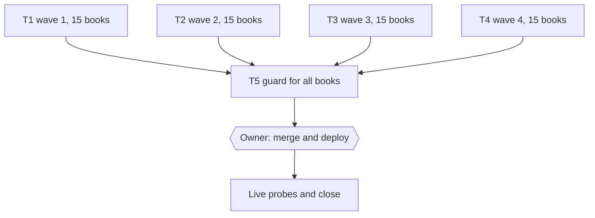

# Free books: contrast framing and reveal colons

**Goal.** Apply the owner rule of 2026-11-02 (GEMINI.md section 29 item 9: no "bukan X, tetapi Y" framing, no reveal colons inside paragraphs) to the 60 free Dawnbook books, the same way the three premium books were swept in plan 2026-11-01-premium-pdf-visual, then make the voice gate refuse the pattern in every book.

**Measured 2026-11-02 on main `c744dd3f`** (60 books, 756 chapters): 1,639 "bukan" (708 of them ", bukan"), 503 "bukan ... tetapi" in one sentence, and 4,947 colons inside paragraphs and list items by the detector. In the premium sweep about 30 % of the flagged colons were keep cases (reference entries, definition labels, list lead-ins, sample sentences), so roughly 3,500 colon fixes and 1,600 "bukan" decisions are expected.

## Approach

- **One wave, one pull request, one deploy.** Each wave sweeps 15 books (one writer per book, two for the 11 books with more than 150 hits, so 17 or 18 writers; at most 15 in flight). The waves are independent, but run one after another because a wave of writers used up the 5-hour model limit once on 2026-11-02 (A16: when a writer stops on 429, no new wave starts until the limit resets).
- **The writer brief is the premium one,** already proven on 15 writers: pattern A (every "bukan" contrast form, including ", bukan Y" and the two-sentence form), pattern B (reveal, explanation and inline-list colons inside prose), the keep cases, the GEMINI.md section 29 contract, section 24 for any heading that has to change, section 25 (no edit inside a mermaid fence; a needed change is reported and done by the coordinator with `diagrams:render`), the 155-character opener cap (section 8), section 16 (Edit tool only, no batch scripts), "kamu", no em dash, and the crutch-word cap.
- **Coordinator pass per wave:** recount, read every reported judgement call, fix meaning drift and cross-chapter quotes, then the gates. Free books also live in D1 (`content_md`), so each deploy is followed by `bun run scripts/migrate-to-d1.ts` (section 19), and `db/seed.sql` is restored afterwards, never committed.
- **Update without trace:** no chapter mentions that it was rewritten.

## Waves (balanced by load: "bukan" plus flagged colons)

| Wave | Books | Load | Writers |
|---|---|---|---|
| 1 | pengaruh-uang-terhadap-kebahagiaan, teori-permainan-game-theory, psikologi-bencana-dan-manajemen-panik, mekanisme-koping-dan-manajemen-stres, memahami-algoritma-x-untuk-pembaca, state-of-flow, filosofi-stoikisme, ekonomi-laissez-faire, peluruhan-beta, iklan-digital-dan-penargetan-algoritma, elastisitas-harga-permintaan-dan-penawaran, geopolitik-dalam-sejarah-piala-dunia, pejorasi-dan-ameliorasi, tonsilektomi, menemukan-tujuan-hidup-ikigai | 1,663 | 18 |
| 2 | psikologi-di-balik-keputusan-finansial-kita, metodologi-microteaching, strategi-manajemen-kelas-proaktif, logika-dan-penalaran-kritis, bias-kognitif, saat-dia-suka-tapi-kamu-tidak, eksistensialisme-dan-makna-hidup, fungsi-manajemen-poac, matriks-keputusan-decision-matrix, struktur-pasar-dan-persaingan, nudge-theory, sistem-peringatan-dini-early-warning-system, virtue-ethics-aristoteles, sejarah-evolusi-drama-korea, multiple-intelligences | 1,641 | 17 |
| 3 | kenapa-kita-gampang-percaya-hoax, kenapa-kita-suka-menunda-nunda, psikologi-positif, resiliensi-dan-ketangguhan, metakognisi, aerodinamika-dan-desain-airfoil, teori-gaya-kelekatan, neurobiologi-motivasi-dopamin, piaget, siklus-hidrologi-mikrofisika-awan, soft-power-jepang-lewat-manga-dan-anime, sistem-pengendalian-topik-dalam-wacana-pedagogi-di-sekolah-dasar, sistem-modul-rust, eksistensialisme-dan-kehendak-bebas, pembelajaran-multidisiplin | 1,630 | 17 |
| 4 | kenapa-kebiasaan-susah-diubah, analisis-wacana-kritis-awk-dalam-kriminologi, kecerdasan-interpersonal, quarter-life-crisis, human-capital-theory, neuroplastisitas-dalam-belajar, gegar-budaya, pelajaran-hidup-dari-harvest-moon-back-to-nature, relief-karmawibhangga-dan-hukum-sebab-akibat, teori-teori-kepribadian, arsitektur-kernel-linux, neurobiologi-sistem-vestibular, digital-minimalisme, literasi-keuangan, analisis-ekspresif-9-summers-10-autumns | 1,652 | 17 |

## Acceptance Criteria

- [ ] AC-1: in every swept book, no "bukan" contrast framing remains; each remaining "bukan" is a plain negation, quoted text or form text, listed with its reason in the wave PR.
- [ ] AC-2: in every swept book, no colon inside a paragraph or list item reveals, explains or lists; the remaining colons are keep cases (references, definition labels, list lead-ins, sample sentences, titles, links, code, times, ratios).
- [ ] AC-3: facts, links, hedges, evidence levels and diagrams are unchanged in meaning; no chapter opener exceeds 155 characters; `check:voice`, `check:structure`, `check:headings`, the repeated-headings check and `check:diagrams` exit 0.
- [ ] AC-4: each wave is live after an owner-approved deploy and D1 seed, with probes showing the changed text on a sample page per book.
- [ ] AC-5: after wave 4, `check-voice` refuses both patterns in every book (T5), proven RED then GREEN.

**Traceability:**

| AC | Task | Check |
|---|---|---|
| AC-1 | T1, T2, T3, T4 | `rg -c -i ', bukan\b' books/<slug>/src/content` plus the detector recount in the wave PR |
| AC-2 | T1, T2, T3, T4 | detector recount of in-paragraph colons, every remaining one listed with its keep reason |
| AC-3 | T1, T2, T3, T4 | `bun run check:voice`, `check:structure`, `check:headings`, repeated headings, `check:diagrams` |
| AC-4 | T1, T2, T3, T4 | deploy log, `migrate-to-d1` exit 0, live page probes |
| AC-5 | T5 | `timeout 120 bun test tests/scripts/check-voice.test.ts` RED then GREEN, `bun run check:voice` |

## Task T1: Wave 1

- [ ] Step 1: Dispatch the wave-1 writers with the premium brief and their chapter scopes.
- [ ] Step 2: Coordinator pass (recount, judgement calls, drift), then the gates | expect: exit 0.
- [ ] Step 3: Pull request, then merge, deploy and D1 seed, each after its own owner question; live probes.

## Task T2: Wave 2

- [ ] Step 1: Dispatch the wave-2 writers.
- [ ] Step 2: Coordinator pass and gates | expect: exit 0.
- [ ] Step 3: Pull request, merge, deploy, D1 seed and probes, each asked separately.

## Task T3: Wave 3

- [ ] Step 1: Dispatch the wave-3 writers.
- [ ] Step 2: Coordinator pass and gates | expect: exit 0.
- [ ] Step 3: Pull request, merge, deploy, D1 seed and probes, each asked separately.

## Task T4: Wave 4

- [ ] Step 1: Dispatch the wave-4 writers; the Harvest Moon book keeps its own guard test green.
- [ ] Step 2: Coordinator pass and gates | expect: exit 0.
- [ ] Step 3: Pull request, merge, deploy, D1 seed and probes, each asked separately.

## Task T5: Guard for all books

The edition-2026 guard from plan 2026-11-01-premium-pdf-visual is extended to every book: drop the edition condition in `scripts/check-voice.ts`, keep the blockquote and `voice-ok` exceptions.

- [ ] Step 1: Write the failing test (a free book with each pattern fails).
- [ ] Step 2: Run `timeout 120 bun test tests/scripts/check-voice.test.ts` | expect: exit 1.
- [ ] Step 3: Implement, then run the test, `bun run check:voice` and `bun run typecheck` | expect: exit 0.

## Risks and rollback

- **Meaning drift** across about 5,000 small rewrites: writers report every judgement call, the coordinator reads them all and fixes drift before the PR, as in the premium sweep (it found and fixed four).
- **Rate limit:** a wave can stop mid-way; writers resume from disk (their edits are saved), as on 2026-11-02.
- **Rollback:** each wave is one merge commit; `git revert -m 1 <merge>` and a redeploy plus D1 seed restore the previous text.
