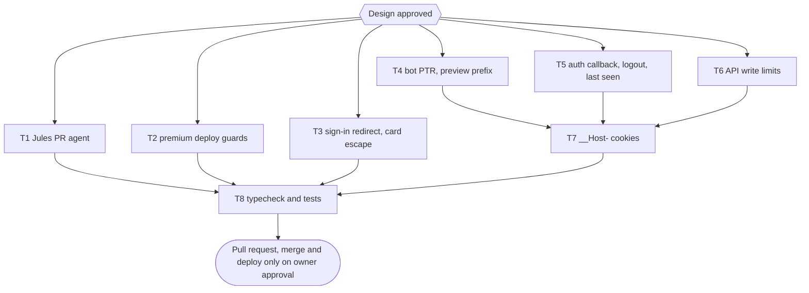

# Dawnbook audit fixes (batch audit 2026-11-05)

Source: `~/Dokumen/audit-batch-2026-11-05/temuan-dawnbook.json` (32 findings at `fe5d13dc`, which is also `origin/main` on 2026-11-05). Duplicates merged into 21 issues; each was re-checked in the code. Owner decisions taken on 2026-11-05 through the question tool: automated merging only by manual dispatch with no conflict auto-resolve; `__Host-` prefix on all three auth cookies (one-time sign-out); refuse Google accounts whose email is unverified; count one view per IP per book per 24 hours.

## Visual map

## Verification of the findings

| Issue | Audit no. | Verdict | Evidence |
|---|---|---|---|
| Jules PR recognised by the word "Jules" in title or body | 24, 173, 182 | real | `scripts/lib/gh-client.ts:22,67-80`; the past Jules PRs (#105 to #125) were opened under the owner account `belajarcarabelajar`, so detection uses owner login + same-repo head + `jules.google.com/task/<digits>` footer |
| Cron runs without dry-run, no cap, merge not pinned to the assessed head | 24 | real | `.github/workflows/pr-integration.yml:45`, `scripts/lib/gh-client.ts:124-130` |
| Workflow inputs interpolated into the shell | 174, 183 | real | `.github/workflows/pr-integration.yml:45-47` |
| "MANUAL REVIEW" commit left on HEAD, pushed by the next PR | 25 | real | `scripts/pr-integration-agent.ts:203-205,241` |
| Overlapping resolver inserts the other side as live code and pushes to main untested | 26 | real | `scripts/lib/conflict-resolver.ts:128-136`, `scripts/pr-integration-agent.ts:241` |
| `deploy.yml` lacks the premium output guard | 27 | real | `.github/workflows/deploy.yml:45-51` vs `scripts/deploy-website.sh:42` |
| Raw `redirect_url` on the sign-in page | 80, 130, 175 | real | `scripts/builder/template-engine.ts:523,582` |
| `.amazonaws.com` PTR suffix trusted | 57, 122, 248 | real | `functions/lib/bot-verify.ts:72` |
| New Google account without `email_verified` | 58, 125, 249 | real | `functions/api/auth/callback.ts:153-160` |
| POST progress/books without Content-Type check | 65 | real, low (SameSite=Lax blocks cross-site; same-site siblings remain) | `functions/api/progress.ts:131`, `functions/api/books/index.ts:93` |
| `completed_paths` and progress rows unbounded | 66, 68 | real | `functions/api/progress.ts:184-190` |
| Book emoji not escaped on the hub | 176 | real, low (source is `icon.txt` in the repo) | `scripts/builder/template-engine.ts:195` |
| Free-preview prefix without digit boundary | 35 | real, latent (no book uses `chapter_1x` or `01x` names today) | `functions/lib/gating.ts:168` |
| Cookies without `__Host-` | 59, 124 | real | `functions/api/auth/login.ts:25`, `functions/lib/auth.ts:77` |
| Logout by GET | 60, 123 | real | `functions/api/auth/logout.ts:51`; the only caller posts (`apps/hub/src/scripts/hub-runtime.ts:369`) |
| `isPublicPath` throws URIError | 67 | false | `functions/_middleware.ts:363-381` catches URIError and answers 400 |
| Prune deletes every image of a book missing from staging | 69 | real for a manual run (deploy order is guarded by `check-premium-output`) | `scripts/premium/sync-media.ts:140-150` |
| Book publish not atomic | 70 | real | `functions/api/books/index.ts:127-170` |
| View counter can be pumped | 71 | real, low | `functions/api/books/[slug]/view.ts:47` |
| `decodeURIComponent` after the session is created | 250 | real | `functions/api/auth/callback.ts:190` |
| `last_seen_at` UPDATE on every gated request | 251 | real | `functions/lib/auth.ts:133` |

## Acceptance criteria

- [ ] AC-1: A PR is a Jules PR only when its author login is `belajarcarabelajar`, its head is in this repository, and its body has a `jules.google.com/task/<digits>` link; the override pattern matches the author login only.
- [ ] AC-2: The workflow passes inputs through `env:` only, rejects a non-numeric `pr_number`, and a scheduled run is always a dry run.
- [ ] AC-3: A real merge uses `--match-head-commit <assessed sha>`, at most 3 PRs merge per run, and a conflicting PR is only flagged; the agent never commits or pushes to main itself, and the conflict resolver module is removed.
- [ ] AC-4: `deploy.yml` runs `scripts/check-premium-output.ts` before the Pages deploy.
- [ ] AC-5: `sync-media prune` refuses to run when a registered premium book has no staged image.
- [ ] AC-6: The sign-in and sign-up pages navigate only to a same-origin path from `redirect_url`, otherwise `/`, and show a message for `email_unverified`; the hub card escapes the emoji.
- [ ] AC-7: `.amazonaws.com` is no longer a trusted PTR suffix, and a PTR suffix only verifies the crawler family whose user agent it belongs to.
- [ ] AC-8: The free-preview prefix matches `01` and `chapter_1` only when no digit follows.
- [ ] AC-9: A new Google account with `email_verified !== true` is refused with `email_unverified`; the redirect cookie is decoded safely before the session is created; logout answers only POST; `last_seen_at` is written at most once per 5 minutes per session.
- [ ] AC-10: POST `/api/progress` and POST `/api/books` require `Content-Type: application/json`; progress paths must be under `/books/<bookSlug>/`, `completed_paths` is capped per book, and rows per user are capped; publish writes metadata and content in one batch; a view counts once per IP per book per 24 hours.
- [ ] AC-11: The session, OAuth state and OAuth redirect cookies are named with the `__Host-` prefix through one shared module.
- [ ] AC-12: `bun run typecheck` and the tests under `tests/scripts` and `tests/functions` exit 0.

## Traceability

| AC | Task | Check |
|---|---|---|
| AC-1 | T1 | `tests/scripts/gh-client.test.ts` |
| AC-2 | T1 | `tests/scripts/pr-integration-workflow.test.ts` |
| AC-3 | T1 | `tests/scripts/pr-integration-agent.test.ts`, `tests/scripts/gh-client.test.ts` |
| AC-4 | T2 | `tests/scripts/deploy-workflow.test.ts` |
| AC-5 | T2 | `tests/scripts/premium-sync-media.test.ts` |
| AC-6 | T3 | `tests/scripts/sign-in-redirect.test.ts`, `tests/scripts/builder-template-engine.test.ts` |
| AC-7 | T4 | `tests/functions/lib/bot-verify.test.ts` |
| AC-8 | T4 | `tests/functions/lib/gating.test.ts` |
| AC-9 | T5 | `tests/functions/api/auth.test.ts`, `tests/functions/lib/auth.test.ts` |
| AC-10 | T6 | `tests/functions/api/progress.test.ts`, `tests/functions/api/books.test.ts`, `tests/functions/api/books/[slug].test.ts` |
| AC-11 | T7 | `timeout 300 bun test tests/functions` |
| AC-12 | T8 | `bun run typecheck`, `timeout 300 bun test tests/scripts tests/functions` |

## Task T1: Jules PR agent hardening

Files: `scripts/lib/gh-client.ts`, `scripts/pr-integration-agent.ts`, `.github/workflows/pr-integration.yml`, delete `scripts/lib/conflict-resolver.ts` and `tests/scripts/conflict-resolver.test.ts`; tests `tests/scripts/gh-client.test.ts`, `tests/scripts/pr-integration-workflow.test.ts`, `tests/scripts/pr-integration-agent.test.ts`.

- [ ] Step 1: RED tests for `isJulesPR` (owner + same repo + footer; a title or body "Jules" alone is refused; a fork is refused), for the merge args (`--match-head-commit`), for the cap of 3, for a conflicting PR being flagged without any git write, and for the workflow file (no `${{ inputs.` inside a `run:` block, schedule forces dry run).
- [ ] Step 2: run them, expect exit 1.
- [ ] Step 3: implement; `gh pr list --json` adds `headRefOid,isCrossRepository`.
- [ ] Step 4: run the T1 command, expect exit 0.

## Task T2: Premium deploy guards

- [ ] Step 1: RED test that `deploy.yml` runs `bun run scripts/check-premium-output.ts` before the `Deploy to Cloudflare Pages` step, and a RED test that `prune` returns 1 and deletes nothing when a registry slug has no staged image.
- [ ] Step 2: implement, run the T2 command, expect exit 0.

## Task T3: Sign-in redirect and card escape

- [ ] Step 1: RED test that runs the built sign-in script with `redirect_url` values `javascript:alert(1)`, `https://evil.example/`, `//evil.example/`, a same-origin absolute URL and a path, and checks the navigation target; RED test that a card emoji `` is escaped; message key `email_unverified` exists.
- [ ] Step 2: implement one `safeNext(redirectUrl, origin)` used by the logged-in redirect, the Google button and `bcbSignInHref`; run the T3 command, expect exit 0.

## Task T4: Bot PTR and preview prefix

- [ ] Step 1: RED tests: Googlebot UA from an `ec2-…compute-1.amazonaws.com` PTR is not verified; Googlebot UA with a `search.msn.com` PTR is not verified; Googlebot with `googlebot.com` still is; `chapter_10.html` and `010_x.html` are gated while `chapter_1.html` and `01_x.html` stay public.
- [ ] Step 2: implement a UA family to PTR suffix map, drop `.amazonaws.com`; run the T4 command, expect exit 0.

## Task T5: Auth callback, logout, last seen

- [ ] Step 1: RED tests: callback with `email_verified: false` for a new account redirects to `/sign-in?error=email_unverified` and creates no user or session; a malformed `oauth_redirect` cookie leads to `/` with a session and no orphan; GET logout answers 405; `verifySession` skips the UPDATE when `last_seen_at` is under 5 minutes old.
- [ ] Step 2: implement; run the T5 command, expect exit 0.

## Task T6: API write limits

- [ ] Step 1: RED tests: POST without JSON content type answers 415; a path outside `/books/<bookSlug>/` answers 400; adding past the per-book cap of `completed_paths` is refused; a new book row past the per-user cap is refused; publish sends one `DB.batch` holding the metadata upsert and every chunk; a second view from the same IP for the same book within 24 hours does not increment.
- [ ] Step 2: implement; run the T6 command, expect exit 0.

## Task T7: `__Host-` cookies

- [ ] Step 1: add `functions/lib/cookies.ts` with the three names, use it in every handler, update the cookie literals in the tests.
- [ ] Step 2: run the T7 command, expect exit 0.

## Task T8: Gates

- [ ] Step 1: `bun run typecheck`, expect exit 0.
- [ ] Step 2: `timeout 300 bun test tests/scripts tests/functions`, expect exit 0.

## Non-goals and follow-ups

- Re-enabling `pr-integration.yml` is a separate owner question after the PR; GitHub Actions stay off repo-wide (GEMINI.md section 19) whatever the answer.
- Branch protection with required review on `main` (suggested in finding 24) is a repository setting, not code; offered as a follow-up.

## Risks and rollback

- The cookie rename signs every reader out once (owner decision). Rollback: revert the PR; old-name cookies are then read again.
- Unverified Google emails can no longer create an account. Rollback: revert the callback check.
- Rollback of the whole change: `git revert` of the merge commit, then a manual deploy (section 19).
