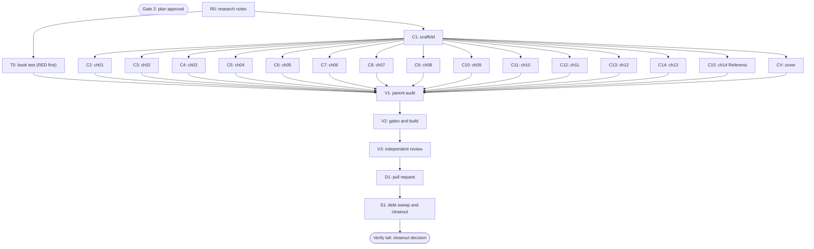

# Plan: Dawnbook book Simbolisme Alam dalam Sastra by Kania Salsabila

Status: Approved
Session: dawnbook-simbolisme-alam
Branch: 2026-11-05-dawnbook-simbolisme-alam/dawnbook-simbolisme-alam
Worktree: /mnt/belajarcarabelajar/dawnbook-wt/dawnbook-simbolisme-alam
Skill: ~/.claude/skills/super-ultra-code-plan/SKILL.md, loaded through the Skill tool (the harness resolves the skill by name, so the first fallback path ~/vivera/Super Ultra Code Plan Implementation.md was not read)
Author: Kania Salsabila <kaniasalsabila639@gmail.com>, commit trailer `Co-authored-by: Iwan Kurniawan <iwan@belajarcarabelajar.com>` (GEMINI.md section 18; owner decision 2026-11-05 over the pasted workflow's no-trailer default)
Classification: Bounded. The book goes through the existing new-book flow (same shape as plan 2026-10-23-dawnbook-harvest-moon). A plan file is required because subagents own the chunks.
Source: the owner's own study notes on the topic (a local Markdown file outside the repository, 13 modules), plus web sources read with TinyFish.

## Checklist

- [x] Claim: session slot claimed and worktree created on the external disk. Evidence: `bun ~/vivera/scripts/pr-registry.mjs claim --plan 2026-11-05-dawnbook-simbolisme-alam --session dawnbook-simbolisme-alam --repo /home/belajarcarabelajar/Proyek/dawnbook --worktree` exit 0; worktree /mnt/belajarcarabelajar/dawnbook-wt/dawnbook-simbolisme-alam at origin/main fe5d13dc; node_modules linked by wt-new.
- [x] Intent (Gate 1): outline, commit identity, formulas, grounding depth decided. Evidence: AskUserQuestion 2026-11-05: Outline = 13 chapters + Referensi; Commit ID = Kania + Iwan trailer; Formulas = drop, diagrams where grounded; Grounding = verify every claim.
- [x] Research (R0): every literary claim the chapters keep is checked with TinyFish and written to docs/code-plan/plans/research-dawnbook-simbolisme-alam.md with a section 9 source table. Evidence: 4 researcher reports (aqua x2, timid x2; 26, 29, 31 and 34 tool calls), 45 items (A1-A9, B1-B12, C1-C13, D1-D11), 21 of them CORRECTED or hedged against the owner's notes (section 8 table); parent fetched 9 more catalogue pages with TinyFish fetch_content (Princeton, PRH x2, Simon & Schuster, HarperStacks, Gramedia, the Mukhlis article, Gutenberg 38923); `sourceTableUrls(notes, /^\| S[0-9]+ \|/)` = 67 URLs from 65 rows (2 DOI links), 0 duplicates, 0 with trailing punctuation; the LibreTexts URL percent-encoded and curl HTTP 200; the unofficial Ronggeng copy kept out of the table.
- [x] Plan (Gate 2): this file validates (`Validation: OK`), published at Draft, owner approves. Evidence: `bun ~/vivera/scripts/ultra-plan-runner.mjs <plan>` exit 0, `Validation: OK`, 23 tasks, Error Ledger empty; `bun scripts/validate-skill.mjs` (vivera) exit 0; `plan-sync.mjs --project dawnbook` publish exit 0, issue-sync exit 0 (issue #262); AskUserQuestion 2026-11-05: Plan = Approve and execute.
- [x] Test RED (T0): book test written before any chapter and fails because the book is absent. Evidence: chef wrote tests/books/simbolisme-alam-dalam-sastra.test.ts (205 lines, ASCII-only, reuses checkBookStructure, extractUrls, extractLinkTargets, contentFiles, sourceTableUrls, extractLeadText, formatSerpDescription); parent read the file end to end and re-ran `timeout 120 bun test tests/books/simbolisme-alam-dalam-sastra.test.ts` exit 1, 4 pass 8 fail; the 4 passes are the 65-row table count and the 16-word positive, 15-word negative and fence controls; the 8 fails are book-dependent (14 SUMMARY entries missing on disk, 0 chapter files); `bun run typecheck` exit 0 (chef report).
- [x] Scaffold (C1): books/simbolisme-alam-dalam-sastra/ with book.toml, icon.txt, theme/, src/SUMMARY.md (14 entries), release-dates.json key. Evidence: nappy report plus parent check: `diff books/_template/book.toml <new>` shows only authors, language, title, description (153 chars), subject_label Sastra; `diff -r` theme exit 0; SUMMARY.md 14 entries; icon.txt bytes f0 9f 8c 99 0a; `git diff release-dates.json` adds one key plus a comma; src/content empty at hand-off.
- [x] Author (C2-C15): 14 chapter files (13 content + Referensi), one subagent each, inside the byte budget. Evidence: 14 subagents (chef x5, nappy x5, hoggy x4) each returned one file with self-check output, no subagent ran git; sizes 6.107-7.678 B for chapters, Referensi 9.033 B, 98.812 B total (`wc -c`); book test RED to GREEN: exit 1 (4 pass 8 fail) before, `timeout 120 bun test tests/books/simbolisme-alam-dalam-sastra.test.ts` exit 0 (12 pass, 0 fail) after the V1 edits, shared-run scan against the owner's notes included (notes present).
- [x] Cover (CV): cover.svg passes `bun run check:covers --book simbolisme-alam-dalam-sastra`, preview cards read by the parent. Evidence: hoggy wrote cover.svg (3.765 B, dusk landscape with crescent moon, setting sun, mountain, conifer edge, river and one flower; no text, figures or logos); RED first (`check:covers` exit 1, missing-cover) then exit 0 (0 cover violations); `bun run og:preview` exit 0, 15 cards; parent Read index.png: on-topic, balanced next to the black panel, title in 3 lines.
- [x] Audit (V1): parent line-by-line read of every chapter plus scans; diagrams rendered. Evidence: parent Read all 14 files end to end against the notes (pre-edit copies in ~/.cache/tmp/dawnbook-scratch/pre-v1/); edits: one hypothetical name "Laras" had been chosen by 7 writers, renamed per chapter (Sekar ch02, Dinda ch05, Rani ch06, Bima ch09, Wulan ch10, Nadia ch13; ch01 keeps Laras) and the three job-loss scenes varied (ch06 scholarship letter, ch09 rejected manuscript); L'Etranger corrected to L'Étranger in ch04, ch14 and the notes; ch04 'tahanan itu mau menunggu' made 'diberi waktu' (no added intent); ch09 opener shortened to 145 chars after the rename (structure gate caught 160); 6 crutch words trimmed in ch02, ch05, ch11 after `bun run check:voice` exit 1 (x8, x5, x5 over max 4), then exit 0; scans: 0 duplicate headings across chapters, 0 contrast-framing hits, 0 em dash or Anda; `bun run diagrams:render --book <slug>` exit 0 (rendered 3: ch01 chain, ch03 season cycle, ch05 moon phases), `check:diagrams --book <slug>` exit 0; `bun run scripts/check-book-structure.ts <slug>` exit 0, 14 chapters, 0 problems; no LaTeX in the book.
- [x] Gates (V2): every run[] step exit 0, SEO validation passed. Evidence (final run after the review fixes): `bun test tests/books/simbolisme-alam-dalam-sastra.test.ts tests/books/referensi-links.test.ts tests/books/referensi-presence.test.ts tests/books/known-misattributions.test.ts tests/scripts/check-book-structure.test.ts` exit 0 (68 pass, 0 fail); `bun run scripts/check-book-structure.ts simbolisme-alam-dalam-sastra` exit 0 (14 chapters, 0 problems); `bun run check:headings` exit 0 (0 violations, 61 books); `bun run scripts/check-repeated-headings.ts` exit 0; `bun run check:voice` exit 0; `bun run check:diagrams` exit 0 (0 violations; 13 orphan SVGs in other books, pre-existing); `bun run check:covers --book simbolisme-alam-dalam-sastra` exit 0; `bun run typecheck` exit 0; `bun run build` exit 0 in 59 s with `Successfully built: simbolisme-alam-dalam-sastra`, `Inlined 3 diagram(s)`, `SEO Validation passed! All rules (R1-R7) satisfied.`, 14 built chapter metas 117-154 chars, all complete sentences, 14 chapter share cards plus index. The build ran in a detached scratch worktree on the NVMe (~/.cache/tmp, removed after) holding the same book files (`diff -r` identical), because two runs in the session worktree on the external NTFS disk hit `timeout` at 600 s and 1800 s (exit 124) while another session's `bun install` and `git status` kept the disk 100% busy; the session worktree's regenerated functions/lib/built-stats.ts is byte-identical (`cmp`) to the NVMe build's (770 to 784 chapters, Kania Salsabila 11 to 12 books). `bun ~/vivera/scripts/check-copy-rules.mjs --diff origin/main` exit 1 with one hit, the icon.txt emoji that GEMINI.md section 14 permits.
- [x] Review (V3): independent reviewers, findings resolved, report saved. Evidence: 3 parallel staid reviewers (ch01-07: not correct, 0 P1 14 P2; ch08-14 plus Referensi: not correct, 1 P1 11 P2; test, scaffold, cover, diagrams, notes, plan: correct, 0 P1 0 P2); parent triage kept 6 findings with reasons (owner-notes readings already hedged, brief-requested Indonesia sentence, tides bridge, Hobbit reference page, test controls to backlog, link italics); 3 fixers on disjoint chapter groups (chef ch01-04, nappy ch05-07, hoggy ch08-13) with pre-edit copies; parent read every changed sentence with a sentence-level diff against fix1-pre, fix2-pre, fix3-pre (only named sentences changed, no new facts) and applied 9 follow-up polish edits (repeated scene-closer pattern in ch06 and ch10, ch02 heading 'Empat Cara Memandang Alam', ch04 duplicate writer framing and Icarus repeat, ch05 'membaca membaca', ch07 'Hutan Fangorn', ch09 hedge); gates re-run: focused tests exit 0 (68 pass, 0 fail), structure, headings, repeated headings, voice, diagrams (rendered 0, cached 3), covers exit 0; report at docs/code-plan/artifacts/2026-11-05-dawnbook-simbolisme-alam-review-report.md.
- [x] Deliver (D1): commit as Kania Salsabila with the Iwan trailer, PR opened through pr-registry. Evidence: commit 3dfa6991 (author and committer Kania Salsabila <kaniasalsabila639@gmail.com>, trailer `Co-authored-by: Iwan Kurniawan <iwan@belajarcarabelajar.com>`, attribution scan of the message finds only that trailer); 31 files staged by explicit path = 31 in `git show --name-only HEAD`; `pr-registry state dawnbook-simbolisme-alam verified` exit 0; `pr-registry open ... --body-file docs/code-plan/artifacts/2026-11-05-dawnbook-simbolisme-alam-pr-body.md` exit 0 -> https://github.com/belajarcarabelajar/dawnbook/pull/264 recorded (open), head 3dfa6991; body says Refs #262.
- [x] Sweep (S1): debt sweep, learning ledger, graphify sync, closeout decision. Evidence: 6 debts found (N1, N2 closed as follow-ups with evidence in the backlog; L1-L4 written with `defer:` lines); 0 `defer:` markers in the repository (method proven on ~/vivera, 2 markers); learning ledger docs/code-plan/artifacts/2026-11-05-dawnbook-simbolisme-alam-learning-ledger.md (2 KEEP rules written to project memory new-book-authoring-traps items 10 and 11); closeout readiness NEEDS-HUMAN, owner answered Keep it open (see Closeout status); graphify: `graphify update .` on the main checkout exit 0 (no code topology change), `bun scripts/graphify-sync.mjs --root <main checkout>` exit 0 (22.457 nodes); this session's documents reach the graph with the first sync after PR #264 merges.

## Active Project Profile

Snapshot taken 2026-11-05 at origin/main fe5d13dc.

- Repository root: /home/belajarcarabelajar/Proyek/dawnbook (session worktree above). Runtime Bun 1.4.4, mdBook v0.5.4 in ~/.cargo/bin.
- Target scope: new directory `books/simbolisme-alam-dalam-sastra/`, one `release-dates.json` entry, one book test, the research notes and session artifacts. Files the build regenerates (`functions/lib/built-stats.ts`) are committed with the PR (repo convention).
- Book layout (verified on books/pelajaran-hidup-dari-harvest-moon-back-to-nature): `book.toml` (template copy with title, authors, language = "id", description, subject_label), `icon.txt`, `theme/` copied from the template, `src/SUMMARY.md`, `src/content/NN_kebab.md`, `cover.svg` (GEMINI.md section 27).
- Chapters open with `##` equal to the SUMMARY title; sub-sections use `###`. No LaTeX (owner decision: the notes' formulas are dropped).
- Subject label `Sastra` exists in data/subject-labels.json and is used by Kania's two other literature books.
- Gates: `scripts/check-book-structure.ts`, `bun run check:headings`, `bun run scripts/check-repeated-headings.ts`, `bun run check:voice` (section 29 item 9 contrast caps apply to every free book), `bun run diagrams:render` then `bun run check:diagrams`, `bun run check:covers`, `bun run typecheck`, `bun run build`. Copy rules: `bun ~/vivera/scripts/check-copy-rules.mjs --diff origin/main`.
- Deploy (post-merge, owner-gated): GEMINI.md section 19 (deploy-website.sh also posts the Telegram announcement, section 28), then `bun run scripts/migrate-to-d1.ts`, then GSC reindex by the OAuth path.
- Unknowns: none blocking. Research limits carried into the contracts: Britannica, Etymonline and fandom pages were bot-blocked for the researchers, so those facts rest on the rows listed in notes section 9.

## 1. Intent and Scope

- Goal: a 14-page Dawnbook book (13 content chapters + Referensi) credited to Kania Salsabila, built from the owner's 13-module notes and improved to the house rules: every claim verified, the notes' misplaced module titles replaced by titles that match the content, the voice cooked (GEMINI.md section 29).
- Slug `simbolisme-alam-dalam-sastra`. Title `Simbolisme Alam dalam Sastra`. Subject label `Sastra`. Icon: the crescent moon emoji from the notes, in icon.txt only. Language `id`.
- Description (153 chars): "Cara penulis memakai matahari, bulan, musim, air, hutan, dan badai untuk menyuarakan batin tokoh, dibaca dari Shakespeare dan Brontë sampai Ahmad Tohari."
- Owner decisions (AskUserQuestion, 2026-11-05): 13 chapters from the real content plus Referensi (the three module titles without content, fire, earth and animals, are not written); commit author Kania with the Iwan trailer; pseudo-math formulas and Python pseudocode dropped, Mermaid only where the text states a process or comparison; every literary claim verified.
- Improvements over the notes, applied in every chapter: "kamu" instead of "Anda"; no emoji, em dash, colon heading or reveal colon; no "bukan X, tetapi Y" framing; no stock scaffolds ("Think about this", "Real-World Application", "Latihan Refleksi", "Pesan Penting", repeated per chapter); English quotes paraphrased in Indonesian; factual errors fixed silently (no "the notes said" trace); invented terms dropped.
- Non-goals: no edits to any other book, template, CSS or script; no new topics beyond the 13 modules; no deploy without a separate owner decision.
- Acceptance criteria:
  - AC-1: 14 entries in SUMMARY.md equal 14 files in src/content; each chapter's first heading equals its SUMMARY title. Check: `bun run scripts/check-book-structure.ts simbolisme-alam-dalam-sastra` exit 0.
  - AC-2: 0 em dash, 0 emoji outside icon.txt, 0 "Anda", 0 colon headings, no heading repeated across chapters, every chapter meta 110 to 155 characters, 0 contrast-framing hits. Check: the book test, `bun run check:headings`, `bun run check:voice`.
  - AC-3: no chapter shares 16 or more consecutive words with the owner's notes (cooked prose, section 29). Check: book test shared-run case (skipped with a warning when the local notes file is absent).
  - AC-4: every URL in the book appears in research notes section 9, every Referensi entry is a markdown link, no archive.org/details link. Check: book test allowlist case, `tests/books/referensi-links.test.ts`, `tests/books/referensi-presence.test.ts`.
  - AC-5: cover passes `bun run check:covers --book simbolisme-alam-dalam-sastra`; `bun run build` exit 0 with SEO validation passed and the slug in output/manifest.json; `bun run check:diagrams` exit 0.

## 2. Visual Implementation Map

Gate 2 sits between R0 and T0 in time: no task after R0 starts before the owner approves this plan.

## 2b. Affected Surfaces

| Task | Surface it can break | Evidence command |
|---|---|---|
| C1 | Hub card (title, icon, chapter count, PUEBI timestamp) and manifest.json | `bun run build`, then `jq` on output/manifest.json |
| C1 | D1 `books` row and subject label after deploy | `bun run scripts/migrate-to-d1.ts` (post-merge, owner-gated) |
| C1 | release-dates.json read by scripts/build.ts | `git diff release-dates.json` shows one added key |
| C2-C15 | mdBook build, SEO meta extraction, heading, voice and diagram gates shared by all books | `bun run build`, `bun run check:headings`, `bun run check:voice`, `bun run check:diagrams` |
| C15 | Repository-wide Referensi guards | `bun test tests/books/referensi-links.test.ts tests/books/referensi-presence.test.ts` |
| CV | Share cards of every page of this book; the build fails without a valid cover | `bun run check:covers --book simbolisme-alam-dalam-sastra`, `bun run og:preview simbolisme-alam-dalam-sastra` |
| V2 | Build gate for every book (a failing new book blocks deploy for all) | `bun run build` exit code |

## 3. Batch Manifest

Each chunk has one owner and writes one file (C1 writes its scaffold set). Subagents write only inside the worktree and never run git or gh. Chapter paths are under books/simbolisme-alam-dalam-sastra/src/content/. The parent renders Mermaid cache files under books/<slug>/diagrams/ after the chapters land, so no two agents write that folder. "Notes" = the owner's notes, read by line range from the local file; "W" = verified web items in the research notes.

| Chunk | Owner | Target file | Chapter title (= SUMMARY entry) | Owner notes lines | Web items | Budget | Verification |
|---|---|---|---|---|---|---|---|
| T0 | chef | tests/books/simbolisme-alam-dalam-sastra.test.ts | (book test) | n/a | section 9 | n/a | `bun test <file>` exit 1 for the right reason (book absent) |
| C1 | nappy | book.toml, icon.txt, theme/, src/SUMMARY.md, release-dates.json | (scaffold) | n/a | n/a | n/a | `find`, `diff` against template, `jq` |
| C2 | chef | 01_ketika-alam-menjadi-bahasa-batin.md | Ketika Alam Menjadi Bahasa Batin | 18-102 | A8 | 6-8.5 KB | `wc -c`, parent read |
| C3 | nappy | 02_pathetic-fallacy-dan-langit-yang-ikut-berduka.md | Pathetic Fallacy dan Langit yang Ikut Berduka | 104-199 | A1-A6 | 6-8.5 KB | `wc -c`, parent read |
| C4 | hoggy | 03_empat-musim-sebagai-perjalanan-usia.md | Empat Musim sebagai Perjalanan Usia | 201-306 | A7, A9 | 6-8.5 KB | `wc -c`, parent read |
| C5 | chef | 04_matahari-kesadaran-dan-bahaya-terlalu-dekat.md | Matahari, Kesadaran, dan Bahaya Terlalu Dekat | 308-406 | B1-B5 | 6-8.5 KB | `wc -c`, parent read |
| C6 | nappy | 05_bulan-dan-sisi-batin-yang-tersembunyi.md | Bulan dan Sisi Batin yang Tersembunyi | 408-500 | B5-B10 (B5 by back-reference) | 6-8.5 KB | `wc -c`, parent read |
| C7 | hoggy | 06_air-yang-membasuh-dan-menenggelamkan.md | Air yang Membasuh dan Menenggelamkan | 502-603 | B11, B12 | 6-8.5 KB | `wc -c`, parent read |
| C8 | chef | 07_pohon-hutan-dan-labirin-batin.md | Pohon, Hutan, dan Labirin Batin | 605-712 | C1, C2 | 6-8.5 KB | `wc -c`, parent read |
| C9 | nappy | 08_badai-petir-dan-angin-dalam-dada-tokoh.md | Badai, Petir, dan Angin dalam Dada Tokoh | 714-803 | C3 | 6-8.5 KB | `wc -c`, parent read |
| C10 | hoggy | 09_puncak-gunung-dan-dasar-lembah.md | Puncak Gunung dan Dasar Lembah | 805-901 | C4-C6 | 6-8.5 KB | `wc -c`, parent read |
| C11 | chef | 10_bunga-kecantikan-dan-kerapuhan.md | Bunga, Kecantikan, dan Kerapuhan | 903-1006 | C7-C12 | 6-8.5 KB | `wc -c`, parent read |
| C12 | nappy | 11_lanskap-batin-dan-korelatif-objektif.md | Lanskap Batin dan Korelatif Objektif | 1008-1096 | D1, C13 | 6-8.5 KB | `wc -c`, parent read |
| C13 | hoggy | 12_membaca-alam-dalam-tiga-novel.md | Membaca Alam dalam Tiga Novel | 1098-1187 | D2-D5, B12 | 6-8.5 KB | `wc -c`, parent read |
| C14 | chef | 13_dari-keagungan-ke-kecemasan-ekologis.md | Dari Keagungan ke Kecemasan Ekologis | 1189-1281 | D6-D11 | 6-8.5 KB | `wc -c`, parent read |
| C15 | nappy | 14_referensi.md | Referensi | n/a | section 9 rows mapped to the items above | 4-10 KB | `wc -c`, book test allowlist |
| CV | hoggy | cover.svg | (cover) | n/a | book.toml, SUMMARY.md | under 40 KB | `bun run check:covers --book <slug>`, `bun run og:preview <slug>` |

Fan-out: T0 and C1 run as one batch of 2. C2-C15 and CV run as one batch of 15 after C1 is integrated (the 15-in-flight cap). If a subagent dies with a 429 session limit, dispatch stops and the rest is finished inline or after the reset (AGENTS.md A16). C15 builds the Referensi from the manifest item IDs and section 9, not from the other chapters.

Fact ownership: a fact shared by two chapters is told once in its owner chapter (section 7 of the notes); the other chapter refers back with "di bab N" or forward with one clause. The Old Man and the Sea is owned by chapter 12; chapter 06 names it in one clause. Pathetic fallacy is owned by chapter 02; chapters 05, 06, 08 and 12 refer back.

Per-chunk contract (sent in full in each dispatch prompt; fields of templates/subagent-contract-template.md: scope, inputs, permitted file, expected output, verification, review checkpoint): worktree path, one target file, chapter title, the owner-notes line range and the W item IDs to use, assigned opener device, closing section title, bridge form, one owner chapter per fact, people's names and titles exactly as the notes give them, no causal links, generalisations or superlatives the notes do not support, keep each interpretive claim hedged as an interpretation ("sering dibaca sebagai", "dalam tafsir Jungian"), facts corrected by section 8 of the notes stated directly with no trace of the old error (owner rule: update without trace), the voice paragraph of GEMINI.md section 29 verbatim, byte budget with a mandatory `wc -c` self-trim (3-attempt cap, GEMINI.md section 20), the house rules (kamu not Anda, 0 emoji, 0 em dash, no colon in any heading or bold sub-title, scaffold-label and connector caps from section 24, first sentence 110 to 155 characters, no LaTeX, no code blocks), the Mermaid contract paragraph of GEMINI.md section 25 for C2, C4 and C6 only, the cover contract paragraph of section 27 for CV, no git, no files outside the target.

### Opener, closer and bridge assignments (GEMINI.md sections 21 and 24)

| Ch | Opener device | Closing section title | Bridge to the next chapter | Optional diagram |
|---|---|---|---|---|
| 01 | scene: a character on a pier watching fog swallow the horizon | Intisari | a question: what if the sky seems to grieve with us | object, feeling, meaning chain (flowchart LR) |
| 02 | question: why does rain so often fall at a funeral in fiction | Ringkasan | an image of one year turning | none |
| 03 | quoted paradox: Eliot calling April cruel | Benang Merah | from the calendar to the sky above it | season cycle (flowchart LR, cycle) |
| 04 | data point: a king who took the sun as his emblem | Poin Penting | from the day to the night that follows | none |
| 05 | sensory scene: moonlight blurring the edges of a yard | Inti Pembahasan | from the moon's pull to the tides | moon phases (flowchart LR) |
| 06 | contrast: the same water that washes and that drowns | Yang Perlu Kamu Ingat | none, an image of a riverbank leading into trees | none |
| 07 | literary opening: Dante waking in a dark wood | Kesimpulan Bab | from the canopy to the sky above it | none |
| 08 | scene: a detective at a rain-beaten window | Poin Kunci | upward, toward high ground | none |
| 09 | hypothetical: climbing a hill at sunset after a loss | Recap | from rock to what grows on it | none |
| 10 | object close-up: an orchid dropping petals | Gagasan Utama | from single symbols to whole landscapes | none |
| 11 | analogy: a projector and a white screen | Key Takeaways | to three novels where it all works together | none |
| 12 | comparison: two houses on one moor | Catatan Akhir Bab | from three novels to two centuries | none |
| 13 | question: a mountain once read as divine, now as a melting glacier | Penutup | none (final content chapter) | none |
| 14 | short orientation sentence | (no closer) | none | none |

## 4. Tasks

### Task R0
Four read-only researchers (aqua x2, timid x2, 28 to 30 tool calls each) verify claims A1-A9, B1-B12, C1-C13 and D1-D11 with TinyFish. The parent synthesizes docs/code-plan/plans/research-dawnbook-simbolisme-alam.md: section 1 method, sections 2 to 6 verified items by chapter group with the corrected fact in paraphrase, section 7 fact ownership, section 8 corrections to the owner's notes, section 9 source table (`| S<n> | title | URL | site | accessed |`) with the exact page titles.

### Task T0
Test-first. Seams: `checkBookStructure(bookDir)`, `extractUrls`, `extractLinkTargets` from scripts/check-book-structure.ts; `contentFiles`, `sourceTableSection`, `sourceTableUrls` from tests/helpers/book-test.ts; `extractLeadText`, `formatSerpDescription`, `escapeHtml` from scripts/inject-gating.ts (all existing, as in the Harvest Moon book test). Cases: 14 chapters with 0 problems and `14_referensi.md` last; byte budget (content 5.500 to 9.000 B, Referensi 3.000 to 10.500 B); every chapter meta 110 to 155 characters; every URL and link target in the book comes from the section 9 table; a shared-run detector that flags 16 or more consecutive normalized words shared with the owner's notes, with a positive control on a fixture and a negative control on a 15-word run; the notes path is `DAWNBOOK_SA_SOURCE` or `~/Dokumen/Learn Earth/Simbolisme Alam dalam Sastra.md`, skipped with a printed warning when absent; banned-scaffold scan (0 "Think about this", "Real-World Application", "Latihan Refleksi", "Pesan Penting"); a corrected-fact guard (no "Mazmur 24" and no "Celestial Mountains" anywhere in the book). RED until C2-C15 land.

### Task C1
`mkdir -p books/simbolisme-alam-dalam-sastra/src/content`, `cp -r books/_template/theme books/simbolisme-alam-dalam-sastra/theme`, write book.toml (template copy with authors = ["Kania Salsabila"], language = "id", title, description, subject_label = "Sastra"), icon.txt (crescent moon emoji plus newline), SUMMARY.md with 14 entries in the manifest order, and add the `release-dates.json` key with the current epoch milliseconds. Only the new book's book.toml is written (GEMINI.md section 1).

### Task C2
One subagent writes the file named in manifest row C2 per the assignment table.

### Task C3
One subagent writes the file named in manifest row C3 per the assignment table.

### Task C4
One subagent writes the file named in manifest row C4 per the assignment table.

### Task C5
One subagent writes the file named in manifest row C5 per the assignment table.

### Task C6
One subagent writes the file named in manifest row C6 per the assignment table.

### Task C7
One subagent writes the file named in manifest row C7 per the assignment table.

### Task C8
One subagent writes the file named in manifest row C8 per the assignment table.

### Task C9
One subagent writes the file named in manifest row C9 per the assignment table.

### Task C10
One subagent writes the file named in manifest row C10 per the assignment table.

### Task C11
One subagent writes the file named in manifest row C11 per the assignment table.

### Task C12
One subagent writes the file named in manifest row C12 per the assignment table.

### Task C13
One subagent writes the file named in manifest row C13 per the assignment table.

### Task C14
One subagent writes the file named in manifest row C14 per the assignment table.

### Task C15
One subagent writes the Referensi from the section 9 rows mapped to the manifest item IDs, every entry a markdown link; the intro separates works the chapters name from further reading; in-copyright books link a publisher page or library catalogue record, never archive.org/details, a scan or a borrow page.

### Task CV
One subagent writes cover.svg by the GEMINI.md section 27 contract, runs the cover gate until exit 0 and `og:preview`, and reads the index card and the longest-title chapter card. The parent reads the same two cards before V1 closes.

### Task V1
Parent audit: line-by-line read of every chapter against the notes, plus scans for em dash, emoji, `\bAnda\b`, colon headings, duplicated headings, SUMMARY vs disk, opener length, contrast framing, shared runs with the owner's notes, and URLs against section 9. Render any Mermaid block with `bun run diagrams:render --book simbolisme-alam-dalam-sastra`.

### Task V2
Gates: the run list in the frontmatter (all exit 0, SEO validation passed); built meta descriptions checked.

### Task V3
Independent reviewers (staid, three in parallel: chapters 01-07, chapters 08-14, test plus scaffold plus cover plus notes) audit the diff and the facts against the notes; report saved as the review-report artifact; findings fixed and gates re-run.

### Task D1
Commit as Kania Salsabila <kaniasalsabila639@gmail.com> with the trailer `Co-authored-by: Iwan Kurniawan <iwan@belajarcarabelajar.com>`, files staged by explicit path, push the session branch through `pr-registry open --body-file`, PR body says `Refs #<issue>`.

### Task S1
Debt sweep, learning ledger, graphify update and sync, plan closeout decision.

## Assumptions

- The owner's notes stay outside the repository; the research notes carry line numbers and paraphrase only.
- Interpretive readings (Jungian sun and moon, seasons as life stages) stay in the book as hedged interpretations with a cited scholar or tradition.
- Diagrams are optional and limited to chapters 01, 03 and 05.

## Risks and rollback

- A claim stretched past its source (for example a Jungian reading stated as fact): mitigated by the hedge rule, the parent audit and the reviewers.
- Prose copied from the owner's notes instead of cooked: mitigated by the 16-word shared-run test and the parent read.
- Rollback of the whole change: close the PR; nothing outside the new book, the test, release-dates.json, built-stats.ts and docs is touched before merge.

## Follow-up Backlog

Debt sweep 2026-11-05: 0 `defer:` markers in this repository (`git grep -nE '(#|//|/[*]) ?defer:' origin/main` = 0; the same command finds 2 in ~/vivera/scripts/validate-agents.mjs, so the method works). `plan-closeout.mjs --audit` listed four older dawnbook plans, but it reads the main checkout, which is 12 commits behind origin/main where #255-#257 closed plans; not asked, re-run after the next pull.

- N1 (NOW candidate) Add a positive and a negative control to the meta-length case in tests/books/simbolisme-alam-dalam-sastra.test.ts, as the Harvest Moon sibling has (a short opener cut before a long second sentence, a 120-character opener); finish line: `bun test tests/books/simbolisme-alam-dalam-sastra.test.ts` exit 0 with the two new cases. Reviewer 3 P3. Done 2026-11-05 (owner selected): chef added `metaOutOfRange` and one control test (a 79-character opener cut before a 160-character second sentence is flagged; a 123-character opener passes); RED with META_MIN mutated to 200 (`bun test ... -t 'meta length check'` exit 1, `Expected: false, Received: true` at the 123-character case; mutation proven by diff), restored (cmp identical, `META_MIN = 110`); GREEN on an NVMe scratch worktree at 3dfa6991 with the three changed files copied (cmp identical): `bun test tests/books/simbolisme-alam-dalam-sastra.test.ts tests/books/referensi-links.test.ts tests/books/referensi-presence.test.ts tests/scripts/check-book-structure.test.ts` exit 0, 68 pass, 0 fail, 242 ms; `bun run typecheck` exit 0; scratch worktree removed. On the external disk the same file took 5-6 minutes per run while another session's vitest kept it 100% busy.
- N2 (NOW candidate) Make link text for works consistent: chapter 02 puts italics inside link text (`[*Macbeth*]`, `[*Modern Painters*]`) while chapters 03-13 do not; finish line: `rg -n '\[\*' books/simbolisme-alam-dalam-sastra/src/content` returns nothing and the book test exit 0. Reviewer 1 P3. Done 2026-11-05 (owner selected): nappy removed the italics in chapter 02 (2 links, diff against the pre-copy shows only the 4 asterisks); the same pattern in chapter 09 (2 links) was fixed by the parent as the same item; `rg -n '\[\*' books/simbolisme-alam-dalam-sastra/src/content` exit 1 (no match); `bun run scripts/check-book-structure.ts simbolisme-alam-dalam-sastra` exit 0.
- L1 Deploy, D1 seed, GSC sitemap resubmission and the Telegram announcement after PR #264 merges. `defer: owner-gated production deploy, after the merge of PR #264`
- L2 `~/vivera/scripts/check-copy-rules.mjs` flags the emoji in books/*/icon.txt, which GEMINI.md section 14 permits. `defer: other repository (vivera), when a dawnbook PR next adds a book or icon` In progress 2026-11-05 (owner: "do backlog first"): vivera session copy-rule-icon-file.
- L3 13 orphaned diagram SVGs in other books (`bun run check:diagrams` warnings, pre-existing; `bun run diagrams:render --prune` deletes them). `defer: deletes files in other books, separate session with its own PR` Done 2026-11-05 (owner: "do backlog first"), in this PR: `bun run diagrams:render --prune` exit 0 (`rendered 0, cached 173, missing 0, orphans 13, pruned 13`), then `bun run check:diagrams` exit 0 (0 violations, 0 orphaned SVGs).
- L4 The House-Tree-Person encyclopedia page (S30) linked in chapter 11 and the Ruskin Gutenberg HTML (S1) linked in chapter 02 have no Referensi entry of their own (the works are listed through other rows); Chaucer is named in chapter 03 without an entry (no source row). `defer: cosmetic, when the book is next revised` Done 2026-11-05 (owner: "do backlog first"): the Referensi fact-check group gains the House-Tree-Person entry (S30); Chaucer stays without an entry of his own because no source row covers him, and the chapter's Chaucer remark is backed by the Waste Land page (S9), which is listed.

## Closeout status

Decision (AskUserQuestion 2026-11-05, Close plan): Keep it open. Follow-ups selected in the same call: N1 and N2.
- Verdict: `bun ~/vivera/scripts/plan-closeout.mjs --readiness docs/code-plan/plans/2026-11-05-dawnbook-simbolisme-alam.md` exit 3, NEEDS-HUMAN: 0 open NOW follow-ups, 0 open step boxes, 1 other open box (the Sweep checklist item), every task UNPROVEN because its `skip_if` is the `false` sentinel (evidence is in the checklist, not machine-checkable).
- What remains: the merge of PR #264, then the owner-gated deploy, D1 seed, GSC sitemap resubmission and Telegram announcement (backlog L1).
- Reopen trigger: after PR #264 merges and the live book index answers 200 with its meta equal to the book.toml description, mark this plan Complete in the next dawnbook session's PR.
