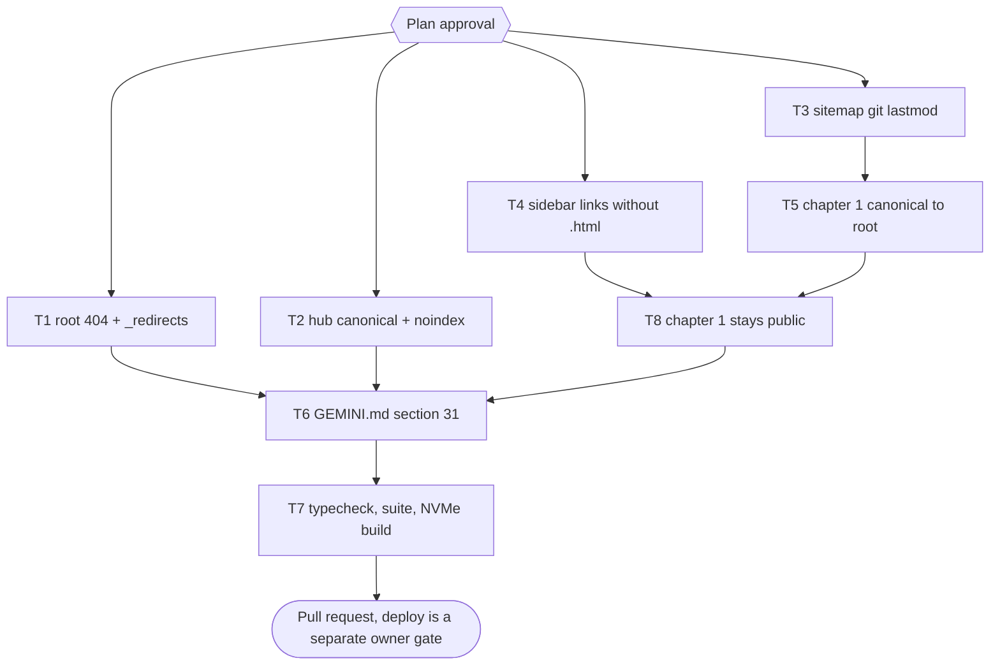

# GSC Coverage Fixes: Soft 404, Canonicals, Sitemap Lastmod, Sidebar Links

> For agentic workers: REQUIRED EXECUTION METHOD: delegated task execution. Steps use checkbox syntax. Git writes belong to the parent only.

**Goal:** Act on the Search Console Page indexing export of 2026-11-07 (537 indexed, 759 not indexed) by removing the site-side causes behind the soft 404, duplicate, redirect and not-crawled buckets.

**Architecture:** Five independent build-pipeline changes: a root `404.html` and `_redirects` in `public/` (copied by `copyAssets`), canonical and noindex tags in the hub template, git-based `lastmod` in the sitemap generator, a post-build pass that rewrites the mdBook sidebar script links to the canonical extensionless form (with the progress tracker made form-agnostic), and a chapter-1 canonical that points at the book root. One docs task records the rules in `GEMINI.md`; one verify task runs typecheck, the full suite and a real build on NVMe.

**Tech Stack:** Bun 1.4.4, TypeScript (strict `tsc`), mdBook 0.5.x, Cloudflare Pages + Pages Functions, `bun:test`.

**Active Project Profile:** repository `/home/belajarcarabelajar/Proyek/dawnbook` (main at `0444f3ea`), session worktree from `pr-registry claim` (wt-new, `/mnt/belajarcarabelajar/dawnbook-wt/<slot>`). Config sources: `package.json` scripts, `tsconfig.json`, `functions/tsconfig.json`, `GEMINI.md` (symlinked as `CLAUDE.md`/`AGENTS.md`), `scripts/build.ts`, `scripts/deploy-website.sh`. GitHub Actions are off (GEMINI.md section 19), so all checks run locally or on Colab.

**Project Commands:** tests `colab-test -- bun test <files>` (A47; exit 3 = Colab unavailable, then `timeout 120 bun test <file>` locally per A12); typecheck `colab-test -- bun run typecheck`; build `bun run build` (local, NVMe detached worktree per A44, `PATH=$HOME/.cargo/bin:$PATH`, `DAWNBOOK_PREMIUM_DIR` absolute); deploy `bash scripts/deploy-website.sh` (owner-only, not part of this plan).

**Protected Boundaries:** never hand-edit `books/*/book.toml` (section 1); no cache-busting renames (section 3); progress paths keep the `.html` comparison form (section 5); premium text and premium chapter 2+ URLs never reach the sitemap (section 30); bot pass-through and AI-crawler rules in `functions/` are untouched (section 11); no deploy, no GSC write, no Actions dispatch without the owner.

**Spec:** none (Bounded path); the design and evidence are in this plan.

**Scope:** chapter-1 client gate (`dawnbook-free-chapter` meta), `public/404.html`, `public/_redirects`, hub `<head>` (canonical, description, noindex) and hub nav links, `public/offline.html` noindex, sitemap `lastmod`/`changefreq`/`priority`, sitemap chapter-1 exclusion, mdBook `toc-*.js` link rewrite, `shared-script.js` `normalizePath`, chapter-1 canonical and `og:url`, `GEMINI.md` section 31 plus the one sentence in section 30.

**Non-Goals:** rewriting book content; changing book roots into separate landing pages; the hub `lang="en"` and the duplicated `hreflang en/id` pair (logged as follow-ups); the search-result links inside `searchindex` (client-side, not crawled); clicking "Validate fix" in Search Console and resubmitting the sitemap (owner actions after deploy); deploy itself.

**Visual Map:**

**Reasoning Lenses:** intent (owner chose all four fixes plus "Ch1 canonical to root"), investigative (each bucket traced to a URL and a line of code, Evidence below), computational (sitemap lastmod from one `git log` pass, not one call per URL), compatibility (progress paths stay `.html` in storage, only the comparison normalizes), operational (no deploy here; post-deploy checks listed), verification (RED test per task, NVMe build with an output checker).

**Acceptance Criteria:**

- [x] AC-1: the build output holds a root `404.html` (Indonesian, links to `/`), so Cloudflare Pages leaves SPA mode and an unknown non-book path is answered with status 404 instead of the home page. (evidence: T1 test exit 0; NVMe build output has `404.html`, checker exit 0)
- [x] AC-2: `_redirects` holds a 301 for each of the two URLs that earned impressions and no longer exist, each target is an existing chapter, and every source is absent from the build. (evidence: T1 test exit 0 (targets exist, sources absent); `_redirects` in build output)
- [x] AC-3: every indexable hub page (`/`, `/about`, `/contribute`, `/donate`, `/appreciation`, `/statistics`, `/dmca`) carries exactly one self-referencing absolute canonical and its own meta description; `sign-in`, `sign-up` and `offline` carry `noindex`; hub nav links point at the extensionless URLs. (evidence: T2 tests exit 0 (75 pass); checker exit 0 on the build (canonicals, noindex, no `.html` hub links))
- [x] AC-4: each sitemap `lastmod` is the date of the last commit that touched that page's source (chapter `.md` for a chapter, the book folder for a book root, all books for `/`); a page with no git history has no `lastmod`; `changefreq` and `priority` are gone. (evidence: T3 tests exit 0; build sitemap lastmod spread 2026-10-24..2026-11-05, no changefreq/priority)
- [x] AC-5: no chapter link in any built `toc-*.js` ends in `.html`, links to `print`, `toc` and `404` keep theirs, and the progress bar counts an extensionless sidebar link against a `.html` completed path. (evidence: T4 tests exit 0; build normalized 64 toc files, checker exit 0)
- [x] AC-6: a first chapter's canonical and `og:url` are its book root URL, every other page keeps a self canonical, and the sitemap lists no first chapter (free or premium). (evidence: T5 tests exit 0; build sitemap 794 URLs without chapter 1, check-seo in build passed, checker exit 0)
- [x] AC-8: a signed-out reader (and Google's renderer) landing cold on a book's first chapter is never redirected to `/sign-in`; chapters 2 and later keep today's entry-point rule. (evidence: T8 RED exit 1 then GREEN exit 0 (35 pass); checker found the meta on every first chapter)
- [x] AC-7: `bun run typecheck` exit 0, `bun test` exit 0, and `bun run build` exit 0 on an NVMe copy whose output passes `scripts/check-indexing-output.ts`. (evidence: runner `--execute` 2026-11-07 after follow-up F1: T7 PASSED, `colab-test -- bun run typecheck` exit 0, `colab-test -- bun test` exit 0, NVMe `bun run build` exit 0 with the indexing check inside, `check-indexing-output.ts` exit 0)

**Traceability:**

| AC | Task | Check | Evidence |
|---|---|---|---|
| AC-1, AC-2 | T1 | `colab-test -- bun test tests/scripts/not-found-and-redirects.test.ts` | RED exit 1 before the files exist, then exit 0 |
| AC-3 | T2 | `colab-test -- bun test tests/scripts/hub-seo.test.ts` | canonical count, noindex and nav assertions on a temp output |
| AC-4 | T3 | `colab-test -- bun test tests/scripts/generate-sitemap.test.ts -t 'git lastmod'` | injected lastmod map in, exact XML out |
| AC-5 | T4 | `colab-test -- bun test tests/scripts/normalize-toc-links.test.ts tests/books/shared-script.test.ts` | fixture toc JS rewritten; progress test with mixed forms |
| AC-6 | T5 | `colab-test -- bun test tests/scripts/inject-gating-canonical.test.ts` | canonical and og:url on chapter 1 vs chapter 2; sitemap without chapter 1 |
| AC-8 | T8 | `colab-test -- bun test tests/books/shared-script.test.ts -t 'first chapter'` | RED: today's script redirects; GREEN: no redirect with the first-chapter marker, redirect kept on chapter 2 |
| AC-7 | T7 | `bun run build` on NVMe, then `scripts/check-indexing-output.ts` | build exit 0; checker exit 0 |

**Evidence (gathered 2026-11-07, read-only):**

| GSC bucket (export 2026-11-07) | Pages | Cause | How it was shown |
|---|---|---|---|
| Halaman dengan pengalihan | 344 | mdBook 0.5 renders the sidebar from `toc-<hash>.js`, whose links end in `.html`; Cloudflare answers them with 308 to the extensionless URL. `normalizeInternalLinks` only rewrites HTML files. Hub nav links also use `/about.html` and friends. | `rg -o 'content/[^"]*' output/books/fungsi-manajemen-poac/toc-05394be7.js` shows `.html`; `curl` of `/about.html` gives 308 |
| Soft 404 | 21 | No root `404.html`, so Pages runs its SPA fallback and serves `/` with 200 for any unknown path ([Cloudflare, Serving Pages](https://developers.cloudflare.com/pages/configuration/serving-pages/), fetched 2026-11-07). | `curl /tidak-ada-halaman` and `/books/tidak-ada-buku-ini/` give 200 with title "Home" |
| Duplikat tanpa kanonis pilihan pengguna | 34 | Hub pages carry no canonical; SPA-fallback URLs return a copy of the home page. | URL Inspection API: `userCanonical` null on `/`, `/about`, `/contribute`; `output/*.html` have no `rel="canonical"` |
| Ditemukan / Di-crawl, tidak diindeks | 218 / 94 | Many book roots never crawled. Contributing: book root and chapter 1 have identical `<main>` and each self-canonical; all 858 sitemap entries carry the deploy date as `lastmod`, which Google ignores when it is not accurate ([Google, Build a sitemap](https://developers.google.com/search/docs/crawling-indexing/sitemaps/build-sitemap), fetched 2026-11-07). | `diff` of `<main>` of root vs chapter 1 exit 0; `rg -o '<lastmod>[^<]+' sitemap.xml \| uniq -c` gives 858 x 2026-11-05 |
| Tidak ditemukan (404) | 11 | Old chapter URLs; two have impressions: `filosofi-stoikisme/content/09_amor-fati-menerima-takdir-tanpa-protes` and `matriks-keputusan-decision-matrix/content/06_langkah-3-pembagian-bobot-pada-kriteria`. | Search Analytics pages 2026-08-01..2026-11-06 vs `output/` |
| Halaman dengan pengalihan (sitemap URLs) | 28 | The free **first chapter** of 28 books is recorded with Google canonical `/sign-in` (crawls 2026-08-03 to 2026-11-05). inject-gating adds the `free_chapter_viewed` setter only to gated chapters, so on a cold landing on chapter 1 `shared-script.js` finds no free chapter, `isPublic` is false (`books/shared-script.js:104`) and `checkAuth` calls `redirectToSignIn()` for every signed-out visitor, Googlebot's renderer included. The server answers 200. | URL Inspection of all 858 sitemap URLs: 28 chapter-1 URLs in "Halaman dengan pengalihan", 29 with Google canonical `/sign-in`; live chapter 1 has no `free_chapter_viewed` in its HTML |
| noindex 34, 401 1 | 35 | `toc.html` (mdBook noindex) and gated pages: intended, no action. | 63 `toc.html` with noindex in `output/` |

Raw probe data stays outside the repo in `~/.cache/tmp/dawnbook-gsc-coverage-20261107/` (sitemap URL list, URL Inspection JSONL, Search Analytics JSON).

**Assumptions & Open Questions:**
- Assumed: `_redirects` rules apply when the Pages Functions middleware calls `next()`; Cloudflare documents them as applied to static asset responses. Anonymous visitors to a gated old path still get the middleware's 401 first; verified search bots pass through and see the 301. Checked after deploy (Operations).
- Measured: Google records 28 first chapters as redirects to `/sign-in` (T8). Gated chapters 2+ get the `free_chapter_viewed` setter, so a cold render of them stays public; that rule is unchanged here.
- Owner decisions (2026-11-07, question tool): all four fixes in scope; chapter 1 canonical points to the book root. T8 was found after that answer (full URL Inspection run) and is part of the plan approval.

**Dependencies & Impact:** T5 edits `scripts/generate-sitemap.ts` after T3, so it depends on T3. All other fix tasks have disjoint files. Consumers: `deploy-website.sh` ships `output/`; the hub (`scripts/build.ts`) progress uses `manifest.json` `.html` paths and is untouched; `functions/` is untouched.

**Risks & Rollback:**
- A root `404.html` ends SPA mode; any path that relied on the fallback would now 404. Mitigation: `check-indexing-output.ts` asserts every hub nav link resolves to a file, and Operations probes the live hub links after deploy. Rollback: delete `public/404.html`.
- Progress bar could read 0 if the sidebar form and stored form diverge. Mitigation: `normalizePath` appends `.html` to extensionless `/content/` paths, tested both ways. Rollback: revert T4's commit.
- Chapter-1 canonical moves ranking signals from chapter 1 to the root (intended). Rollback: revert T5's commit.

**Security & Compatibility:** no auth, cookie or gating code changes; `_redirects` targets are same-site relative paths; mdBook's own active-link check already strips `.html` (`toc.js` compares both forms), so the rewrite stays compatible.

**Operations & Rollout:** after the owner deploys: `curl -s -o /dev/null -w '%{http_code}' https://dawnbook.belajarcarabelajar.com/tidak-ada-halaman` expects 404; `curl -sI` of each hub page expects 200; resubmit the sitemap with the `_TULIS` OAuth token (memory `reindex-scripts-403-exit-0`); the owner clicks "Validate fix" for Soft 404 and Duplicate in Search Console. Rollback: redeploy the previous commit.

**CI/Review Gate:** Actions are off; T7 is the gate. Independent diff review by a reviewer subagent before the PR.

**Documentation:** `GEMINI.md` new section 31 "Indexing Hygiene" (404, redirects, canonical rules, sitemap lastmod, sidebar link form) and section 30's sitemap sentence (chapter 1 no longer listed).

**Definition of Done:** AC-1..AC-7 checked with evidence; plan checklist ticked; PR opened with `Refs #<issue>`; debt sweep run.

**Plan Status & Version:** Complete, version 1.

**Reproducibility:** Bun 1.4.4, mdBook from `~/.cargo/bin`, Colab pool through `colab-test`; build in `~/.cache/tmp/dawnbook-gsc-coverage-build` (NVMe).

**Test Reliability:** tests write only to temp dirs or the repo's ignored `output/test-*`; the sitemap lastmod test injects its git map instead of reading history, so it does not depend on clone depth.

**Privacy & Data Governance:** GSC tokens are read from `~/cloudflare/.env` and never printed; probe data stays in `~/.cache/tmp`; nothing from the private premium repo enters this public repo.

**Dependencies & Supply Chain:** no new packages.

**UX States:** the 404 page is a plain Indonesian page with a link to the hub, styled with the hub CSS already shipped; the sidebar keeps its active-chapter highlight.

**Persistent State & Artifact Storage:** progress storage format unchanged (`.html` paths in D1 and `completed_paths`).

**Entity & Sourcing Verification:** Cloudflare Pages 404/SPA and `_redirects` behaviour, limits (2,000 static rules) and Google's lastmod, canonical and indexing-reason definitions were fetched with TinyFish on 2026-11-07 (links above and [Google, Page indexing report](https://support.google.com/webmasters/answer/7440203?hl=en), [Google, canonical URLs](https://developers.google.com/search/docs/crawling-indexing/consolidate-duplicate-urls), [Cloudflare, Redirects](https://developers.cloudflare.com/pages/configuration/redirects/)).

**Verification:** T7 run[] plus the Operations probes after the owner's deploy.

## Global Constraints

- Bun only (`bun test`, `bun run`), never npm/npx/node.
- Every test and typecheck runs through `colab-test` (A47); local fallback is targeted only (A12).
- Subagents never run git or gh; the parent stages by explicit path.
- No em dash, no emoji, no "Anda" in any user-visible text; the 404 page addresses the reader as "kamu".
- No new fact or SEO claim in docs that this plan did not measure.

## Session Checklist

- [x] Grounding: GSC export parsed (sheets Bagan, Masalah penting, Masalah non-kritis), causes mapped to code and live URLs; evidence in the Evidence table (curl, URL Inspection API, Search Analytics, `diff` exit 0).
- [x] Scope decided by the owner: all four fixes plus chapter 1 canonical to root (question tool answer, 2026-11-07).
- [x] Plan validated (`bun scripts/ultra-plan-runner.mjs` prints `Validation: OK`, exit 0, 8 tasks; `bun scripts/validate-skill.mjs` exit 0) and published at Draft (`plan-sync.mjs`: publish exit 0, issue-sync exit 0, issue #268).
- [x] Plan approved by the owner (Gate 2, question tool answer "Approve, execute", 2026-11-07), approval recorded below, plan re-synced.
- [x] Session claimed: `pr-registry claim` exit 0, branch `2026-11-07-gsc-coverage-fixes/gsc-coverage-fixes`, worktree `/mnt/belajarcarabelajar/dawnbook-wt/gsc-coverage-fixes` from origin/main `f4bfae70`; plan committed `97459b21`.
- [x] T1 done: RED `colab-test -- bun test tests/scripts/not-found-and-redirects.test.ts` exit 1 (7 fail, assertion failures); GREEN same command exit 0 (10 pass, 0 fail), re-run by the parent exit 0; commit `5f9e4b4e`.
- [x] T2 done: RED `colab-test -- bun test tests/scripts/hub-seo.test.ts` exit 1 (21 fail on assertions); scope extended by the parent to `hub-runtime.ts` line 352 and the `/dmca.html` expectation in `builder-template-engine.test.ts`; GREEN 4 files exit 0 (75 pass, 0 fail), re-run by the parent exit 0; commit `70827566`.
- [x] T3 done: RED `colab-test -- bun test tests/scripts/generate-sitemap.test.ts -t 'git lastmod'` exit 1 (7 fail); GREEN with `premium-surfaces.test.ts` exit 0 (18 pass, 0 fail), re-run by the parent exit 0; typecheck exit 0 on Colab; commit `59f80a6b`.
- [x] T4 done: RED `colab-test -- bun test tests/scripts/normalize-toc-links.test.ts tests/books/shared-script.test.ts` exit 1 (2 progress assertions 0% vs 100%, missing module); GREEN with `build.test.ts` exit 0 (23 pass, 0 fail), re-run by the parent exit 0; real toc file probe 0 `.html` chapter links left; commit `363ae7b4`.
- [x] T5 done: RED (3 test files) exit 1 (8 fail on assertions); scope extended by the parent to `scripts/check-seo.ts` (its build-time sitemap rule required chapter 1); GREEN 8 files exit 0 (69 pass), re-run by the parent (7 files) exit 0 (58 pass, 0 fail); typecheck exit 0 on Colab; commit `5c3f1e02`.
- [x] T8 done: RED `colab-test -- bun test tests/books/shared-script.test.ts -t 'first chapter'` exit 1 (test (a) redirected to `/sign-in?redirect_url=%2Fbooks%2Fmy-book%2Fcontent%2F01_intro`, controls passed); GREEN 4 files exit 0 (35 pass), re-run by the parent exit 0 (35 pass, 0 fail); typecheck exit 0 on Colab; commit `e6cfca33`.
- [x] T6 done: GEMINI.md section 31 plus the section 30 sentence; names checked against the code (`gitLastmods`, `canonicalUrl`, `normalizeTocLinks`, `dawnbook-free-chapter` all found); `check-copy-rules.mjs --diff origin/main` exit 0, merge base `f4bfae70` = origin/main.
- [x] T7 done: `colab-test -- bun run typecheck` exit 0. `colab-test -- bun test` exit 1: 1759 pass, 1 fail, the only failure `test_gsc_batch_indexing_ping.py` (ImportError `tests.scripts` under Colab's Python 3.13); same single failure on base `f4bfae70` (1683 pass, 1 fail), and the same Python test passes locally on this branch (exit 0, 6 tests), so it is a pre-existing Colab environment failure. NVMe build `bun run build` exit 0 (64 toc files normalized, sitemap 794 URLs, lastmod spread 2026-10-24..2026-11-05); `scripts/check-indexing-output.ts` on that output exit 0; build worktree removed. Runner log: T1-T5, T8 SKIPPED-IDEMPOTENT, T6 PASSED, T7 FAILED-ISOLATED at step 2 (the environment failure above), steps 3-7 then run by the parent.
- [x] Independent diff review done (read-only reviewer, 34 targeted tests exit 0): no high or medium finding; finding 5 (checker decode throws) fixed in `d92399ea`; findings 1-4 (checker not wired into the build, shallow-clone lastmod, latent `index` suffix rule, llms.txt still lists chapter 1) carried to the debt sweep.
- [x] PR #269 opened (`pr-registry open` exit 0, body `Refs #268`), plan synced.
- [x] Debt sweep run: owner picked F1-F4, all done RED then GREEN (F1 `71896b1a`, F2 `07f6c60b`, F3 `f7b469ac`, F4 `58e08dd4`, parent re-run exit 0); runner re-run all PASSED or SKIPPED-IDEMPOTENT; closeout question asked again before merge.

## Batch Manifest

Wave 1 runs in parallel (disjoint files); wave 2 and 3 follow their dependencies. Subagents edit and test only; the parent stages by path and commits.

| Chunk | Owner | Permitted files | Expected output | Verification |
|---|---|---|---|---|
| T1 | chef | `public/404.html`, `public/_redirects`, `tests/scripts/not-found-and-redirects.test.ts` | 404 page, two 301 rules, test | `colab-test -- bun test tests/scripts/not-found-and-redirects.test.ts` RED then GREEN |
| T2 | hoggy | `scripts/builder/template-engine.ts`, `public/offline.html`, `tests/scripts/hub-seo.test.ts`; extended by the parent: `apps/hub/src/scripts/hub-runtime.ts` (inlined `/appreciation.html` link), `tests/scripts/builder-template-engine.test.ts` (old `/dmca.html` expectation) | hub canonical, descriptions, noindex, extensionless nav | T2 `run[]` |
| T3 | nappy | `scripts/generate-sitemap.ts`, `tests/scripts/generate-sitemap.test.ts` | `gitLastmods`, lastmod lookup, no changefreq/priority | T3 `run[]` |
| T4 | chef (second instance) | `scripts/builder/normalize-toc-links.ts`, `tests/scripts/normalize-toc-links.test.ts`, `scripts/build.ts`, `books/shared-script.js`, `tests/books/shared-script.test.ts` | toc link rewrite, build call, form-agnostic `normalizePath` | T4 `run[]` |
| T5 | nappy (second instance) | `scripts/inject-gating.ts`, `scripts/generate-sitemap.ts`, `scripts/check-seo.ts` (extended by the parent: its build-time sitemap rule required chapter 1), `tests/scripts/inject-gating-canonical.test.ts`, `tests/scripts/generate-sitemap.test.ts`, `tests/scripts/premium-surfaces.test.ts` | chapter 1 canonical to root, sitemap without chapter 1 | T5 `run[]` |
| T8 | wave 3 implementer | `scripts/inject-gating.ts`, `books/shared-script.js`, `tests/books/shared-script.test.ts`, `tests/scripts/inject-gating-canonical.test.ts` | `dawnbook-free-chapter` meta and `isPublic` check | T8 `run[]` |
| T6 | parent (one file, docs) | `GEMINI.md` | section 31 and the section 30 sentence | copy-rules check |
| T7 | parent plus one implementer for `scripts/check-indexing-output.ts` | `scripts/check-indexing-output.ts` | output checker | T7 `run[]` |

Boundary check: every task has one owner; no two chunks in the same wave write the same file (T3/T5 share `generate-sitemap.ts` and T4/T5/T8 share files across waves only).

## Task T1: Root 404 Page and Redirects for Moved URLs

**Files:**
- Create: `public/404.html`, `public/_redirects`, `tests/scripts/not-found-and-redirects.test.ts`

**Interfaces:** none consumed; produces two static files copied by `copyAssets` (`scripts/builder/template-engine.ts:938`, `cp -r public/* output/`).

**Preconditions:** `public/` exists; both redirect targets exist: `books/filosofi-stoikisme/src/content/09_amor-fati-mencintai-takdir.md`, `books/matriks-keputusan-decision-matrix/src/content/06_langkah-3-pemberian-bobot-pada-kriteria.md` (else `E_PRECOND_INPUT`).

**Idempotency Check:** skip when the T1 test exits 0.

**Behavior & Acceptance:** AC-1, AC-2.
- `public/404.html`: `<html lang="id">`, title "Halaman tidak ditemukan | Dawnbook", one short paragraph addressing "kamu", a link to `/`, the hub stylesheets (`/typography.css`, `/HubLayout.css`), no scripts, no canonical.
- `public/_redirects`, one rule per line, `301`, sources extensionless:
  - `/books/filosofi-stoikisme/content/09_amor-fati-menerima-takdir-tanpa-protes /books/filosofi-stoikisme/content/09_amor-fati-mencintai-takdir 301`
  - `/books/matriks-keputusan-decision-matrix/content/06_langkah-3-pembagian-bobot-pada-kriteria /books/matriks-keputusan-decision-matrix/content/06_langkah-3-pemberian-bobot-pada-kriteria 301`
- Test asserts: 404 file exists with `lang="id"`, a link to `/`, no `noindex` needed (status does it) and no em dash or "Anda"; every `_redirects` line parses as `source dest 301`, every target maps to an existing `books/<slug>/src/content/<name>.md`, no source maps to an existing chapter, at most 2,000 lines, no duplicate source.

**Edge Cases & Failure Behavior:** `/books/<slug>/...` misses still use mdBook's book-level `404.html` (nearest wins), which is correct.

**Deliberate Shortcuts & Deferrals:** redirects cover only URLs with measured impressions. `defer: 2,000 static rules, a GSC 404 example list or a chapter rename that had impressions`.

**Review & Evidence:** RED exit 1, GREEN exit 0 (colab-test).

- [x] Step 1: write `tests/scripts/not-found-and-redirects.test.ts`.
- [x] Step 2: run RED | cmd: `colab-test -- bun test tests/scripts/not-found-and-redirects.test.ts` | expect: exit 1 | retry: 0
- [x] Step 3: write `public/404.html` and `public/_redirects`.
- [x] Step 4: run GREEN | cmd: `colab-test -- bun test tests/scripts/not-found-and-redirects.test.ts` | expect: exit 0 | retry: 1
- [x] Step 5: parent commits `public/404.html public/_redirects tests/scripts/not-found-and-redirects.test.ts`.

## Task T2: Hub Canonical, Descriptions, Noindex and Nav Links

**Files:**
- Modify: `scripts/builder/template-engine.ts` (`generatePage` at lines 93-120, nav links lines 152-156, inline links lines 423 and 430, page writes lines 866-900), `public/offline.html`
- Create: `tests/scripts/hub-seo.test.ts`

**Interfaces:** `generatePage(title, content, isHome)` gains a page options argument `{ path: string; description: string; noindex?: boolean }`; `generateSitePages(rootDir, outputDir, builtBooks, buildEnv)` signature unchanged.

**Preconditions:** `generateSitePages` accepts an injectable env (it does, line 54).

**Idempotency Check:** skip when the T2 test exits 0.

**Behavior & Acceptance:** AC-3.
- Canonical `https://dawnbook.belajarcarabelajar.com<path>` with `/` for home and extensionless paths (`/about`, `/contribute`, `/donate`, `/appreciation`, `/statistics`, `/dmca`).
- One English description per page (the hub is `lang="en"`), each under 160 characters, stating only what the page holds; the home keeps the existing sentence.
- `sign-in`, `sign-up`: `<meta name="robots" content="noindex">` and no canonical. `public/offline.html`: add the same noindex.
- Nav and inline links `/about.html`, `/statistics.html`, `/contribute.html`, `/donate.html`, `/dmca.html`, `/appreciation.html` become extensionless.
- Test runs `generateSitePages` into a temp dir with a fixture `builtBooks` and an empty env, then asserts per file: exactly one `rel="canonical"` with the expected URL (none on sign-in/up), noindex only on sign-in/up, distinct descriptions, and no `href="/[a-z-]+\.html"` anywhere; reads `public/offline.html` for noindex.

**Edge Cases & Failure Behavior:** sign-in redirect links keep their `redirect_url` query (no canonical, noindex covers the variants).

**Deliberate Shortcuts & Deferrals:** `lang="en"` on Indonesian-language book listings left as is. `defer: hub language, owner decision on hub language`.

**Review & Evidence:** RED exit 1, GREEN exit 0 together with `builder-template-engine.test.ts` and `sign-up-google.test.ts`.

- [x] Step 1: write `tests/scripts/hub-seo.test.ts`.
- [x] Step 2: run RED | cmd: `colab-test -- bun test tests/scripts/hub-seo.test.ts` | expect: exit 1 | retry: 0
- [x] Step 3: implement in `template-engine.ts` and `public/offline.html`.
- [x] Step 4: run GREEN | cmd: `colab-test -- bun test tests/scripts/hub-seo.test.ts tests/scripts/builder-template-engine.test.ts tests/scripts/sign-up-google.test.ts` | expect: exit 0 | retry: 1
- [x] Step 5: parent commits the three files.

## Task T3: Sitemap Lastmod from Git History

**Files:**
- Modify: `scripts/generate-sitemap.ts`
- Test: `tests/scripts/generate-sitemap.test.ts`

**Interfaces:** produces `export function gitLastmods(rootDir: string): Map<string, string>` (repo-relative path to `YYYY-MM-DD`, newest commit wins, built from one `git log --format=%cs --name-only -- books` pass) and `SitemapOptions.lastmods?: Map<string, string>` (injected in tests, defaults to `gitLastmods(cwd)`).

**Preconditions:** `git --version` exits 0 (else lastmods is an empty map and every entry omits `lastmod`, which the test covers).

**Idempotency Check:** skip when `-t 'git lastmod'` exits 0.

**Behavior & Acceptance:** AC-4.
- Chapter `/books/<slug>/content/<name>` uses `books/<slug>/src/content/<name>.md`; book root uses the newest date under `books/<slug>/`; `/` uses the newest date of all; other hub pages get no `lastmod`.
- A path missing from the map gets no `<lastmod>` element (premium sources live in a private repo, so premium pages omit it).
- `changefreq` and `priority` are removed from the output and from `SitemapItem`.
- Tests (names contain `git lastmod`): injected map gives exact `<lastmod>` per URL; unknown path has none; output contains no `<changefreq>` or `<priority>`; `gitLastmods` on a temp git repo with two commits returns the newer date per file. The existing test's `<lastmod>` regex assertion changes to "absent for a page without history".

**Edge Cases & Failure Behavior:** decoded vs encoded chapter names: map keys use the on-disk name, lookup decodes the URL path first.

**Deliberate Shortcuts & Deferrals:** hub pages other than `/` omit lastmod. `defer: 7 hub pages, a hub page gains content that changes often`.

**Review & Evidence:** RED exit 1, GREEN exit 0 with `premium-surfaces.test.ts`.

- [x] Step 1: add the `git lastmod` tests.
- [x] Step 2: run RED | cmd: `colab-test -- bun test tests/scripts/generate-sitemap.test.ts -t 'git lastmod'` | expect: exit 1 | retry: 0
- [x] Step 3: implement `gitLastmods` and the lookup.
- [x] Step 4: run GREEN | cmd: `colab-test -- bun test tests/scripts/generate-sitemap.test.ts tests/scripts/premium-surfaces.test.ts` | expect: exit 0 | retry: 1
- [x] Step 5: parent commits the two files.

## Task T4: Sidebar Links Without .html

**Files:**
- Create: `scripts/builder/normalize-toc-links.ts`, `tests/scripts/normalize-toc-links.test.ts`
- Modify: `scripts/build.ts` (call after the `inject-gating.ts` step), `books/shared-script.js` (`normalizePath`, around line 298)
- Test: `tests/books/shared-script.test.ts`

**Interfaces:** produces `export async function normalizeTocLinks(outputBooksDir: string): Promise<number>` (rewrites every `books/*/toc-*.js`, returns files changed) built on the existing `normalizeInternalLinks` from `scripts/inject-gating.ts` (imported, not copied).

**Preconditions:** `normalizeInternalLinks` exported (it is, `scripts/inject-gating.ts:138`).

**Idempotency Check:** skip when both test files exit 0.

**Behavior & Acceptance:** AC-5.
- `href="content/01_x.html"` becomes `href="content/01_x"`; `print.html`, `toc.html`, `404.html` and external links stay; a second run changes nothing.
- `build.ts` fails the build when zero `toc-*.js` files were found but books were built (guards against an mdBook layout change).
- `normalizePath` in `shared-script.js` appends `.html` to an extensionless path that contains `/content/` (same rule as `saveProgress`, line 138), so sidebar links in either form match stored `.html` paths.
- Tests: fixture of the real mdBook 0.5 sidebar string (from `output/books/fungsi-manajemen-poac/toc-05394be7.js`, one `<a href>` each of chapter, print, external) before and after; shared-script test where the sidebar has `/books/b/content/01_a` and `completed_paths` has `/books/b/content/01_a.html` and the bar width is 100%.

**Edge Cases & Failure Behavior:** percent-encoded chapter names keep their encoding; only the `.html` suffix changes.

**Deliberate Shortcuts & Deferrals:** `searchindex` result URLs keep `.html`. `defer: search results, Google reports search result URLs`.

**Review & Evidence:** RED exit 1, GREEN exit 0 with `build.test.ts`.

- [x] Step 1: write both tests.
- [x] Step 2: run RED | cmd: `colab-test -- bun test tests/scripts/normalize-toc-links.test.ts tests/books/shared-script.test.ts` | expect: exit 1 | retry: 0
- [x] Step 3: implement `normalize-toc-links.ts`, the build call and `normalizePath`.
- [x] Step 4: run GREEN | cmd: `colab-test -- bun test tests/scripts/normalize-toc-links.test.ts tests/books/shared-script.test.ts tests/scripts/build.test.ts` | expect: exit 0 | retry: 1
- [x] Step 5: parent commits the five files.

## Task T5: Chapter 1 Canonical Points to the Book Root

**Files:**
- Modify: `scripts/inject-gating.ts` (`InjectSeoOptions`, `injectSeoAndGating` seo tags around line 322, `processDirectory` around lines 446-470), `scripts/generate-sitemap.ts` (`premiumListablePages` and the scan)
- Create: `tests/scripts/inject-gating-canonical.test.ts`
- Test: `tests/scripts/generate-sitemap.test.ts`, `tests/scripts/premium-surfaces.test.ts`

**Interfaces:** `InjectSeoOptions.canonicalUrl?: string` (defaults to `url`), used by `rel="canonical"`, `og:url` and both `hreflang` links; `processDirectory` sets it to `https://dawnbook.belajarcarabelajar.com/books/<slug>/` when the decoded page path equals `manifest.chapters[slug][0]`. Consumes T3's `generateSitemap` shape.

**Preconditions:** T3 committed (same file).

**Idempotency Check:** skip when the T5 test exits 0.

**Behavior & Acceptance:** AC-6.
- First chapter: canonical, `og:url`, `hreflang` to the book root. Meta description stays the chapter opener (section 8).
- Root, other chapters, `toc`, `print`, `404`: unchanged self canonical.
- Sitemap skips `manifest.chapters[slug][0]` for every book, so premium books list only their root.
- Tests: `injectSeoAndGating` with and without `canonicalUrl`; sitemap from a temp output with a manifest whose first chapter is absent from the XML and second chapter present; premium fixture lists only the root.

**Edge Cases & Failure Behavior:** a book missing from `manifest.chapters` keeps self canonicals and lists every page (no crash).

**Deliberate Shortcuts & Deferrals:** None.

**Review & Evidence:** RED exit 1, GREEN exit 0 with the existing inject-gating and SERP tests.

- [x] Step 1: write the tests.
- [x] Step 2: run RED | cmd: `colab-test -- bun test tests/scripts/inject-gating-canonical.test.ts` | expect: exit 1 | retry: 0
- [x] Step 3: implement in both scripts.
- [x] Step 4: run GREEN | cmd: see `run[]` for T5 | expect: exit 0 | retry: 1
- [x] Step 5: parent commits the touched files.

## Task T8: Chapter 1 Stays Public for Signed-out Readers

**Files:**
- Modify: `scripts/inject-gating.ts` (first-chapter branch in `processDirectory`, `injectSeoAndGating` seo tags), `books/shared-script.js` (`isPublic`, line 104)
- Test: `tests/books/shared-script.test.ts`, `tests/scripts/inject-gating-canonical.test.ts`

**Interfaces:** `InjectSeoOptions.isFirstChapter?: boolean` adds `<meta name="dawnbook-free-chapter" content="1">` to the head; `shared-script.js` treats a page carrying that meta as public. Consumes T5's first-chapter detection and T4's edited `shared-script.js`.

**Preconditions:** T4 and T5 committed (same files).

**Idempotency Check:** skip when `-t 'first chapter'` exits 0.

**Behavior & Acceptance:** AC-8.
- First chapter: the meta is present; with empty sessionStorage and `/api/auth/me` answering 401 the page is revealed and `location.href` is not set to `/sign-in`.
- Chapter 2 with empty sessionStorage and no meta: today's behaviour (redirect) kept, so the paywall is unchanged.
- inject-gating test: first chapter has the meta exactly once, chapter 2 has none.

**Edge Cases & Failure Behavior:** a reader who already used `free_chapter_viewed` on chapter 5 still opens chapter 1 (it is free by design, section 30).

**Deliberate Shortcuts & Deferrals:** None.

**Review & Evidence:** RED exit 1 (new `first chapter` test against today's script), GREEN exit 0.

- [x] Step 1: add the `first chapter` tests.
- [x] Step 2: run RED | cmd: `colab-test -- bun test tests/books/shared-script.test.ts -t 'first chapter'` | expect: exit 1 | retry: 0
- [x] Step 3: implement the meta and the `isPublic` check.
- [x] Step 4: run GREEN | cmd: see `run[]` for T8 | expect: exit 0 | retry: 1
- [x] Step 5: parent commits the touched files.

## Task T6: GEMINI.md Indexing Hygiene Section

**Files:** Modify: `GEMINI.md` (new section 31 after section 30; section 30 sentence "`sitemap.xml` and `llms.txt` list only the book root and chapter 1" becomes "`sitemap.xml` lists only the book root and `llms.txt` lists the book root and chapter 1").

**Behavior & Acceptance:** section 31 states, each with its file: keep `public/404.html` (without it Pages answers unknown URLs with the home page and 200); add a 301 to `public/_redirects` when renaming a chapter that has search impressions; hub pages carry a self canonical and sign-in/up/offline carry noindex; chapter 1 canonical is the book root and the sitemap omits it; sitemap `lastmod` comes from git; the first chapter carries the `dawnbook-free-chapter` meta so the client gate never bounces it; built `toc-*.js` links are extensionless and `normalizePath` accepts both forms; a revert line naming the files. No claim beyond the Evidence table.

- [x] Step 1: write the section.
- [x] Step 2: run | cmd: `bun /home/belajarcarabelajar/vivera/scripts/check-copy-rules.mjs --diff origin/main` | expect: exit 0 | retry: 0
- [x] Step 3: parent commits `GEMINI.md`.

## Task T7: Verify Typecheck, Suite and Real Build

**Files:** none changed except the build checker, `scripts/check-indexing-output.ts`, which T7's owner writes first and the parent commits. It exits 1 naming each failure when: `output/404.html` or `output/_redirects` is missing; a hub page lacks its canonical or sign-in lacks noindex; any `output/books/*/toc-*.js` holds `content/…\.html"`; any sitemap entry has `changefreq`/`priority` or a first chapter; a first chapter's canonical is not its root; any `href` in a hub page points at a file absent from `output/`.

- [x] Step 1: run | cmd: `colab-test -- bun run typecheck` | expect: exit 0 | retry: 1
- [x] Step 2: run | cmd: `colab-test -- bun test` | expect: exit 0 | retry: 1
- [x] Step 3: NVMe detached worktree, `node_modules` symlink, `bun run build`, checker, `git worktree remove` (each one `run[]` step).

## Approval

- 2026-11-07: scope approved by the owner through the question tool (all four fixes; chapter 1 canonical to the book root).
- 2026-11-07: plan approved by the owner through the question tool ("Approve, execute"), including T8.

## Debt Sweep (2026-11-07)

Harvest: 0 `defer:` comment markers in the branch (`git grep -nE '(#|//|/[*]) ?defer:'`; the same command finds 2 in vivera `scripts/validate-agents.mjs`, so the search works); no TODO, skip, ts-ignore added; reviewer findings 1-4; T7 full-suite failure. Learning harvest written to the session memory (`gsc-coverage-fix-traps`, `reindex-scripts-403-exit-0` updated).

Owner selection (question tool, 2026-11-07): all four follow-ups; plan stays open (readiness NOT-READY at ask time).

| ID | Follow-up | Files | Check |
|---|---|---|---|
| F1 | Python GSC ping test runnable on Colab (unittest discover, no `tests.scripts` import) | `tests/scripts/gsc-batch-indexing-ping.test.ts` | `colab-test -- bun test tests/scripts/gsc-batch-indexing-ping.test.ts` RED exit 1, GREEN exit 0 |
| F2 | `bun run build` runs `checkIndexingOutput` after check-seo | `scripts/build.ts`, `tests/scripts/build.test.ts` | `-t 'indexing check'` RED/GREEN, NVMe build exit 0 |
| F3 | Shallow clone gives no lastmod instead of one date | `scripts/generate-sitemap.ts`, `tests/scripts/generate-sitemap.test.ts` | `-t 'shallow'` RED/GREEN |
| F4 | `normalizeInternalLinks` maps only a real `index` segment to the directory | `scripts/inject-gating.ts`, `tests/scripts/inject-gating.test.ts` | `-t 'index suffix'` RED/GREEN |

## Closeout status

- 2026-11-07, `bun scripts/plan-closeout.mjs --readiness` after the follow-ups: **NEEDS-HUMAN** (exit 3). T1-T5 and T8 DONE by `skip_if`; T6 and T7 UNPROVEN only because their `skip_if` is the `false` sentinel; the runner `--execute` log of the same day records T6 PASSED and T7 PASSED; 0 open step boxes, 0 other open boxes.
- Owner answer to the `Close plan` gate: **Keep it open**.
- Remaining: owner deploy of PR #269, then the Operations probes (unknown path 404, hub pages 200, sitemap resubmitted, Validate fix started, request indexing for the 28 first chapters).
- Reopen the closeout question: when those probes pass after the deploy.
- 2026-11-07, after the deploy: PR #269 merged (`45548e2f`); `scripts/deploy-website.sh` from `45548e2f` exit 0 (Pages deployment `7a137d55`, no new books announced, 3 store PDFs reprinted, R2 prune 0 deleted); post-deploy probes 18/18 PASS (unknown path and unknown book 404, 7 hub canonicals, sign-in noindex, chapter 1 200 with root canonical and `dawnbook-free-chapter` meta, sidebar toc JS without `.html` chapter links, sitemap 794 URLs without changefreq, priority or chapter 1, 9 distinct lastmod dates); sitemap resubmitted with the write-scope token (PUT 204, pending, 0 errors).
- Readiness re-run on the closeout branch: `bun scripts/plan-closeout.mjs --readiness` **NEEDS-HUMAN** (exit 3; T6 and T7 UNPROVEN only by the `false` sentinel, both PASSED in the runner log; 0 open boxes).
- Owner answer to the second `Close plan` gate, with that verdict in front of them: **Mark Complete**. Recorded as an owner decision on NEEDS-HUMAN; the skill's READY-only default yields to the owner's explicit answer.
- Plan cost (`bun scripts/plan-cost.mjs --plan 2026-11-07-gsc-coverage-fixes`): 1 main transcript, 10 subagent runs, about 34.56 USD (estimate; caveats: sessions without a registry claim and other work in a claiming session are not separated).
- Owner actions left in the Search Console UI (no API allows them): start "Validate fix" for Soft 404 and Duplicate without user-selected canonical; request indexing for the 31 book roots that were not indexed on 2026-11-07 (list `~/.cache/tmp/dawnbook-gsc-coverage-20261107/request-indexing-roots.txt`; the 28 first chapters now point to their roots, so requesting them is wasted). Google's Indexing API is limited to `JobPosting` and `BroadcastEvent` pages (Indexing API quickstart, fetched 2026-11-07).

## Follow-up Backlog
- `llms.txt` still lists chapter 1 while its canonical is the book root (`scripts/generate-llmstxt.ts`). `defer: hint file only, owner wants llms.txt to match the sitemap`.
- Stale `.html` path comments in `functions/lib/gating.ts:11`, `functions/api/stats.ts:6` and sample paths in `tests/functions/api/auth.test.ts`. `defer: comments and samples, next edit of those files`.

- Google canonical `/sign-in` for the `metodologi-microteaching` root (crawled 2026-09-28): re-inspect after deploy. `defer: 1 URL, still /sign-in after the first recrawl`.
- `scripts/gsc_batch_indexing_ping.py` sends book pages to the Indexing API (`indexing.googleapis.com`), which Google limits to `JobPosting` and `BroadcastEvent` pages and polices for abuse. `defer: one script, next post-deploy reindex run or an owner decision to retire it`.
- Hub `lang="en"` and the identical `hreflang en`/`id` pair on book pages. `defer: language signals, owner decision on hub language`.
- Repo scripts `audit-full-gsc-index.ts` and `gsc_*.py` use the expired read-only token or a service account. `defer: GSC tooling, next reindex run`.
