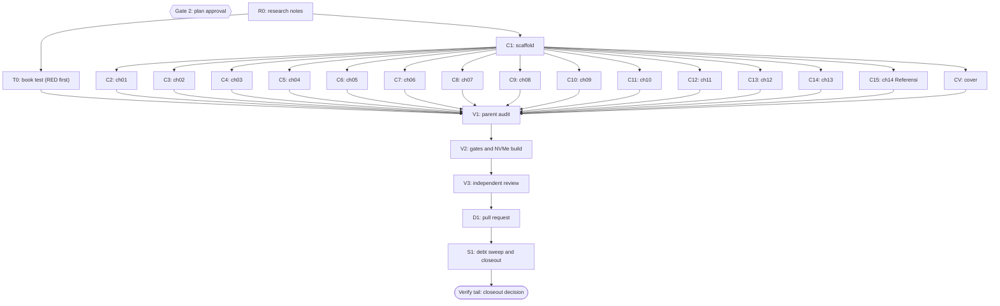

# Plan: Dawnbook book Etimologi dan Derivasi Anthropos by Iwan Kurniawan

Status: Approved
Session: dawnbook-etimologi-anthropos
Branch: 2026-11-15-dawnbook-etimologi-anthropos/dawnbook-etimologi-anthropos
Worktree: /mnt/belajarcarabelajar/dawnbook-wt/dawnbook-etimologi-anthropos
Skill: the first file found in the fallback chain is ~/vivera/Super Ultra Code Plan Implementation.md; the skill was loaded through the Skill tool (~/.claude/skills/super-ultra-code-plan/SKILL.md), then sucp-rules, sucp-brainstorm and sucp-plan.
Author: Iwan Kurniawan <iwan@belajarcarabelajar.com>, no co-author trailer (GEMINI.md section 18: Iwan-authored commits carry none; the owner named Iwan as main author).
Classification: Bounded. The book goes through the existing new-book flow (same shape as plan 2026-11-05-dawnbook-simbolisme-alam) and changes no code or shared interface. A plan file is required because subagents own the chunks and tasks have depends_on edges.
Source: the owner chose the topic and supplied study notes (a local Markdown file outside the repository, 12 modules, no references; path in the book test), plus web sources read with TinyFish.

## Checklist

- [x] Claim: session slot claimed and worktree created. Evidence: `bun ~/vivera/scripts/pr-registry.mjs claim --plan 2026-11-15-dawnbook-etimologi-anthropos --session dawnbook-etimologi-anthropos --repo /home/belajarcarabelajar/Proyek/dawnbook --worktree` exit 0 (after `git worktree prune`); worktree /mnt/belajarcarabelajar/dawnbook-wt/dawnbook-etimologi-anthropos at origin/main 85c39d10; node_modules linked by wt-new.
- [x] Intent (Gate 1): outline, label and format decided. Evidence: AskUserQuestion 2026-11-15: Outline = content of the notes plus a Likantropi chapter (13 content chapters + Referensi); Label = Antropologi; Format = no code blocks, Greek as plain text, no pseudo-formulas, Mermaid only where grounded.
- [x] Research (R0): every claim the chapters may keep checked with TinyFish and written to docs/code-plan/plans/research-dawnbook-etimologi-anthropos.md with a section 9 source table. Evidence: 4 researcher reports (aqua x2, timid x2; 55, 60, 72 and 73 tool uses as reported by the harness, above the 40-call budget in the brief, which counted TinyFish calls but was not enforced) plus 1 top-up researcher (aqua, 30 tool uses) for structural items: surname classes, Indonesian single names, endo- and exocannibalism, static and dynamic anthropometry, the Indonesian two-branch division (notes section 5b, items E1-E14), items A1-A31, B1-B35, C1-C33, D1-D54 with status CONFIRMED, CORRECTED, HEDGE, DROP or UNVERIFIED; parent fetched 3 pages with TinyFish fetch_content (Perseus Diogenes Laertius book VI ch. 2: "I am looking for a man" and the tub; NPS Donner-Reed page: party of 1846, 87 began, 40 died, rescued spring 1847; Open Library record answered with a human-verification wall, so the record stays as the researcher read it through the JSON API); source table 130 rows (section 9) after de-duplicating 13 pages fetched by two researchers; fields no fetched page showed (translator initials, first names, a bonobo listing, a suffix gloss) removed after the advisor check; evidence pages restored next to Crossref-only DOI rows, 0 duplicate URLs, Greek Wiktionary URLs percent-encoded; dropped rows: a CAPTCHA-only PMC page, a search-JSON page, Crossref API rows replaced by doi.org links, an IUGS PDF replaced by the stratigraphy.org statement.
- [x] Plan (Gate 2): this file validates (`Validation: OK`), published at Draft, owner approves. Evidence: `bun ~/vivera/scripts/ultra-plan-runner.mjs <plan>` exit 0, `Validation: OK`, 23 tasks, Error Ledger empty; `bun scripts/validate-skill.mjs` (vivera) exit 0; `plan-sync.mjs --project dawnbook` publish exit 0, issue-sync exit 0 (issue #285, created then body updated after the advisor fixes); AskUserQuestion 2026-11-15: Design = Approve and execute.
- [x] Test RED (T0): book test written before any chapter and fails because the book is absent (`expect_exit: 1`). Evidence: chef wrote tests/books/etimologi-dan-derivasi-anthropos.test.ts (352 lines, ASCII-only, 18 tests); parent re-ran `HEAVY_LOCAL=book-test-red timeout 120 bun test tests/books/etimologi-dan-derivasi-anthropos.test.ts` exit 1, 8 pass 10 fail; the 8 passes are the 130-row source table count, the public notes/plan overlap scan against the private notes, and 6 detector controls (79-char and 123-char metas, 16-word positive and 15-word negative runs, a non-mermaid fence, scaffold-label detection); every fail is `files.length` 0 because no chapter exists; `HEAVY_LOCAL=typecheck bun run typecheck` exit 0 (chef report); with `DAWNBOOK_ETA_SOURCE=/nonexistent` the two overlap cases skip with a warning (chef report).
- [x] Scaffold (C1): books/etimologi-dan-derivasi-anthropos/ with book.toml, icon.txt, theme/, src/SUMMARY.md (14 entries), release-dates.json key. Evidence: nappy report plus parent check: `diff books/_template/book.toml <new>` shows only language, title, description (141 chars) and subject_label Antropologi (authors already Iwan Kurniawan in the template); `diff -r` theme exit 0; SUMMARY.md 14 entries; icon.txt bytes f0 9f 93 9a 0a; `git diff release-dates.json` adds one key (1794740965112) plus a comma; src/content empty at hand-off. The subagent Write hook refused SUMMARY.md (".md report files"), so nappy wrote it with python3 and `cmp` matched; chapter contracts tell writers to use a Bash heredoc.
- [x] Author (C2-C15): 14 chapter files (13 content + Referensi), one subagent each, inside the byte budget; book test RED to GREEN. Evidence: 14 writer reports; bytes after the V1 audit 6266,6056,6331,6467,6472,6370,6771,7372,6163,6337,6420,6055,6597,10363 (content 5500-9000, Referensi 3000-11000); `HEAVY_LOCAL=book-test timeout 120 bun test tests/books/etimologi-dan-derivasi-anthropos.test.ts` exit 0, 18 pass, 0 fail (log ~/.cache/tmp/dawnbook-etimologi-anthropos/v1b-test.log), RED earlier exit 1 (t0-red.log).
- [x] Cover (CV): cover.svg passes `check:covers`, preview cards read by the parent. Evidence: cover.svg 3828 B; `HEAVY_LOCAL=check-covers bun run check:covers --book etimologi-dan-derivasi-anthropos` exit 0; parent Read index.png and the longest-title card 06 (title wraps in 3 lines, bust with wolf, two figures, ruler and strata medallions, no text-like marks, nothing clipped).
- [x] Audit (V1): parent line-by-line read of every chapter plus scans; diagrams rendered. Evidence: parent read chapters 01-14 in full; fixes: ch06 crutch words 5 to 3, openers of ch05, 06, 07, 09, 10, 13 no longer start "Bayangkan <name>" (each fictional character still marked as invented), ch07 title backed by the Broad release (S59, "our closest living relatives", added to note C5), Referensi +6 chapter-cited studies (10363 B), ch13 diagram rebuilt as flowchart LR (616 px, was 1076 px with split words); pre-edit copies in ~/.cache/tmp/dawnbook-etimologi-anthropos/pre-v1/; `check-voice` exit 0, `check-book-structure` exit 0 (14 chapters, 0 problems), `check-heading-colons` exit 0 (0 violations), book test exit 0 (18 pass, 0 fail), `diagrams:render --prune` exit 0 (rendered 1, cached 2, pruned 1), `check:diagrams --book` exit 0.
- [x] Gates (V2): every run[] step exit 0, SEO validation passed in the NVMe build. Evidence: `bun ~/vivera/scripts/ultra-plan-runner.mjs <plan> --execute` exit 0, V2 PASSED, Error Ledger empty (log ~/.cache/tmp/dawnbook-etimologi-anthropos/runner-execute-2.log; the first run failed V2 step 7 `check:diagrams` on the ch13 diagram, fixed in V1); the full NVMe build regenerated functions/lib/built-stats.ts (chapters 784 to 798, Iwan Kurniawan books 49 to 50).
- [x] Review (V3): independent reviewers, findings resolved, report saved. Evidence: 3 staid reviewers (facts, voice, technical), 0 blockers, 11 should-fix and the nits triaged in docs/code-plan/artifacts/2026-11-15-dawnbook-etimologi-anthropos-review-report.md; after the fixes book test exit 0 (19 pass, 0 fail), check-voice, check-book-structure, check-heading-colons, check-repeated-headings, check:diagrams and typecheck each exit 0; runner --execute exit 0 with V2 PASSED (runner-execute-3.log).
- [ ] Deliver (D1): commit as Iwan Kurniawan with no trailer, PR opened through pr-registry, `Refs #<issue>`.
- [ ] Sweep (S1): debt sweep, learning ledger, graphify sync, closeout decision.

## Active Project Profile

Snapshot taken 2026-11-15 at origin/main 85c39d10.

- Repository root: /home/belajarcarabelajar/Proyek/dawnbook (public repository: `gh repo view --json isPrivate` = false). Session worktree above, on the external disk (ext4 image). Runtime Bun 1.4.4, mdBook v0.5.4 in ~/.cargo/bin.
- Target scope: new directory `books/etimologi-dan-derivasi-anthropos/`, one `release-dates.json` entry, one book test, the research notes and session artifacts, and `functions/lib/built-stats.ts` regenerated by the build (repo convention: committed with the PR that adds chapters).
- Book layout (verified on books/simbolisme-alam-dalam-sastra): `book.toml` (template copy with title, authors, language = "id", description, subject_label), `icon.txt`, `theme/` copied from the template, `src/SUMMARY.md`, `src/content/NN_kebab.md`, `cover.svg` (GEMINI.md section 27), `diagrams/` cache when a chapter has a Mermaid block.
- Subject label `Antropologi` exists in data/subject-labels.json (owner choice).
- Heavy work runs on this PC with a `HEAVY_LOCAL=<reason>` prefix, one job at a time (AGENTS.md A47; colab-test serves only Snipset). The full `bun run build` runs in a detached worktree on the NVMe (/home/belajarcarabelajar/.cache/tmp/dawnbook-etimologi-anthropos-build) holding the same book files, never in the session worktree on the external disk (GEMINI.md section 19, AGENTS.md A44).
- Gates: `scripts/check-book-structure.ts`, `bun run check:headings`, `bun run scripts/check-repeated-headings.ts`, `bun run check:voice`, `bun run diagrams:render` then `bun run check:diagrams`, `bun run check:covers`, `bun run typecheck`, `bun run build`. Copy rules: `bun ~/vivera/scripts/check-copy-rules.mjs --diff origin/main` (AGENTS.md A27).
- Protected boundaries: no edits to other books, `books/_template/`, CSS, scripts or functions; GitHub Actions stay off (section 19); no deploy, D1 seed or Telegram announcement inside this plan.

## 1. Intent and Scope

- Goal: a 14-page Dawnbook book (13 content chapters + Referensi) by Iwan Kurniawan on the Greek root anthrōpos and the words built from it, grounded in the owner's notes but improved to the house rules: every claim verified on the web, the notes' mismatched module titles replaced by titles that match the content, the voice cooked (GEMINI.md section 29).
- Slug `etimologi-dan-derivasi-anthropos`. Title `Etimologi dan Derivasi Anthropos`. Subject label `Antropologi`. Icon: the books emoji from the notes, in icon.txt only. Language `id`.
- Description (141 characters): "Menelusuri kata Yunani anthrōpos dan turunannya, dari antropologi, filantropi, dan misantropi sampai antroposen, antropofagi, dan likantropi."
- Owner decisions (AskUserQuestion, 2026-11-15): chapters follow the real content of the 12 modules, plus one research-only chapter on likantropi (lykos + anthrōpos); paleoantropologi becomes a section of the antropoid chapter and antropogenik a section of the antroposen chapter; androgini (from anēr and gynē) and transhumanisme (Julian Huxley, 1957, Latin humanus) are not anthrōpos derivatives and are not written; label Antropologi; the two Python blocks and every pseudo-formula are dropped, Greek words are written as plain text with a transliteration (never inside `$...$`), Mermaid only where the text states a process, chronology or classification.
- Improvements over the notes, applied in every chapter: "kamu" instead of "Anda" (51 in the notes); no emoji, em dash (11 in the notes), colon heading or reveal colon; no "bukan X, tetapi Y" framing; no stock scaffolds ("Wawasan Penting", "Analogi untuk Mengingat", "Real-World Application", "Aplikasi Dunia Nyata", "Latihan Refleksi", "Insight Memorable", "Pesan Penting", repeated per chapter); factual errors fixed silently (no "the notes said" trace); claims with no reliable source dropped.
- Non-goals: no edits to any other book, template, CSS or script; no new topics beyond the agreed outline; no deploy, D1 seed or announcement without a separate owner decision after merge.
- Acceptance criteria:
  - [ ] AC-1: 14 entries in SUMMARY.md equal 14 files in src/content; each chapter's first heading equals its SUMMARY title. Check: `HEAVY_LOCAL=check-structure bun run scripts/check-book-structure.ts etimologi-dan-derivasi-anthropos` exit 0.
  - [ ] AC-2: 0 em dash, 0 emoji outside icon.txt, 0 "Anda", 0 colon headings, no heading repeated across chapters, every chapter meta 110 to 155 characters, 0 contrast-framing hits, 0 code blocks other than mermaid, 0 `$` math. Check: the book test, `bun run check:headings`, `bun run check:voice`.
  - [ ] AC-3: no chapter shares 16 or more consecutive words with the owner's notes (cooked prose, section 29), and no corrected or dropped claim from the notes reappears. Check: book test shared-run and banned-phrase cases (the shared-run case is skipped with a warning when the private notes file is absent).
  - [ ] AC-4: every URL in the book appears in research notes section 9, every Referensi entry is a markdown link, no archive.org/details link. Check: book test allowlist case, `tests/books/referensi-links.test.ts`, `tests/books/referensi-presence.test.ts`.
  - [ ] AC-5: cover passes `bun run check:covers --book etimologi-dan-derivasi-anthropos`; `bun run build` exit 0 with SEO validation passed and the slug in output/manifest.json; `bun run check:diagrams` exit 0.

**Traceability:**

| AC | Task | Check | Evidence |
|---|---|---|---|
| AC-1 | C1, C2, C15, V2 | `HEAVY_LOCAL=check-structure bun run scripts/check-book-structure.ts etimologi-dan-derivasi-anthropos` | exit 0, 14 chapters, 0 problems |
| AC-2 | T0, V1, V2 | `HEAVY_LOCAL=new-book-tests timeout 120 bun test tests/books/etimologi-dan-derivasi-anthropos.test.ts` | exit 0 plus `check:headings` and `check:voice` exit 0 |
| AC-3 | T0, V1 | `HEAVY_LOCAL=new-book-tests timeout 120 bun test tests/books/etimologi-dan-derivasi-anthropos.test.ts` | shared-run and banned-phrase cases pass with the private notes present |
| AC-4 | C15, V2 | `HEAVY_LOCAL=new-book-tests timeout 120 bun test tests/books/referensi-links.test.ts tests/books/referensi-presence.test.ts` | exit 0 |
| AC-5 | CV, V2 | `cd /home/belajarcarabelajar/.cache/tmp/dawnbook-etimologi-anthropos-build && HEAVY_LOCAL=full-build-nvme bun run build` | exit 0, SEO validation passed, slug in output/manifest.json |

## 2. Visual Implementation Map

Gate 2 sits between R0 and T0 in time: no task after R0 starts before the owner approves this plan.

## 2b. Affected Surfaces

| Task | Surface it can break | Evidence command |
|---|---|---|
| C1 | Hub card (title, icon, chapter count, PUEBI timestamp) and manifest.json | `bun run build`, then `jq` on output/manifest.json |
| C1 | D1 `books` row and subject label after deploy | `bun run scripts/migrate-to-d1.ts` (post-merge, owner-gated) |
| C1 | release-dates.json read by scripts/build.ts | `git diff release-dates.json` shows one added key |
| C2-C15 | mdBook build, SEO meta extraction, heading, voice and diagram gates shared by all books | `bun run build`, `bun run check:headings`, `bun run check:voice`, `bun run check:diagrams` |
| C15 | Repository-wide Referensi guards | `bun test tests/books/referensi-links.test.ts tests/books/referensi-presence.test.ts` |
| CV | Share cards of every page of this book; the build fails without a valid cover | `bun run check:covers --book etimologi-dan-derivasi-anthropos`, `bun run og:preview etimologi-dan-derivasi-anthropos` |
| V2 | Build gate for every book (a failing new book blocks deploy for all); built-stats.ts counts | `bun run build` exit code, `git diff --stat functions/lib/built-stats.ts` |

## 3. Batch Manifest

Each chunk has one owner and writes one file (C1 writes its scaffold set). Subagents write only inside the worktree and never run git or gh. Chapter paths are under books/etimologi-dan-derivasi-anthropos/src/content/. The parent renders Mermaid cache files under books/etimologi-dan-derivasi-anthropos/diagrams/ after the chapters land, so no two agents write that folder. "Notes lines" = the owner's private notes, read by line range from the local file; "Web items" = verified items in the research notes.

| Chunk | Owner | Target file | Chapter title (= SUMMARY entry) | Notes lines | Web items | Budget | Verification |
|---|---|---|---|---|---|---|---|
| T0 | chef | tests/books/etimologi-dan-derivasi-anthropos.test.ts | (book test) | n/a | section 9 | n/a | `bun test <file>` exit 1 for the right reason (book absent) |
| C1 | nappy | book.toml, icon.txt, theme/, src/SUMMARY.md, release-dates.json | (scaffold) | n/a | n/a | n/a | `find`, `diff` against template, `jq` |
| C2 | chef | 01_akar-kata-anthropos.md | Akar Kata Anthropos | 18-113 | A1-A7 (rows S1-S6) | 6-8.5 KB | `wc -c`, parent read |
| C3 | nappy | 02_antropologi-ragawi-dan-budaya.md | Antropologi Ragawi dan Budaya | 114-195 | A11-A18, E14 | 6-8.5 KB | `wc -c`, parent read |
| C4 | hoggy | 03_filantropi-sebagai-cinta-pada-sesama.md | Filantropi sebagai Cinta pada Sesama | 196-286 | A20-A29 | 6-8.5 KB | `wc -c`, parent read |
| C5 | chef | 04_ketika-misantropi-tumbuh-dari-kecewa.md | Ketika Misantropi Tumbuh dari Kecewa | 287-379 | B1-B11 | 6-8.5 KB | `wc -c`, parent read |
| C6 | nappy | 05_antropomorfisme-di-sekitar-kita.md | Antropomorfisme di Sekitar Kita | 380-472 | B13-B22 | 6-8.5 KB | `wc -c`, parent read |
| C7 | hoggy | 06_antroposentrisme-dalam-etika-lingkungan.md | Antroposentrisme dalam Etika Lingkungan | 473-567 | B25-B35 | 6-8.5 KB | `wc -c`, parent read |
| C8 | chef | 07_antropoid-dan-kerabat-terdekat-manusia.md | Antropoid dan Kerabat Terdekat Manusia | 568-664 | C1-C10 | 6-8.5 KB | `wc -c`, parent read |
| C9 | nappy | 08_antroposen-dan-jejak-manusia-di-bumi.md | Antroposen dan Jejak Manusia di Bumi | 665-760 | C11-C23 | 6-8.5 KB | `wc -c`, parent read |
| C10 | hoggy | 09_mengukur-tubuh-lewat-antropometri.md | Mengukur Tubuh lewat Antropometri | 761-886 | C25-C33, E11-E13 | 6-8.5 KB | `wc -c`, parent read |
| C11 | chef | 10_antroponim-dan-kisah-di-balik-nama.md | Antroponim dan Kisah di Balik Nama | 887-1000 | D1-D19, E1-E7 | 6-8.5 KB | `wc -c`, parent read |
| C12 | nappy | 11_antropofagi-dalam-sejarah-dan-ilmu.md | Antropofagi dalam Sejarah dan Ilmu | 1001-1107 | D22-D34, E8-E10 | 6-8.5 KB | `wc -c`, parent read |
| C13 | hoggy | 12_likantropi-dan-mitos-manusia-serigala.md | Likantropi dan Mitos Manusia Serigala | none (research only) | D37-D43 | 6-8.5 KB | `wc -c`, parent read |
| C14 | chef | 13_warisan-anthropos-dalam-kosakata-dunia.md | Warisan Anthropos dalam Kosakata Dunia | 1108-1200 | D46-D54 (back-references only) | 6-8.5 KB | `wc -c`, parent read |
| C15 | nappy | 14_referensi.md | Referensi | n/a | section 9 rows used by the chapters | 3-16 KB | `wc -c`, parent read |
| CV | hoggy | cover.svg | (cover) | n/a | book.toml, SUMMARY.md | under 40 KB | `bun run check:covers --book <slug>`, `bun run og:preview <slug>` |

Fan-out: T0 and C1 run as one batch of 2. C2-C15 and CV run as one batch of 15 after C1 is integrated (the 15-in-flight cap). If a subagent dies with a 429 session limit, dispatch stops and the rest is finished inline or after the reset (AGENTS.md A16). C15 builds the Referensi from the manifest item IDs and section 9, not from the other chapters.

Fact ownership: a fact shared by two chapters is told once in its owner chapter (research notes section 7); the other chapter refers back with "di bab N" or forward with one clause.

Per-chunk contract (sent in full in each dispatch prompt; fields of templates/subagent-contract-template.md: scope, inputs, permitted file, expected output, verification, review checkpoint): worktree path, one target file, chapter title, the notes line range and the web item IDs to use, assigned opener device, character name, closing section title and bridge form, one owner chapter per fact, people's names and titles exactly as the research notes give them (no first names or details from memory), no causal links, generalisations or superlatives the research notes do not support, contested etymologies hedged as a theory ("menurut salah satu teori", "Plato mengusulkan"), facts corrected by the research notes stated directly with no trace of the old error (owner rule: update without trace), claims marked DROP left out, the voice paragraph of GEMINI.md section 29 verbatim, byte budget with a mandatory `wc -c` self-trim (3-attempt cap, GEMINI.md section 20), the house rules (kamu not Anda, 0 emoji, 0 em dash, no colon in any heading or bold sub-title, scaffold-label and connector caps from section 24, first sentence 110 to 155 characters, Greek as plain text with transliteration, no LaTeX, no code blocks), the Mermaid contract paragraph of GEMINI.md section 25 for C2, C9 and C14 only, the cover contract paragraph of section 27 for CV, the Referensi rules for C15 (each entry cites the chapter it supports; in-copyright books link a publisher page or library catalogue record, never archive.org/details, a scan or a borrow page; no field filled from memory; titles exactly as the source table records them), no git, no files outside the target.

### Opener, character, closer and bridge assignments (GEMINI.md sections 21 and 24)

Each chapter's invented character and situation is assigned here (section 21, measured 2026-11-05); no two chapters share either.

| Ch | Opener device and character | Closing section title | Bridge to the next chapter | Optional diagram |
|---|---|---|---|---|
| 01 | scene: Sinta, a student, finds two Greek words for "man" in a dictionary | Intisari | a question: what do we call the science that studies this creature | word-formation flowchart LR: root to prefix and suffix derivatives (only forms verified in R0) |
| 02 | question: why does a family in a new town eat with their hands, and Bayu does not | Ringkasan | an image of a hand reaching out to help | none |
| 03 | data point: an early attested use of the adjective in a Greek tragedy, spoken as a reproach (never "the first") | Benang Merah | a turn: what happens when that love runs dry | none |
| 04 | literary opening: a stage character who cannot stand polite lies | Poin Penting | from people we reject to things we treat as people | none |
| 05 | sensory scene: Kirana sees a face in the front of a car | Inti Pembahasan | from seeing ourselves everywhere to putting ourselves at the centre | none |
| 06 | hypothetical: Arif at a village meeting about a planned dam | Yang Perlu Kamu Ingat | none, an image of a river valley seen from above | none |
| 07 | scene: Lestari watching an orangutan at a zoo copy a keeper | Kesimpulan Bab | from bodies to the rocks they leave behind | none |
| 08 | question: what will a geologist far in the future find in our layer of rock | Poin Kunci | from the planet back to the body | dated timeline of the term (only dates verified in R0) |
| 09 | analogy: Fikri's desk that fits nobody in the office | Recap | from measuring the body to naming it | none |
| 10 | contrast: Maya choosing a baby name while her grandmother had a single name | Gagasan Utama | a turn toward a darker word | none |
| 11 | paradox: a word that sounds clinical for an act that frightens everyone | Catatan Akhir Bab | from eating people to becoming a wolf | none |
| 12 | myth opening: a king punished by being turned into a wolf (only as verified in R0) | Key Takeaways | to the whole family of words at once | none |
| 13 | object close-up: Gilang's notebook page listing every word he learned | Penutup | none (final content chapter) | taxonomy flowchart TD of the derivatives the book covered |
| 14 | short orientation sentence | (no closer) | none | none |

## 4. Tasks

### Task R0

Four read-only researchers (aqua x2, timid x2, at most 40 tool calls each) verify every factual claim in the owner's notes with TinyFish `search` then `fetch_content`, and research the likantropi chapter from scratch. The parent synthesizes their reports into docs/code-plan/plans/research-dawnbook-etimologi-anthropos.md: method, items per chapter group (CONFIRMED, CORRECTED, HEDGE, DROP) in paraphrase, the list of claims that must not reappear (section 8), fact ownership (section 7) and the source table (section 9, one row per fetched page with its exact title). The notes copy no run of 16 words from the owner's notes and never name the notes' origin. Evidence: researcher reports, the parent's own fetches, a URL count of the source table.

### Task T0

chef writes tests/books/etimologi-dan-derivasi-anthropos.test.ts before any chapter exists, modelled on tests/books/simbolisme-alam-dalam-sastra.test.ts and reusing `checkBookStructure`, `extractUrls`, `extractLinkTargets`, `contentFiles`, `sourceTableSection`, `sourceTableUrls`, `extractLeadText`, `formatSerpDescription`. Cases: 14 chapters with Referensi last and no structural problems; byte budget per chapter (5,5 to 9 KB, Referensi 3 to 16 KB (raised from 11 KB in V3 so every chapter-cited source fits)); chapter metas 110 to 155 characters computed as the build does, with a positive and a negative control; the source table row count; every URL in the book from the source table; banned scaffolds and the section 8 phrases in no chapter; no fence other than mermaid and no `$` in any chapter; no 16-word run shared with the owner's notes (path from `DAWNBOOK_ETA_SOURCE`, default ~/.config/dawnbook/private-notes/etimologi-dan-derivasi-anthropos.source.md; skipped with a printed warning when absent), with a 16-word positive and a 15-word negative control; at most 2 headings per book starting with a scaffold label (section 24). The file stays ASCII (em dash built with `String.fromCharCode`).
- [ ] Step 1: write the test (chef).
- [ ] Step 2: `HEAVY_LOCAL=book-test-red timeout 120 bun test tests/books/etimologi-dan-derivasi-anthropos.test.ts` exit 1 because the book is absent; book-independent cases pass.
- [ ] Step 3: `HEAVY_LOCAL=typecheck bun run typecheck` exit 0.

### Task C1

nappy creates books/etimologi-dan-derivasi-anthropos/: book.toml as a copy of books/_template/book.toml with `title = "Etimologi dan Derivasi Anthropos"`, `authors = ["Iwan Kurniawan"]`, `language = "id"`, the description above and `subject_label = "Antropologi"`; icon.txt with the books emoji; theme/ copied from the template; src/SUMMARY.md with the 14 titles of the manifest in order; one key `"etimologi-dan-derivasi-anthropos"` added at the end of release-dates.json with the current epoch milliseconds; src/content/ empty; no introduction.md. Evidence: `diff books/_template/book.toml`, `diff -r` of theme/, `git diff release-dates.json`.

### Task C2

Writes books/etimologi-dan-derivasi-anthropos/src/content/01_akar-kata-anthropos.md, titled `## Akar Kata Anthropos`, from the owner's notes lines 18-113 and the web items in the manifest, by the per-chunk contract above. Evidence: `wc -c` inside the budget, the author's self-check output, the parent read in V1.

### Task C3

Writes books/etimologi-dan-derivasi-anthropos/src/content/02_antropologi-ragawi-dan-budaya.md, titled `## Antropologi Ragawi dan Budaya`, from the owner's notes lines 114-195 and the web items in the manifest, by the per-chunk contract above. Evidence: `wc -c` inside the budget, the author's self-check output, the parent read in V1.

### Task C4

Writes books/etimologi-dan-derivasi-anthropos/src/content/03_filantropi-sebagai-cinta-pada-sesama.md, titled `## Filantropi sebagai Cinta pada Sesama`, from the owner's notes lines 196-286 and the web items in the manifest, by the per-chunk contract above. Evidence: `wc -c` inside the budget, the author's self-check output, the parent read in V1.

### Task C5

Writes books/etimologi-dan-derivasi-anthropos/src/content/04_ketika-misantropi-tumbuh-dari-kecewa.md, titled `## Ketika Misantropi Tumbuh dari Kecewa`, from the owner's notes lines 287-379 and the web items in the manifest, by the per-chunk contract above. Evidence: `wc -c` inside the budget, the author's self-check output, the parent read in V1.

### Task C6

Writes books/etimologi-dan-derivasi-anthropos/src/content/05_antropomorfisme-di-sekitar-kita.md, titled `## Antropomorfisme di Sekitar Kita`, from the owner's notes lines 380-472 and the web items in the manifest, by the per-chunk contract above. Evidence: `wc -c` inside the budget, the author's self-check output, the parent read in V1.

### Task C7

Writes books/etimologi-dan-derivasi-anthropos/src/content/06_antroposentrisme-dalam-etika-lingkungan.md, titled `## Antroposentrisme dalam Etika Lingkungan`, from the owner's notes lines 473-567 and the web items in the manifest, by the per-chunk contract above. Evidence: `wc -c` inside the budget, the author's self-check output, the parent read in V1.

### Task C8

Writes books/etimologi-dan-derivasi-anthropos/src/content/07_antropoid-dan-kerabat-terdekat-manusia.md, titled `## Antropoid dan Kerabat Terdekat Manusia`, from the owner's notes lines 568-664 and the web items in the manifest, by the per-chunk contract above. Evidence: `wc -c` inside the budget, the author's self-check output, the parent read in V1.

### Task C9

Writes books/etimologi-dan-derivasi-anthropos/src/content/08_antroposen-dan-jejak-manusia-di-bumi.md, titled `## Antroposen dan Jejak Manusia di Bumi`, from the owner's notes lines 665-760 and the web items in the manifest, by the per-chunk contract above. Evidence: `wc -c` inside the budget, the author's self-check output, the parent read in V1.

### Task C10

Writes books/etimologi-dan-derivasi-anthropos/src/content/09_mengukur-tubuh-lewat-antropometri.md, titled `## Mengukur Tubuh lewat Antropometri`, from the owner's notes lines 761-886 and the web items in the manifest, by the per-chunk contract above. Evidence: `wc -c` inside the budget, the author's self-check output, the parent read in V1.

### Task C11

Writes books/etimologi-dan-derivasi-anthropos/src/content/10_antroponim-dan-kisah-di-balik-nama.md, titled `## Antroponim dan Kisah di Balik Nama`, from the owner's notes lines 887-1000 and the web items in the manifest, by the per-chunk contract above. Evidence: `wc -c` inside the budget, the author's self-check output, the parent read in V1.

### Task C12

Writes books/etimologi-dan-derivasi-anthropos/src/content/11_antropofagi-dalam-sejarah-dan-ilmu.md, titled `## Antropofagi dalam Sejarah dan Ilmu`, from the owner's notes lines 1001-1107 and the web items in the manifest, by the per-chunk contract above. Evidence: `wc -c` inside the budget, the author's self-check output, the parent read in V1.

### Task C13

Writes books/etimologi-dan-derivasi-anthropos/src/content/12_likantropi-dan-mitos-manusia-serigala.md, titled `## Likantropi dan Mitos Manusia Serigala`, from the research notes only (the owner's notes have no likantropi text), by the per-chunk contract above. Evidence: `wc -c` inside the budget, the author's self-check output, the parent read in V1.

### Task C14

Writes books/etimologi-dan-derivasi-anthropos/src/content/13_warisan-anthropos-dalam-kosakata-dunia.md, titled `## Warisan Anthropos dalam Kosakata Dunia`, from the owner's notes lines 1108-1200 and the web items in the manifest, by the per-chunk contract above. Evidence: `wc -c` inside the budget, the author's self-check output, the parent read in V1.

### Task C15

Writes books/etimologi-dan-derivasi-anthropos/src/content/14_referensi.md, titled `## Referensi`, from research notes section 9 and the item IDs of every chapter, by the per-chunk contract above. Evidence: `wc -c` inside the budget, the author's self-check output, the parent read in V1.

### Task CV

hoggy writes books/etimologi-dan-derivasi-anthropos/cover.svg by the GEMINI.md section 27 contract after SUMMARY.md is final. Step: `HEAVY_LOCAL=check-covers bun run check:covers --book etimologi-dan-derivasi-anthropos` exit 0, then `HEAVY_LOCAL=read-preview bun run og:preview etimologi-dan-derivasi-anthropos` and the parent reads index.png and the longest-title card.

### Task V1

The parent reads every chapter end to end against the research notes (pre-edit copies saved to ~/.cache/tmp/dawnbook-etimologi-anthropos/pre-v1/), checks hedges, names, invented characters (one per chapter, as assigned), recap bullets and first sentences, then fixes defects with targeted edits. Scans: em dash, emoji, "Anda", colon headings, contrast framing, duplicate headings across chapters, opener length, `$` and non-mermaid fences.

### Task V2

Every run[] step in the frontmatter, in order: diagrams render, the focused tests, structure, headings, repeated headings, voice, diagrams, covers, typecheck, then the full build in a detached NVMe worktree (/home/belajarcarabelajar/.cache/tmp/dawnbook-etimologi-anthropos-build) that receives the book directory and release-dates.json by copy and links the main checkout's node_modules; the regenerated functions/lib/built-stats.ts is copied back and the NVMe worktree is removed. Each step records its exit code.

### Task V3

Three staid reviewers in parallel (ch01-07; ch08-14 with Referensi; test, scaffold, cover, diagrams, notes and plan), each against the research notes. The parent triages each finding with a reason, dispatches fixers on disjoint chapter groups with pre-edit copies, diffs every changed sentence, re-runs the V2 gates and writes docs/code-plan/artifacts/2026-11-15-dawnbook-etimologi-anthropos-review-report.md.

### Task D1

The parent commits as Iwan Kurniawan <iwan@belajarcarabelajar.com> with no trailer, staging every path by name and comparing `git show --name-only HEAD` with the staged list (AGENTS.md A34); runs the attribution scan on the message; `pr-registry state dawnbook-etimologi-anthropos verified`; pushes the branch and opens the PR with `pr-registry open` and docs/code-plan/artifacts/2026-11-15-dawnbook-etimologi-anthropos-pr-body.md, which says `Refs #<plan issue>`. Merge and deploy are separate owner decisions.

### Task S1

Session-close debt sweep (sucp-debt-sweep): debts found during the session, learning ledger docs/code-plan/artifacts/2026-11-15-dawnbook-etimologi-anthropos-learning-ledger.md, KEEP rules to project memory, follow-ups through one question-tool call, closeout readiness, plan ticks with `plan-mark-done.mjs`, third sync, `graphify update .` then `bun run graphify:sync`.

## Assumptions

- The book is free (not in data/premium-books.json); chapter 1 is the public preview.
- The release timestamp pinned in release-dates.json is the time C1 runs; the hub card shows it after deploy.
- Hypothetical characters in examples are invented and named per chapter in the table above; no claim that they come from a published work.
- Greek forms are written in Greek script once per chapter where they help, followed by an italic transliteration; later mentions use the transliteration.

## Risks and rollback

- Risk: a researcher misses a wrong claim in the notes. Mitigation: V1 reads every sentence against the research notes; V3 reviewers check facts independently; claims without a source row are dropped.
- Risk: the build on the external disk times out (measured 2026-11-05). Mitigation: V2 builds on the NVMe.
- Risk: a 15-agent wave hits the session limit. Mitigation: AGENTS.md A16 (stop dispatch, finish inline).
- Rollback: the work lives on the session branch only; `git worktree remove` and deleting the branch undo it. After merge, a revert commit removes the book directory, the release-dates.json key and the built-stats change.

## Follow-up Backlog

- Deploy, D1 seed (`bun run scripts/migrate-to-d1.ts`), Telegram announcement and GSC resubmission run after merge, each only when the owner asks (GEMINI.md sections 19, 28, 11).

## Closeout status

Open until S1 runs.
