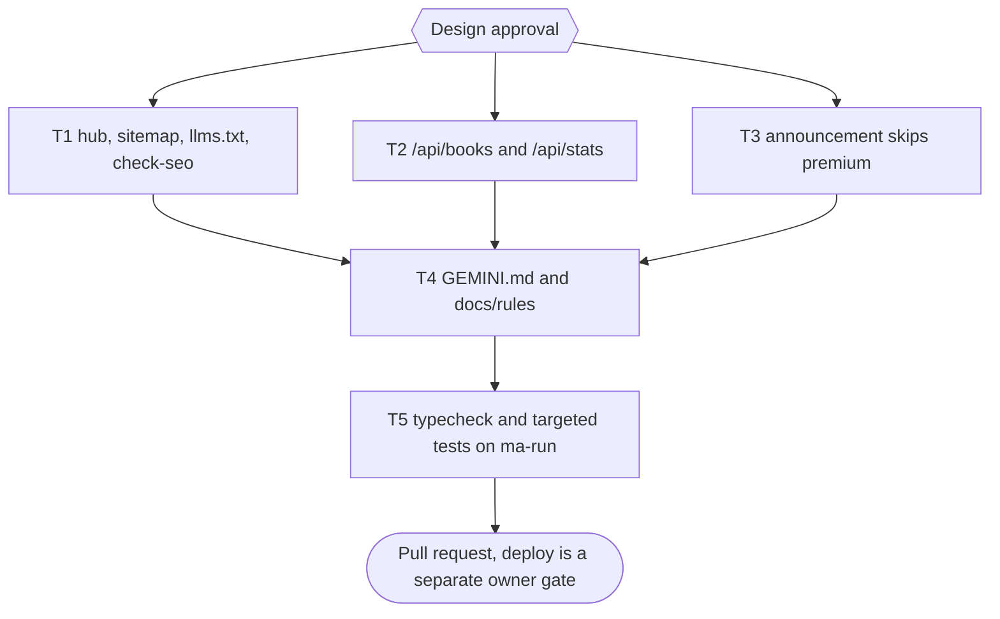

# Hide Premium Books from Every Listing

> For agentic workers: REQUIRED EXECUTION METHOD: delegated task execution. Steps use checkbox syntax. Git writes belong to the parent only.

**Goal:** Premium books (keys of `data/premium-books.json`) stop appearing on any listing surface: the hub home page, `sitemap.xml`, `llms.txt`, `GET /api/books` and `GET /api/stats`, and a new premium book is not announced to Telegram. A premium book stays reachable by its direct link (`/books/<slug>/`), with the access rules of GEMINI.md section 30 unchanged.

**Architecture:** Build-time surfaces filter on `premiumSlugs()` (already imported in each file). Runtime surfaces share one helper in `functions/lib/premium.ts` that returns a `slug NOT IN (...)` fragment and its bound params, empty when the registry is empty (`NOT IN ()` is a SQL error). The announcement filters slugs listed in the built manifest's `premium` key.

**Tech Stack:** Bun 1.4.5, TypeScript strict `tsc`, Cloudflare Pages Functions + D1, `bun:test`.

**Active Project Profile:** repository `/home/belajarcarabelajar/Proyek/dawnbook` (origin/main `115a4beb`), session worktree `/mnt/belajarcarabelajar/wt/dawnbook-wt/hide-premium-listings` (branch `2026-11-27-hide-premium-listings/hide-premium-listings`, from `pr-registry claim`). Config sources: `package.json`, `tsconfig.json`, `GEMINI.md` sections 19, 28, 30, 31, `~/AGENTS.md` A12/A44/A47. Single-file tests while iterating run locally with `HEAVY_LOCAL`; typecheck and the targeted test set run on Claude Managed Agents with `ma-run` on the pushed branch.

**Protected Boundaries:** premium access checks in `functions/_middleware.ts` and `functions/lib/premium.ts` (`checkPremiumAccess`, `isPremiumPublicPage`) are not changed; `manifest.json` keeps its `books` and `premium` keys; no deploy, no GSC write, no Actions dispatch; `functions/lib/built-stats.ts` is never committed regenerated.

**Spec:** none (Bounded path).

**Scope:** hub home cards, sitemap, llms.txt, check-seo coverage gate, `/api/books` for non-admin callers, `/api/stats` D1 aggregates, new-book announcement, docs.

**Non-Goals:** `noindex` on premium pages (owner chose to keep them indexable, 2026-11-27); `manifest.json` (the deploy guard `check-premium-output.ts`, `inject-gating.ts`, sitemap, llms.txt and the announcement read it; it carries slugs only, no titles or rendered links); the frozen old-book broadcast queue (built before premium books existed); deploy.

**Assumptions:** an admin session still sees premium books in `/api/books` (admin tooling); `/api/books?subject_label=...` filters the same way; a manual `announce-new-books.ts --slug <premium>` still announces (explicit owner action).

**Visual Map:**

**Reasoning Lenses:** intent (owner chose home page, sitemap and llms.txt, /api/books, statistics; indexable; no announcement), investigative (surfaces enumerated by grepping the local build output: only index.html, sitemap.xml, llms.txt, manifest.json name a premium book outside its own folder), computational (one SQL helper, empty-registry case), compatibility (manifest keys unchanged), verification (RED per task).

**Evidence:**

- `rg -l '/books/(belajar-cara-belajar|100-study-hacks|lancar-nugas)\b' output` outside those books' folders and `output/og`: `index.html`, `manifest.json`, `llms.txt`, `sitemap.xml` (build of 2026-11-15).
- Hub cards: `scripts/builder/template-engine.ts:218-246`. Sitemap: `scripts/generate-sitemap.ts:152`. llms.txt: `scripts/generate-llmstxt.ts:33`. Coverage gate: `scripts/check-seo.ts:45-50`. API: `functions/lib/db.ts` `getBooks`. Stats: `functions/api/stats.ts` (count, by_subject, views, release range, monthly timeline). Built chapter and contributor stats already skip premium (`scripts/builder/stats-aggregator.ts:151-155`).

**Acceptance Criteria:**

- [x] AC-1: the rendered hub `index.html` holds no card for a premium slug, and free cards keep the FREE label. (evidence: T1; premium-surfaces.test.ts -t hidden: RED exit 1 (5 fail), GREEN exit 0)
- [x] AC-2: `sitemap.xml` and `llms.txt` list no URL of a premium book, root included; `sitemapCoverageError` passes a premium path that is absent and fails one that is listed. (evidence: T1; premium-surfaces.test.ts -t hidden: RED exit 1, GREEN exit 0; check-seo inverted test)
- [x] AC-3: `/api/books` for an anonymous or reader session returns no premium slug; an admin still gets them. (evidence: T2; premium-listing.test.ts: RED exit 1 (4 fail), GREEN exit 0; db.test.ts and books.test.ts expect ["published", ...premiumSlugs()])
- [x] AC-4: `/api/stats` total_books, by_subject, total_views, release range and monthly timeline exclude premium rows; an empty registry adds no condition. (evidence: T2; premium-listing.test.ts GREEN exit 0 (total_books 2, total_views 12, release range, timeline))
- [x] AC-5: `findNewSlugs` (or main) skips a new slug listed in the after-manifest `premium` key; `--slug` still announces it. (evidence: T3; announce-new-books.test.ts -t premium: RED exit 1, GREEN exit 0 (25 pass))
- [x] AC-6: GEMINI.md sections 28 and 30 and `docs/rules/premium-books.md` describe the unlisted behaviour. (evidence: T4; rg -n -i 'unlisted|hidden from the hub' GEMINI.md docs/rules/premium-books.md exit 0)
- [x] AC-7: `bun run typecheck` exit 0 and the targeted test set exit 0 on `ma-run`. (evidence: T5; ma-run at f485ed4c: bun run typecheck exit 0; bun test on 17 affected files exit 0, 250 pass, 0 fail)

**Size:** `scripts/builder/template-engine.ts` (47 KB) and `GEMINI.md` (77 KB) are over the 20 KB default; each changes by a few lines, so no split (size raise accepted for this plan).

**Traceability:**

| AC | Task | Check | Evidence |
|---|---|---|---|
| AC-1, AC-2 | T1 | `HEAVY_LOCAL=iterate timeout 300 bun test ./tests/scripts/premium-surfaces.test.ts -t 'hidden'` | RED exit 1 on today's hub, sitemap, llms.txt and gate; GREEN exit 0 |
| AC-3, AC-4 | T2 | `HEAVY_LOCAL=iterate timeout 300 bun test ./tests/functions/premium-listing.test.ts` | SQLite D1 fixture with one premium and two free rows |
| AC-5 | T3 | `HEAVY_LOCAL=iterate timeout 300 bun test ./tests/scripts/announce-new-books.test.ts -t 'premium'` | before/after manifests with a new premium slug |
| AC-6 | T4 | `rg -n -i 'unlisted|hidden from the hub' GEMINI.md docs/rules/premium-books.md` | doc lines |
| AC-7 | T5 | `ma-run --base origin/main -- bun run typecheck` and the targeted test set | exit codes from ma-run |

## Task T1: Static Surfaces Hide Premium Books

**Files:** modify `scripts/builder/template-engine.ts`, `scripts/generate-sitemap.ts`, `scripts/generate-llmstxt.ts`, `scripts/check-seo.ts`; test `tests/scripts/premium-surfaces.test.ts`.

**Interfaces:** `premiumSlugs()` from `functions/lib/premium.ts` (read only). `sitemapCoverageError` keeps its signature.

**Preconditions:** the four source files exist; `premium-surfaces.test.ts` holds the hub, sitemap, llms.txt and coverage describes.

**Idempotency Check:** skip when the T1 test filter exits 0.

**Behavior & Acceptance:** AC-1, AC-2.
- Hub: `builtBooks` rendered as cards excludes premium slugs; the "Premium" label branch goes (only FREE remains); `manifest.json` unchanged (`books` and `premium` keys as today).
- Sitemap: premium books add no URL, root included. llms.txt: no line for a premium book.
- `sitemapCoverageError`: for a premium slug any path, root included, returns null when absent and an error when listed.
- Tests: invert "a premium card shows the Premium label", the premium-root sitemap and llms.txt expectations and "a premium root missing from the sitemap fails"; each new test name contains "hidden".

**Edge Cases & Failure Behavior:** an empty registry renders every built book as today.

**Deliberate Shortcuts & Deferrals:** none.

**Review & Evidence:** RED exit 1, GREEN exit 0.

- [x] Step 1: edit the tests (RED).
- [x] Step 2: run RED | cmd: `HEAVY_LOCAL=iterate timeout 300 bun test ./tests/scripts/premium-surfaces.test.ts -t 'hidden'` | expect: exit 1 | retry: 0
- [x] Step 3: change the four source files.
- [x] Step 4: run GREEN | cmd: `HEAVY_LOCAL=iterate timeout 300 bun test ./tests/scripts/premium-surfaces.test.ts ./tests/scripts/generate-sitemap.test.ts ./tests/scripts/hub-seo.test.ts ./tests/scripts/build.test.ts` | expect: exit 0 | retry: 1
- [x] Step 5: parent commits the T1 paths by name.

## Task T2: API Books and Stats Hide Premium Books

**Files:** modify `functions/lib/premium.ts`, `functions/lib/db.ts`, `functions/api/stats.ts`; create `tests/functions/premium-listing.test.ts`.

**Interfaces:** new export in `functions/lib/premium.ts`, for example `premiumSlugExclusion(firstParam: number): { sql: string; params: string[] }` returning `slug NOT IN (?n, ...)` with the slugs, or `{ sql: "", params: [] }` for an empty registry.

**Preconditions:** the SQLite D1 harness used by `tests/functions/api/books/[slug]/view.test.ts` exists.

**Idempotency Check:** skip when the T2 test exits 0.

**Behavior & Acceptance:** AC-3, AC-4.
- `getBooks`: non-admin callers get the exclusion; admin callers do not.
- `/api/stats`: total_books, by_subject, total_views, first/last release and the monthly timeline all apply the exclusion. Built chapter and contributor stats are untouched (already premium-free).
- Test: `setPremiumRegistryForTest` with one premium slug, rows for it and two free books; asserts on `GET /api/books` (anonymous) and `GET /api/stats`; one case with an empty registry.

**Edge Cases & Failure Behavior:** empty registry adds no condition and no params.

**Deliberate Shortcuts & Deferrals:** none.

**Review & Evidence:** RED exit 1, GREEN exit 0.

- [x] Step 1: write the test (RED).
- [x] Step 2: run RED | cmd: `HEAVY_LOCAL=iterate timeout 300 bun test ./tests/functions/premium-listing.test.ts` | expect: exit 1 | retry: 0
- [x] Step 3: add the helper and apply it.
- [x] Step 4: run GREEN | cmd: `HEAVY_LOCAL=iterate timeout 300 bun test ./tests/functions/premium-listing.test.ts ./tests/functions/lib/premium.test.ts` | expect: exit 0 | retry: 1
- [x] Step 5: parent commits the T2 paths by name.

## Task T3: Announcement Skips Premium Books

**Files:** modify `scripts/announce-new-books.ts`; test `tests/scripts/announce-new-books.test.ts`.

**Interfaces:** `findNewSlugs(before, after)` drops slugs listed in `after.premium`.

**Preconditions:** the test file exists.

**Idempotency Check:** skip when the premium test exits 0.

**Behavior & Acceptance:** AC-5. A new premium slug is not announced after a deploy; `--slug <premium>` still announces it (explicit owner action).

**Edge Cases & Failure Behavior:** an after-manifest without a `premium` key behaves as today.

**Deliberate Shortcuts & Deferrals:** none.

**Review & Evidence:** RED exit 1, GREEN exit 0.

- [x] Step 1: add the test (RED).
- [x] Step 2: run RED | cmd: `HEAVY_LOCAL=iterate timeout 300 bun test ./tests/scripts/announce-new-books.test.ts -t 'premium'` | expect: exit 1 | retry: 0
- [x] Step 3: filter in `findNewSlugs`.
- [x] Step 4: run GREEN | cmd: `HEAVY_LOCAL=iterate timeout 300 bun test ./tests/scripts/announce-new-books.test.ts` | expect: exit 0 | retry: 1
- [x] Step 5: parent commits the T3 paths by name.

## Task T4: Docs

**Files:** modify `GEMINI.md` (the real file, never the symlinks), `docs/rules/premium-books.md`, `docs/rules/telegram-announcements.md`, `docs/rules/indexing.md` (only where they state the old behaviour).

**Interfaces:** none.

**Preconditions:** T1 to T3 merged into the branch.

**Idempotency Check:** none (`skip_if: false`).

**Behavior & Acceptance:** AC-6. Section 30 "Public surfaces": premium books are unlisted (no hub card, no sitemap or llms.txt entry, not in `/api/books` for non-admins or `/api/stats`), reachable by direct link, still indexable; `manifest.json` still names them for the build scripts. Section 28: the post-deploy announcement skips premium slugs; `--slug` still works. Revert lines included.

**Edge Cases & Failure Behavior:** none.

**Deliberate Shortcuts & Deferrals:** none.

**Review & Evidence:** `rg` exit 0 on the new wording.

- [x] Step 1: edit the docs.
- [x] Step 2: run | cmd: `rg -n -i 'unlisted|hidden from the hub' GEMINI.md docs/rules/premium-books.md` | expect: exit 0 | retry: 0
- [x] Step 3: parent commits the T4 paths by name.

## Task T5: Verification

**Files:** none.

**Interfaces:** none.

**Preconditions:** branch pushed (`ma-run` exit 3 otherwise).

**Idempotency Check:** none.

**Behavior & Acceptance:** AC-7.

**Edge Cases & Failure Behavior:** `ma-run` exit 3 or 70 falls back to local `HEAVY_LOCAL` runs, one at a time.

**Deliberate Shortcuts & Deferrals:** no full `bun run build` (needs the private premium checkout and mdBook; the tests render the hub, sitemap and llms.txt from fixtures). The full suite is not run without asking the owner (A12).

**Review & Evidence:** exit codes from ma-run.

- [x] Step 1: run | cmd: `ma-run --base origin/main -- bun run typecheck` | expect: exit 0 | retry: 1
- [x] Step 2: run | cmd: `ma-run --base origin/main -- bun test` with the targeted set | expect: exit 0 | retry: 1

**Verification (2026-11-27):** parent re-run `HEAVY_LOCAL=iterate timeout 300 bun test ./tests/functions/lib/db.test.ts ./tests/functions/api/books.test.ts ./tests/functions/api/stats.test.ts ./tests/functions/premium-listing.test.ts` exit 0, 50 pass, 0 fail. `ma-run --base origin/main -- bun run typecheck` exit 0 and `ma-run --base origin/main -- bun test` (17 affected files) exit 0, 250 pass, 0 fail, at f485ed4c. Independent review (staid): verdict correct, no blocking findings; `check-copy-rules.mjs --diff origin/main` exit 0.

**Follow-ups (debt sweep, owner selected 2026-11-27):**

- [x] F1: `tests/functions/premium-listing.test.ts` proves `first_release` ignores a premium row that is the oldest (RED by mutating the range query filter and its bind values: exit 1 at the first_release assertion; restored, `git diff --exit-code` exit 0; GREEN exit 0, 9 pass).
- [x] F2: `docs/rules/premium-books.md` notes that `seo-request-reindex.ts` and `audit-full-gsc-index.ts` no longer submit premium pages (they read `sitemap.xml`).
- [x] F3: `GET /api/books/<slug>` answers 404 for a premium slug to non-admin callers; admins unchanged (`functions/api/books/[slug].ts`; RED exit 1 with 2 fail, GREEN `[slug].test.ts` exit 0, 17 pass, `slug.test.ts` exit 0, 9 pass).

**Backlog (LATER):** after the owner deploys, check live: `/` holds no premium card, `/sitemap.xml` and `/llms.txt` hold no premium URL, `/api/books` and `/api/stats` (D1 in production, tests ran on bun:sqlite) leave premium out.

**Approval:** Approved by the owner 2026-11-27 (Design gate, also Gate 2). Scope answers: home page, sitemap and llms.txt, /api/books, statistics; keep indexable; do not announce new premium books.
