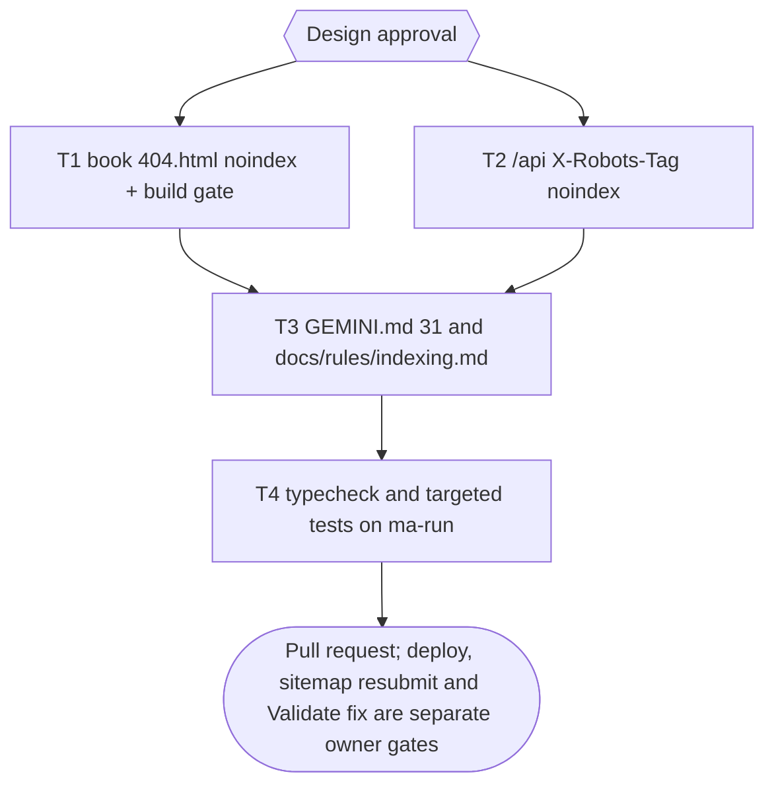

# GSC "Crawled, currently not indexed": the Repo-Side Causes

> For agentic workers: REQUIRED EXECUTION METHOD: delegated task execution. Steps use checkbox syntax. Git writes belong to the parent only.

**Goal:** the two URL groups of the 2026-11-28 Search Console export that this repository can fix leave the "Crawled - currently not indexed" bucket for "Excluded by noindex": the 19 book `404.html` pages and the 2 `/api/*` JSON responses.

**Architecture:** book `404.html` gets `<meta name="robots" content="noindex">` and loses its self canonical, hreflang and og:url in the post-build pass (`processDirectory` passes a `noindex` option to `injectSeoAndGating`); `checkIndexingOutput` fails a build whose book 404 lacks it. Every `/api/` response gets `X-Robots-Tag: noindex` in `applySecurityHeaders` (one place, every middleware exit). No robots.txt Disallow: the hub fetches `/api/books` and `/api/stats` while Google renders it.

**Tech Stack:** Bun 1.4.5, TypeScript strict `tsc`, Cloudflare Pages Functions, `bun:test`.

**Active Project Profile:** repository `/home/belajarcarabelajar/Proyek/dawnbook` (origin/main `13481133`), session worktree from `pr-registry claim`. Config sources: `package.json`, `GEMINI.md` sections 19 and 31, `docs/rules/indexing.md`, `~/AGENTS.md` A12/A44/A47. Single-file tests locally with `HEAVY_LOCAL`; typecheck and the targeted set on `ma-run`.

**Protected Boundaries:** gating and bot verification in `functions/_middleware.ts` and `functions/lib/gating.ts` unchanged; chapter, root, toc and print head tags unchanged; no deploy, no GSC write, no Actions dispatch.

**Spec:** none (Bounded path).

**Scope:** book `404.html` head tags, build gate, `/api/*` response header, docs.

**Non-Goals:** the 77 chapters, 22 first chapters and 6 book roots Google fetched successfully and chose not to index (a quality and time judgment, no code defect found: fetch SUCCESSFUL, user canonical accepted); the 63 `.html` URLs (Pages answers them with 308, 55 of 63 last crawled before 2026-11-01); the 5 `/sign-in?redirect_url=` URLs (already `noindex`, now "URL is unknown to Google"); `clerk.dawnbook...` (old auth host, outside this repo).

**Assumptions:** `X-Robots-Tag` on JSON does not change how the hub renders for Google (Google documents that the header only controls indexing of that URL).

**Visual Map:**

**Reasoning Lenses:** investigative (all 199 URLs plus 63 extensionless twins inspected with the URL Inspection API, 0 errors), critical (129 of 199 last crawled before the 2026-11-07 fixes), computational (one header spot, one option), verification (RED per task).

**Evidence:**

- Export `~/Unduhan/dawnbook.belajarcarabelajar.com-Coverage-Drilldown-2026-11-28.zip`: 199 URLs, reason "Di-crawl - saat ini tidak diindeks", bucket grew from 128 (2026-11-07) to 199 (2026-11-23).
- URL Inspection (2026-11-28, raw JSON in `~/.cache/tmp/dawnbook-gsc-20261128/insp.json`): chapter 77, `.html` 63, first chapter 22, book `404.html` 19, book root 6, api 2, clerk 1 still "Crawled - currently not indexed"; 4 chapters now indexed; 5 sign-in unknown. Every fetch SUCCESSFUL.
- `output/books/bias-kognitif/404.html` carries `<link rel="canonical" href=".../books/bias-kognitif/404">` and no robots meta; `toc.html` already has `noindex` (from mdBook).
- `curl -sI /api/stats`: 200, `application/json`, no `X-Robots-Tag`.

**Acceptance Criteria:**

- [ ] AC-1: a built book `404.html` holds `<meta name="robots" content="noindex">` and no `rel="canonical"`, hreflang or `og:url`; chapter, root and toc pages are unchanged. (evidence: T1)
- [ ] AC-2: `checkIndexingOutput` reports a book `404.html` without noindex. (evidence: T1)
- [ ] AC-3: every middleware response for a path under `/api/` carries `X-Robots-Tag: noindex`; a book page and a hub page do not. (evidence: T2)
- [ ] AC-4: GEMINI.md section 31 and `docs/rules/indexing.md` state both rules. (evidence: T3)
- [ ] AC-5: `bun run typecheck` exit 0 and the targeted set exit 0 on `ma-run`. (evidence: T4)

**Traceability:**

| AC | Task | Check | Evidence |
|---|---|---|---|
| AC-1, AC-2 | T1 | `bun test ./tests/scripts/book-404-noindex.test.ts` | RED exit 1, GREEN exit 0 |
| AC-3 | T2 | `bun test ./tests/functions/api-noindex.test.ts` | RED exit 1, GREEN exit 0 |
| AC-4 | T3 | `rg -n 'X-Robots-Tag: noindex' GEMINI.md docs/rules/indexing.md` | doc lines |
| AC-5 | T4 | `ma-run` typecheck and targeted set | exit codes |

## Task T1: Book 404 Pages Are Noindex

**Files:** modify `scripts/inject-gating.ts`, `scripts/check-indexing-output.ts`; create `tests/scripts/book-404-noindex.test.ts`.

**Interfaces:** `InjectSeoOptions.noindex?: boolean`; with it the head gets the robots meta and no canonical, hreflang or og:url. `processDirectory` sets it for `page === "404.html"`. `checkIndexingOutput` adds one problem per `books/<slug>/404.html` without the robots meta.

**Preconditions:** none.

**Idempotency Check:** skip when the T1 test exits 0.

**Behavior & Acceptance:** AC-1, AC-2. Tests: `injectSeoAndGating` with `noindex` vs without; `processDirectory` over a temp `output/books/<slug>/` with `404.html` and a chapter; `checkIndexingOutput` on a fixture output with a bare book 404.

**Edge Cases & Failure Behavior:** a premium book's 404 behaves the same.

**Deliberate Shortcuts & Deferrals:** none.

- [ ] Step 1: write the test (RED).
- [ ] Step 2: run RED | cmd: `HEAVY_LOCAL=iterate timeout 300 bun test ./tests/scripts/book-404-noindex.test.ts` | expect: exit 1 | retry: 0
- [ ] Step 3: implement.
- [ ] Step 4: run GREEN | cmd: `HEAVY_LOCAL=iterate timeout 300 bun test ./tests/scripts/book-404-noindex.test.ts ./tests/scripts/inject-gating.test.ts ./tests/scripts/inject-gating-canonical.test.ts` | expect: exit 0 | retry: 1
- [ ] Step 5: parent commits the T1 paths by name.

## Task T2: API Responses Carry X-Robots-Tag Noindex

**Files:** modify `functions/_middleware.ts`; create `tests/functions/api-noindex.test.ts`.

**Interfaces:** `applySecurityHeaders(response, pathname)` sets `X-Robots-Tag: noindex` when `pathname` starts with `/api/` and the header is absent.

**Preconditions:** the middleware test harness in `tests/functions/middleware.test.ts` (mock env, `next`).

**Idempotency Check:** skip when the T2 test exits 0.

**Behavior & Acceptance:** AC-3. Test: `onRequest` for `/api/stats` and `/api/books?content=false` has the header; `/books/<slug>/` and `/about` do not.

**Edge Cases & Failure Behavior:** error responses (400, 500 from `onRequest`) on `/api/` need not carry it.

**Deliberate Shortcuts & Deferrals:** none.

- [ ] Step 1: write the test (RED).
- [ ] Step 2: run RED | cmd: `HEAVY_LOCAL=iterate timeout 300 bun test ./tests/functions/api-noindex.test.ts` | expect: exit 1 | retry: 0
- [ ] Step 3: implement.
- [ ] Step 4: run GREEN | cmd: `HEAVY_LOCAL=iterate timeout 300 bun test ./tests/functions/api-noindex.test.ts ./tests/functions/middleware.test.ts` | expect: exit 0 | retry: 1
- [ ] Step 5: parent commits the T2 paths by name.

## Task T3: Docs

**Files:** modify `GEMINI.md` (the real file, never the symlinks) section 31 and `docs/rules/indexing.md`.

**Interfaces:** none.

**Preconditions:** T1 and T2 in the branch.

**Idempotency Check:** none.

**Behavior & Acceptance:** AC-4. One bullet in section 31 (book `404.html` noindex, `/api/*` `X-Robots-Tag: noindex`, no robots.txt Disallow because the hub fetches the API while rendering), detail and revert in `docs/rules/indexing.md`.

**Edge Cases & Failure Behavior:** none.

**Deliberate Shortcuts & Deferrals:** none.

- [ ] Step 1: edit the docs.
- [ ] Step 2: run | cmd: `rg -n 'X-Robots-Tag: noindex' GEMINI.md docs/rules/indexing.md` | expect: exit 0 | retry: 0
- [ ] Step 3: parent commits the T3 paths by name.

## Task T4: Verification

**Files:** none.

**Interfaces:** none.

**Preconditions:** branch pushed.

**Idempotency Check:** none.

**Behavior & Acceptance:** AC-5.

**Edge Cases & Failure Behavior:** `ma-run` exit 3 or 70 falls back to local `HEAVY_LOCAL` runs, one at a time.

**Deliberate Shortcuts & Deferrals:** no full `bun run build`; no full suite without asking (A12).

- [ ] Step 1: run | cmd: `ma-run --base origin/main -- bun run typecheck` | expect: exit 0 | retry: 1
- [ ] Step 2: run | cmd: `ma-run --base origin/main -- bun test` with the targeted set | expect: exit 0 | retry: 1

**Size:** `scripts/inject-gating.ts` (22 KB) and `GEMINI.md` (78 KB) are over the 20 KB default; each changes by a few lines, so no split (size raise accepted for this plan).

**Backlog (LATER, owner gates):** deploy; resubmit the sitemap with `GSC_OAUTH_REFRESH_TOKEN_TULIS`; the owner starts "Validate fix" for "Crawled - currently not indexed" in Search Console.

**Approval:** Approved by the owner 2026-11-28 (Design gate, also Gate 2).
