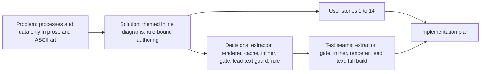

# Spec: Build-time Mermaid diagrams for every Dawnbook

- **Status:** Draft
- **Date:** 2026-10-16
- **Path:** Architectural (a new render subsystem inside the build, a new build gate, a new authoring rule, and content edits across 58 books)
- **Related:** plan `docs/code-plan/plans/2026-10-16-dawnbook-mermaid-diagrams.md`, research `docs/code-plan/plans/research-mermaid-diagrams.md`, spike `docs/code-plan/spikes/2026-10-16-mermaid-render/report.md`, inventory `docs/code-plan/artifacts/2026-10-16-mermaid-inventory/g1.md` to `g6.md`

## Problem Statement

Dawnbook chapters explain processes, cycles, decisions, chronologies and numeric comparisons in prose, tables and, in several books, ASCII art inside code fences. A reader on a phone has to rebuild a seven-step cycle in their head from a numbered list, and ASCII box art breaks on narrow screens. Authoring subagents have no rule that tells them when a diagram helps, how to write one, or how to keep it honest, so no book has a single diagram today.

## Solution

A chapter can contain a Mermaid diagram. The reader sees a crisp diagram that matches the theme they picked (light, rust, coal, navy, ayu), scrolls sideways on a phone instead of squinting, and a screen reader announces its title and description. The page loads no diagram JavaScript. Diagrams on paid chapters stay behind the paywall. Authors (human or subagent) follow one written rule that limits diagrams to what the text already says, and the build refuses a diagram that breaks the rule. Existing books receive their diagrams in batches, each reviewed against its source lines.

## User Stories

1. As a reader on a phone, I want a diagram that stays legible at 375 px, so that I can follow a process without zooming.
2. As a reader using the coal, navy or ayu theme, I want diagram colours that follow my theme, so that a white box does not glare in a dark page.
3. As a screen-reader user, I want each diagram to expose a title and a description, so that I get the same information as a sighted reader.
4. As a reader of a paid chapter, I want the diagram to load with the chapter, so that it is not a broken image.
5. As the platform owner, I want diagrams on paid chapters to be unreachable without a session, so that a diagram is not a paywall bypass.
6. As the platform owner, I want chapter meta descriptions to stay the chapter's first sentence, so that search snippets are not filled with diagram labels.
7. As the platform owner, I want CI to build and deploy without a browser, so that CI stays fast and does not depend on Chromium.
8. As an author, I want one command that renders every new or changed diagram, so that I do not manage files by hand.
9. As an author, I want the build to tell me exactly which diagram failed and why, so that I can fix a syntax error or a missing render.
10. As an authoring subagent, I want the diagram rule in my dispatch contract, so that I add diagrams only where they help and never invent data.
11. As a reviewer, I want every diagram to be traceable to the chapter lines it summarizes, so that I can check it adds no new fact, number or causal claim.
12. As a reviewer, I want ASCII-art diagrams replaced by real diagrams, so that the book does not carry two drawing styles.
13. As the platform owner, I want existing books retrofitted in small batches, so that each pull request stays reviewable and each deploy stays small.
14. As the platform owner, I want a chapter with no fitting candidate to stay without a diagram, so that books do not gain a template-like diagram in every chapter.

## Implementation Decisions

- **Modules:**
  - *Diagram block extractor* (pure): finds fenced Mermaid blocks in chapter Markdown following CommonMark fence rules, including fences inside list items; leaves blockquotes, unclosed fences and other languages alone. Grown from the spike prototype.
  - *Render config*: the locked Mermaid configuration and the theme stylesheet, kept as two repository files that every render reads.
  - *Diagram renderer* (local command): renders every block whose cache entry is missing, with one shared headless browser, and writes the result into the book's diagram cache. It injects title, description and aria attributes for diagram types that drop them (timeline). It never runs in CI.
  - *Diagram inliner* (build step): in the per-book build copy, replaces each block with an inline SVG wrapped in a `dawnbook-diagram` container on one line. A missing cache entry stops the build with the chapter, line and the render command to run.
  - *Diagram gate* (build gate and standalone check): validates every block against the authoring rule before any book is built.
  - *Lead-text guard*: the meta-description extractor ignores anything inside an inline SVG.
- **Interfaces:**
  - A local command that renders cache misses and reports rendered, cached and orphaned entries; an option to delete orphans.
  - A check command that exits non-zero on any violation, listing book, chapter, line and rule.
- **Schema:** each book gains a diagram cache folder beside its `src/` folder, one SVG file per distinct diagram, named by a content hash of the diagram source plus the render config, the theme stylesheet and the pinned Mermaid version. The folder is committed. It is outside `src/`, so mdBook never copies it to the public output.
- **Contracts:**
  - Diagram source contract: allowed types are flowchart, sequenceDiagram, stateDiagram-v2, pie, quadrantChart, xychart (`xychart-beta` accepted) and timeline; mindmap is refused. Every block declares `accTitle` and `accDescr` in Indonesian. No `{{`, no straight double quotes in labels, no emoji, no em dash, no "Anda", no `$`. Every xychart string is quoted and every xychart number uses a dot decimal with no thousands separator. A block is never the first content block of a chapter. The same diagram twice in one chapter is refused.
  - Output contract: one SVG per diagram, no `foreignObject`, no `
`, colours taken from mdBook CSS variables, element ids prefixed by a hash-derived id, an inline width rule that never scales the diagram below 0.75 of its natural size, wrapped in a horizontally scrollable container.
- **Architecture:**
  - Rendering is local and cached, not done in CI: CI builds on every push to main without Chromium, and the spike measured byte-identical repeat renders, so committed SVGs do not churn.
  - Inline SVG, not image files: `.svg` is a public asset extension in the gating middleware, so separate files would bypass the paywall; inline SVG also lets mdBook CSS variables colour the diagram.
  - One SVG for all themes: the spike showed Mermaid passes CSS variables through its theme stylesheet unchanged.
  - Replacement happens on the build copy, never on the source, the same place an earlier math pre-pass lived.
  - `@mermaid-js/mermaid-cli` becomes a pinned devDependency so the Mermaid version that names the cache is fixed in the repository rather than in a global install.

## Testing Decisions

- **What a good test is here:** it feeds Markdown or a book tree in at a public seam and asserts the Markdown, the HTML or the exit code that comes out; it fails when the behaviour breaks, not when an internal helper is renamed.
- **Seams:**

| Seam | What it catches | What it misses |
|---|---|---|
| Extractor function on Markdown strings | fence detection mistakes, list-item and blockquote handling, unclosed fences | rendering and mdBook behaviour (covered by the build seam) |
| Gate function on a fixture book tree | every source-contract rule, cache miss, orphan detection | visual quality (covered by the pilot screenshots) |
| Inliner on a fixture book tree with a fixture cache | one-line output, wrapper, width rule, missing-cache failure | real Mermaid output (covered by the renderer seam) |
| Renderer on one small fixture, run locally | locked config honoured, no `foreignObject`, timeline accessibility injection, deterministic bytes | CI (the renderer never runs there by design) |
| Lead-text extractor on HTML with an inline SVG | label text leaking into meta descriptions | other HTML consumers |
| Full `bun run build` plus `bun test` | integration with sync, gates, inject-gating, sitemap | appearance in a browser (covered by pilot screenshots viewed by the parent) |

- **Prior art:** `tests/scripts/check-repeated-headings.test.ts` (fixture book tree in a temp root), `tests/scripts/inject-gating-utils.test.ts` (pure transform), the spike tests in `docs/code-plan/spikes/2026-10-16-mermaid-render/p3-integration/`.

## Glossary

- **Diagram block:** a fenced code block in chapter Markdown whose info string starts with `mermaid`.
- **Diagram cache:** the committed per-book folder of rendered SVG files, one per distinct diagram, named by content hash.
- **Render config:** the locked Mermaid configuration plus the theme stylesheet that every render uses; part of the cache key.
- **Grounded diagram:** a diagram whose every node, edge, label and number can be traced to lines of the same chapter.

## Out of Scope

- Retrofitting all 58 books in this session: this session ships the tooling, the rule and a 2-book pilot; six later sessions retrofit about 10 books each.
- The four candidates blocked by contradictory text (`menemukan-tujuan-hidup-ikigai`, `tonsilektomi`, `sistem-peringatan-dini-early-warning-system`, `sistem-pengendalian-topik-dalam-wacana-pedagogi-di-sekolah-dasar`): text fixes first, as follow-ups.
- Mindmap diagrams: refused by the gate; candidates become flowcharts.
- Loading the Epilogue web font for diagrams: labels are measured with a sans-serif face and have 12 to 15 percent headroom.
- Client-side Mermaid (`mermaid.min.js` is 5.5 MB and caching is disabled platform-wide).

## Further Notes

- Rollout: the merge to main deploys through CI; the D1 seed for changed chapter Markdown follows the existing post-deploy routine.
- Risk: a Mermaid upgrade changes the cache key and forces a full re-render, which is intended; the renderer reports how many entries it rendered.
- Risk: label width depends on the reader's sans-serif font; the 0.75 minimum scale and the measured headroom cover the observed spread.

## Visual Map

## Approval

| Gate | Answer | Date |
|---|---|---|
| `Intent` | Approve A, B, C | 2026-10-16 |
| `Section` 1 (render pipeline) | Approve | 2026-10-16 |
| `Section` 2 (authoring rule) | Approve | 2026-10-16 |
| `Section` 3 (retrofit and rollout) | Approve | 2026-10-16 |
| `Spec` | pending | |
