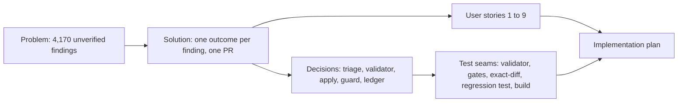

# Spec: Apply the fixable findings of the 2026-10-24 batch audit

- **Status:** Draft (the `Spec` gate is pending; `Intent` and `Section` were approved 2026-10-25)
- **Date:** 2026-10-25
- **Path:** Architectural (4,170 findings over 750 chapters of 60 books, a new decision pipeline with mechanical guards, several pull-request-sized stages)
- **Related:** audit archive `docs/audits/2026-10-24-batch-naskah/` (PR #212, this work is stacked on it); GEMINI.md sections 9, 14, 16, 20, 21, 24, 29

## Problem Statement

On 2026-10-24 a model read every chapter once, with no other context, and reported 4,170 candidate problems in 60 books: 596 typos, 1,220 grammar points, 711 inconsistent terms, 659 unclear sentences, 22 broken references and 962 doubtful facts. The owner wants what can be fixed fixed, quickly.

The report is a claim, not a patch list. A triage of the first 3,239 findings measured it: only 62% of suggestions can be applied as written, 23% are right about the problem but wrong about the fix (they use "Anda", an em dash, a number the book never had, or rewrite more than needed), 9.5% are wrong or only taste, 3.5% need a source or an owner decision, and 1.6% describe text that is already gone. Applying the report with a find-and-replace would add new errors to a public educational book, and GEMINI.md section 16 forbids batch scripts on book content anyway.

## Solution

Every finding ends with exactly one recorded outcome: applied, adapted, merged, rejected, stale, or backlog. The chapters receive only the fixes a reader can trust (spelling, grammar, terms, clarity, and facts that are proved or only softened). The owner gets one reviewable pull request, a ledger that says what happened to each of the 4,170 findings and why, and a short backlog of what needs a source or a decision.

## User Stories

1. As the owner, I want every audit finding to have a recorded outcome, so that nothing is silently dropped and I can see why a suggestion was not used.
2. As the owner, I want wrong audit suggestions rejected, so that the books do not gain new errors.
3. As the owner, I want a doubtful fact corrected only when a source the agent opened or the chapter itself proves it, so that I do not publish an invented number.
4. As the owner, I want claims softened or deleted, never strengthened, when a fact cannot be proved, so that the books stay honest.
5. As a reader, I want typos, grammar slips and inconsistent terms fixed without the author's voice changing, so that the chapters read as before, only cleaner.
6. As the owner, I want math, code blocks, citation data and diagrams left alone unless a record proves a change, so that the build and the formulas stay correct.
7. As the owner, I want the final files to equal the approved decisions byte for byte, so that no agent edit I did not approve slips in.
8. As the owner, I want one commit per book with the book's own author identity, so that history stays attributable.
9. As the owner, I want the leftover decisions (glossary choices, missing sources, math fixes) listed once, so that I can settle them in one sitting.

## Implementation Decisions

- **Modules (by role):** a *triage* stage that reads a unit of chapters and writes a *decision file* per book; a *validator* that checks a decision file against the rules and the current chapters; a *simulation* that applies valid decisions to a scratch copy so the repository's own gates can run on it; a *review* stage that gives risky decisions to an independent reviewer; an *apply* stage that changes the chapters; an *exact-diff guard* that compares the result with the prediction; a *ledger* writer; a *regression test*.
- **Interfaces:** a decision line is `{id, decision, edits[{file, old, new, all}], tags, reason, evidence, merged_into}`, one per finding; `decision` is apply, adapt, merged, reject, stale or backlog. `old` must occur exactly once in its file when the edit runs.
- **Contracts the edits obey:** reader is "kamu"; no em dash; no emoji; math spans and URLs byte-identical; no colon in headings; chapter title equals its SUMMARY entry; first sentence of the opener stays within the site's meta cut; no new fact, number or name without evidence; no stronger claim and no removed hedge; no stock scaffolds (GEMINI.md section 29 caps); edits only inside the finding's own chapter or its book's SUMMARY.md.
- **Architecture:**
  - *Two phases, read-only first.* Triage changes nothing, so the approval gates see concrete decisions and the owner can reject the whole stage at no cost. This replaced a one-phase "agents edit directly" design, because 38% of suggestions needed a decision a script cannot make.
  - *Edit tool only for the apply stage* (GEMINI.md section 16). Each triage agent applies its own approved decisions in the session worktree, which saves rereading 750 chapters.
  - *Facts need evidence or must shrink.* A correction adds a number, name or date only with a URL the agent opened or a quote from the chapter; otherwise the fix softens or deletes. Unsourced "research shows" claims go to the backlog.
  - *Exclusions.* Math, code fences, citation data without a Crossref or catalogue record, and book-wide glossary choices are backlog items. Mermaid text changes go through `bun run diagrams:render`, so the cache stays in step.
  - *Stacked pull request.* The branch sits on the audit archive branch (PR #212) so the reports travel with the fixes; one pull request, one commit per book. `db/seed.sql`, the D1 seed and deploys are not part of it.
  - *Independent review before apply.* About 1,100 decisions are flagged (adapted language, facts with outside evidence, headings, citations, removed hedges, added numbers, diagram edits). A reviewer reads old and new, and each problem is fixed in the decision file before any chapter changes.

## Testing Decisions

Mode: test-later (owner request 2026-10-25: "mode cepat saja test diakhir"). Tests are written and run after the edits and before the pull request is opened.

- **What a good test is here:** it observes the chapters or the repository gates and fails when a fix is reverted or a rule is broken.

| Seam | What it catches | What it misses |
|---|---|---|
| Validator on every decision file | Rule breaks in `new` text (Anda, em dash, math or URL change, non-unique `old`, missing evidence) | Whether the fix is right; covered by the review stage |
| Repository gates on the simulated and the final tree (`check-book-structure`, `check-voice`, `check-repeated-headings`, `check-heading-colons`, `check-diagrams`) | Title and SUMMARY drift, openers over the meta cut, scaffold phrases, repeated or colon headings, stale diagram cache | Meaning errors |
| Exact-diff guard (worktree equals prediction) | Any edit nobody approved, any approved edit that failed | Errors inside an approved edit |
| New test `tests/books/audit-fixes-2026-10-24.test.ts` | A reverted fix: an applied `old` string that comes back in its chapter | A fix rewritten later in a legitimate way (the data file is then updated) |
| Existing book tests and `bun run build` | A test that quotes a heading or sentence an edit removed; build or OG-card failures | Content quality |

- **Red proof:** the new test runs against the base commit in a detached scratch worktree and must fail there; it must pass in the session worktree.
- **Prior art:** `tests/books/known-misattributions.test.ts` and `tests/books/referensi-presence.test.ts` (data-driven checks across books).

## Glossary

- **Finding:** one candidate problem from the 2026-10-24 batch audit, identified as `<request id>:<index>`.
- **Decision file:** the per-book record of what to do with each finding and the exact edit, written during triage.
- **Triage:** the read-only stage in which an agent reads a unit's chapters and decides every finding.
- **Exact-diff guard:** the check that the files in the worktree equal the files the valid decisions predict.
- **Ledger:** the committed record of the outcome of every finding.

## Out of Scope

- Merging, deploying, seeding D1 (`db/seed.sql` embeds chapter text and stays stale until a deploy seeds it) and Search Console reindexing: the owner asks for those separately.
- Math fixes (agents may not edit formulas), code-fence edits, and book-wide glossary choices ("namun" or "tetapi", "Sistem 2" or "System 2"): listed in the backlog for the owner.
- Citation corrections that no record proves, and any new Referensi entry without a record.
- New content, rewriting for voice, or findings the audit did not raise (observations are logged for a later sweep).

## Further Notes

- **Cost, measured:** about 450,000 tokens and 20 minutes per triage unit, 40 units; the apply stage reuses the same agents and is not yet measured.
- **Rollback:** nothing merges without the owner; the branch can be deleted, or the pull request reverted; the audit archive and the scratch decision files stay as evidence.
- **Known risks:** reviewers still miss derived claims (an interval computed from two figures); the exact-diff guard cannot judge meaning, so the review stage and the owner's manual check carry that.

## Visual Map

## Approval

| Gate | Answer | Date |
|---|---|---|
| `Intent` | Approve and continue | 2026-10-25 |
| `Section` (design) | Approve this design | 2026-10-25 |
| `Spec` | pending | |
