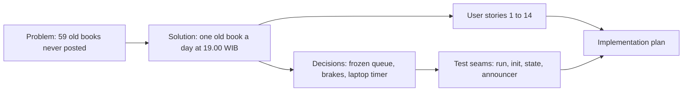

# Spec: Telegram broadcast of old Dawnbook books

- **Status:** Approved (`Spec` gate, 2026-10-30)
- **Date:** 2026-10-30
- **Path:** Architectural (a new self-running job that posts to an external group with a bot credential)
- **Related:** GEMINI.md section 28 (new-book announcement, PR #170); audit in this session, summarised under Further Notes

## Problem Statement

The Dawnbook Telegram group only hears about a book when a deploy ships it for the first time. That started on 2026-10-21, so 59 of the 60 live books were never posted to the group; only "Pelajaran Hidup dari Harvest Moon Back to Nature" was (2026-10-24). Members of the group cannot discover the older catalogue from the group, and the owner has no automation to post it.

## Solution

Once a day, at 19.00 WIB, one old book is posted to the group by the same bot and in the same format as a new-book announcement, oldest book first, until all 59 have gone out once. If the laptop is off at 19.00 the post follows at 20.00 or 21.00; if it stays off for the whole window, that day has no post and the next day still has only one. When anything about a send is uncertain or fails, the job stops itself and tells the owner on the desktop; nothing is retried on its own. When the list is finished, the owner gets one desktop notification and the job sends nothing more.

## User Stories

1. As the owner, I want one old book posted to the group each evening, so that members discover the older catalogue without me posting by hand.
2. As the owner, I want to read all 59 messages before anything is sent, so that I approve the exact texts and order.
3. As a group member, I want at most one archive post a day, so that the group does not feel spammed.
4. As a group member, I want each post to look like the posts I already know, so that it is recognisable as a Dawnbook book.
5. As the owner, I want no post after 21.59 WIB even when the laptop wakes late, so that members are not notified at night.
6. As the owner, I want a book never posted twice, so that the group never sees a duplicate.
7. As the owner, I want the job to pause and notify me when a send fails or its outcome is unknown, so that I decide whether the post went out before anything else is sent.
8. As the owner, I want to resume after a pause by saying whether the message reached the group, so that the queue continues without a duplicate or a gap.
9. As the owner, I want a link checked before it is posted, so that a renamed or removed book is never posted as a dead link.
10. As the owner, I want one notification when all 59 are done, so that I know the series ended and can decide what comes next.
11. As the owner, I want to stop everything with one command, so that I can halt the series at any moment.
12. As the owner, I want to see what was sent and what is next, so that I can check progress without reading files.
13. As the owner, I want the bot token never written to the state, a log or the public repository, so that the credential stays where it is today.
14. As a maintainer, I want the new-book announcement to keep working unchanged, so that deploys behave as before.

## Implementation Decisions

- **Modules:**
  - The old-book broadcaster: a command-line tool with `init`, `run`, `status`, `pause` and `resume`, each with a dry-run where it can send or write.
  - The new-book announcer keeps its behaviour; its existing Telegram send function becomes shared so the broadcaster reuses the same timeout and token redaction.
  - A per-user systemd timer and service run `run` at 19.00, 20.00 and 21.00 Asia/Jakarta; the unit files live in the repository as templates and are installed into the user's systemd folder.
- **Interfaces:**
  - `init` builds the frozen queue and refuses when a state already exists; `init --dry-run` prints every queued message and writes nothing.
  - `run` performs at most one send per invocation; `run --dry-run` prints the decision and the message it would send.
  - `status` prints sent count, next book, and any pause reason.
  - `pause` sets a pause with a reason.
  - `resume --sent` or `resume --not-sent` clears a pause that came from a send attempt, recording the book as sent or leaving it next; a pause without a send attempt resumes with a plain `resume`.
- **Schema:** one JSON state file outside the repository, readable only by the user, written atomically (temporary file, then rename). It holds the frozen queue (book slug, message text, link), the sent log (slug, time, Telegram message id), the in-flight send (slug, time) or none, the pause (reason, time) or none, and whether the done notification was shown. It never holds the token or the chat id.
- **Contracts:**
  - The message text is exactly the new-book format: the first chapter's title, a hyphen and the book title, a blank line, and the chapter link without `.html`.
  - Credentials are the two existing keys `TELEGRAM_BOT_TOKEN` and `DAWNBOOK_TELEGRAM_CHAT_ID`, read from the owner's Cloudflare env file; only those two keys are read. Without either key, `run` logs and exits 0 (the same kill switch as the announcer).
- **Architecture:**
  - Runs on the laptop, not in Cloudflare, because it changes nothing in production and keeps the token where it is. Bots cannot schedule Telegram messages (Telegram error `SCHEDULE_BOT_NOT_ALLOWED`), Cloudflare cron slots are full, and GitHub Actions are off by owner decision.
  - The queue is frozen at `init` so the owner reviews the exact texts once and the evening run does not depend on the state of the checkout. A title changed after `init` is not picked up; that trade-off was accepted.
  - The queue holds the books in the live manifest whose Hub release date is before 2026-10-21, ordered oldest first by the same date the Hub card shows, ties broken by slug. Books from 2026-10-21 on were announced by the deploy step.
  - Order of checks in `run`, each a brake: an exclusive lock; no state means stop and notify (never initialise automatically); a pause means exit; a leftover in-flight send means pause and notify; outside 19.00 to 21.59 Asia/Jakarta means exit; a book already sent on this WIB date means exit; an empty queue means notify once and exit; the link must answer HTTP 200 or the run notifies and exits without changing the state; then the in-flight send is written, the message is sent once, and on success the sent log is updated and the in-flight send cleared, while any error pauses and notifies with the token redacted.
  - The clock is Asia/Jakarta inside the tool, not the system time zone. The timer is persistent, and the window check inside the tool is what prevents a late post after a long sleep.

## Testing Decisions

- **What a good test is here:** it drives a command with an injected clock, network, notifier and state folder, and asserts what was sent, what the state file holds and what was notified; it never calls Telegram or the live site.
- **Seams:**

| Seam | What it catches | What it misses |
|---|---|---|
| `run` with injected clock, fetch, notifier and a temporary state folder | window edges (18.59, 19.00, 21.59, 22.00 WIB), WIB date boundary, second send on one day, leftover in-flight send, dead link, Telegram error and redaction, done notification shown once, missing keys | the real systemd trigger and desktop notification (checked once at rollout) |
| `init` with a fixture manifest and fixture books | order, exclusion of books from 2026-10-21, refusal to overwrite, dry-run writes nothing | the real 59-book list (shown to the owner at rollout) |
| state read and write | atomic replace, file mode, refusal of a malformed file | disk-full behaviour |
| existing announcer tests | unchanged new-book behaviour after the send function is shared | none beyond its current coverage |

- **Prior art:** `tests/scripts/announce-new-books.test.ts` (injected fetch, env and log through `main`).

## Glossary

- **Old book:** a Dawnbook book that was live before 2026-10-21, when the new-book announcement started, and so was never announced in the Telegram group.
- **Old-book broadcast:** the daily posting of old books to the Dawnbook Telegram group, one per day, until each has been posted once.
- **Frozen queue:** the ordered list of old-book messages written once at `init` and never rebuilt by later runs.
- **In-flight send:** the record written just before a Telegram send and cleared after it; one left behind means the outcome is unknown.

## Out of Scope

- Changes to the new-book announcement or the deploy script: they keep working as they are.
- Posting while the laptop is off: a cloud scheduler was weighed and rejected for this round (new secret and production surface); the owner can revisit it.
- Repeating the series after all 59 are posted: the owner decides then.
- Images, buttons or different wording in the message: the owner chose the existing format.

## Further Notes

- Audit sources: Telegram's `messages.sendMessage` page lists `SCHEDULE_BOT_NOT_ALLOWED: Bots cannot schedule messages`; the live manifest held 60 books on 2026-10-30; the first chapter of a sample old book answered HTTP 200 without a session; `social-scheduler` was weighed and rejected because its `channel` column only allows Instagram and Threads, so adding Telegram means migrating a live queue in another repository.
- Rollout after merge, each step gated: `init --dry-run` shown to the owner, `init`, enabling the timer as its own risky confirmation, and the first 19.00 run checked in the user journal and in the group.
- Kill switch: disable the timer. Revert: disable and remove the units, delete the state folder, revert the pull request.
- Verification is targeted unit tests and typecheck only (owner rule A42); no browser or end-to-end run.

## Visual Map

## Approval

| Gate | Answer | Date |
|---|---|---|
| `Lokasi` | Timer laptop | 2026-10-30 |
| `Frekuensi` | 1 per day, 19.00 WIB | 2026-10-30 |
| `Urutan` | Oldest first | 2026-10-30 |
| `Format` | Same as new books | 2026-10-30 |
| `Susulan` | Catch up until 21.00 run | 2026-10-30 |
| `Selesai` | Stop and notify | 2026-10-30 |
| `Intent` | Locked | 2026-10-30 |
| `Section 1`, `Section 2`, `Section 3` | Approved | 2026-10-30 |
| `Spec` | Approve | 2026-10-30 |
