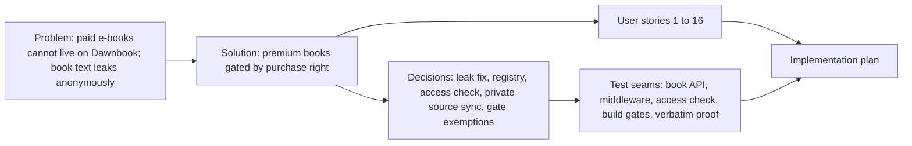

# Spec: Premium e-book Dawnbooks

- **Status:** Draft
- **Date:** 2026-11-01
- **Path:** Architectural (new access tier backed by a second D1 database, a private content source, and a contract change on the public book API)
- **Related:** intent lock and section approvals in the 2026-11-01 session (table at the end)

## Problem Statement

The owner sells three e-books (Belajar Cara Belajar, 100 Study Hacks, Lancar Nugas) as PDFs on belajarcarabelajar.com. Buyers can only read them as PDF downloads. The owner wants each e-book on Dawnbook as its own book, word for word, readable only by people who paid for it.

Dawnbook cannot hold paid content today:

- The repository is public, so any Markdown committed to it is readable on GitHub.
- Book text is readable without signing in through three paths, measured on 2026-11-01: `GET /api/books/<slug>` returns the whole `content_md` (96,919 characters for `metakognisi`), `GET /api/books?content=true` returns every book (5,371,594 bytes), and each book's `searchindex-<hash>.js` (884 KB for `metakognisi`) holds the text of every chapter and is served as a public `.js` asset.
- The chapter gate only asks for any signed-in Google account; it has no idea who bought what.
- The seeder writes every book's text into `db/seed.sql`, which is committed.

## Solution

Each of the three e-books becomes a premium Dawnbook. Anyone can open its book page, table of contents and first chapter. Every other chapter, image and search index of that book opens only for a signed-in reader whose Google account email holds a purchase right for that e-book, any membership right, or a row in the course allowlist, all read from the store's own database. Everyone else is sent to sign in, or shown a page with links to buy. Bots get no shortcut. The book text lives in a private repository and never reaches the public repository, the seed file or the public API. Before any premium book ships, the three anonymous text leaks are closed for every book.

## User Stories

1. As a buyer of Lancar Nugas, I want to sign in with Google and read every chapter of the Lancar Nugas Dawnbook, so that I can read the e-book in the browser instead of a PDF.
2. As a Membership VIP, bundle or Shinobidone holder, I want all three premium books to open, so that my membership keeps covering the e-books as it does on belajarcarabelajar.com.
3. As an E-course Study Hacks student in the allowlist, I want the premium books to open, so that course access and e-book access stay the same.
4. As a buyer of only Lancar Nugas, I want a clear page when I open 100 Study Hacks, so that I know I do not own it and where to buy it.
5. As a buyer who signed in with the wrong Google account, I want the refusal page to tell me to sign in with my purchase email, so that I can fix it myself.
6. As an anonymous visitor, I want to read the book page and the first chapter, so that I can judge the e-book before buying.
7. As an anonymous visitor opening chapter 2, I want to be sent to sign in and come back afterwards, so that buying or signing in is one step.
8. As the owner, I want a search-engine bot to be refused on premium chapters, so that paid text is not indexed or cached anywhere.
9. As the owner, I want no premium text in the public repository, the seed file, the book API or a public asset, so that the only way to read it is the gate.
10. As the owner, I want the gate to stay closed when the store database is unreachable, so that an outage never gives the books away.
11. As the owner, I want a deploy to refuse to run when a premium book is missing from the build, so that a contributor's build never deletes the premium books from production.
12. As the owner, I want the Dawnbook text to match the PDF word for word, with a proof, so that buyers get exactly what they paid for.
13. As the owner, I want premium books to keep their own wording (emoji, "yg", "Anda", colon headings), so that the house content gates do not rewrite a paid product.
14. As a reader of a free Dawnbook, I want the free chapter and hub to keep working after the leak fix, so that nothing I use breaks.
15. As a visitor of the hub, I want premium books marked as Premium, so that I know before opening one.
16. As the owner, I want sitemap and llms.txt to list only the book page and first chapter of a premium book, so that crawlers are not pointed at pages that refuse them.

## Implementation Decisions

- **Modules:**
  - Book API (single book and list): returns book text only to admins.
  - Gating policy: treats a book's search index as gated content.
  - Premium registry: the public list of premium slugs, the store product ids that unlock each, and the product page link.
  - Premium access check: given an email and a premium slug, answers allowed, refused, or unavailable, using one read-only query on the store database.
  - Edge middleware: runs the premium rule before the public-path rule and before the verified-bot pass-through.
  - Premium sync: copies the premium books from the private repository checkout into the gitignored book folders before a build.
  - Build gates: content gates skip premium slugs; technical gates still run.
  - Seeder, sitemap, llms.txt, hub manifest and hub card: premium-aware.
- **Interfaces:**
  - The access check takes the session email and the registry entry and returns one of three outcomes; it never throws to its caller.
  - The registry is a JSON file keyed by slug with `products` (store product ids with `unduhan` rights for that e-book) and `productUrl`.
- **Schema:** no new table. A new read-only binding `LMS_DB` to the existing `bcbacademy-lms` database (tables `entitlements`, `allowlist`, owned by the bcb repository). The manifest gains a `premium` flag per book.
- **Contracts:**
  - `GET /api/books/<slug>` and `GET /api/books?content=true`: `content_md` only for admin sessions. The hub never asked for it.
  - Access rule: allowed when the email (trimmed, lower-cased, as the store stores it) has a non-revoked `entitlements` row of kind `member` (any product), or of kind `unduhan` for one of the book's products, or has an `allowlist` row. This mirrors the store's own `unduhan` rule.
  - Public parts of a premium book: book root, `index`, `toc`, the first chapter, mdBook theme assets, and images under `images/public/`. Everything else is gated, search index included.
  - Responses: no session gives a 302 to sign-in with a return link (HTML) or 401 (other); a session without the right gives 403 with links to the product page, the bundle and "sign in with your purchase email"; a missing binding or a database error gives 503. All gated responses are `private, no-store`.
  - Deploy refuses when a registry slug has no built output.
- **Architecture:**
  - Private content is copied, not symlinked, into the book folders: twelve build scripts list books with `isDirectory()`, which is false for a symlink. Approaches scored 36 (copy), 28 (symlink), 27 (submodule).
  - The store database is bound directly (same Cloudflare account, one query), not reached through the store Worker, so only one repository changes.
  - Sign-in stays Google-only for now; email OTP is a follow-up.
  - The store database is written only by the bcb repository; Dawnbook code issues SELECT only.

## Testing Decisions

- **What a good test is here:** it calls the middleware or an API handler with a request and fake bindings and checks the response status, headers and body, so it fails when a reader gets in who should not, or is kept out who should not be.

| Seam | What it catches | What it misses |
|---|---|---|
| Book API handlers with a fake D1 | `content_md` returned to non-admins | Live deployment config; covered by the post-deploy probe |
| Gating policy function | search index or chapter paths classified as public | Middleware ordering; covered by the middleware seam |
| Middleware with fake `DB` and `LMS_DB` | wrong order (bot or public rule before premium), missing 302/403/503, cache headers, fail-open on error | Real store data; covered by the post-deploy probe with a real buyer email |
| Premium access check with a fake D1 | revoked rows, other product's `unduhan`, case of email, allowlist, `member` of any product | SQL dialect differences; covered by one query run against the real database read-only |
| Build gates on fixture books | content gates firing on premium slugs, technical gates skipped | Real book content; covered by the full `bun run build` |
| Verbatim proof script on the real PDFs | dropped or altered words between `pdftotext` and the chapters | Words inside images; covered by the per-chapter read |

- **Prior art:** `tests/` gating and API tests, `tests/books/*.test.ts` per-book guards.

## Glossary

- **Premium book:** a Dawnbook book listed in the premium registry; its chapters after the first open only for readers with a purchase right.
- **Premium registry:** the public file that lists premium slugs, the store product ids that unlock each, and the product page link.
- **Purchase right:** a non-revoked `entitlements` row of kind `unduhan` for the book's product, or of kind `member` for any product, or an `allowlist` row, for the reader's email in the store database.
- **Store database:** the D1 database `bcbacademy-lms`, owned by the bcb repository.
- **Private source:** the private repository that holds the premium book folders and the raw markitdown output.
- **Verbatim proof:** the token comparison between the PDF text and the joined chapters, with every allowed difference listed.

## Out of Scope

- Email OTP sign-in on Dawnbook (follow-up; buyers without a Google account under their purchase email cannot read yet).
- Grandbook Pro (also a member PDF in R2, but not one of the three e-books on the membership page).
- The public Google Drive link on `/membership` (owned by the bcb repository; that page is public by design).
- Rewriting premium text to house style (owner chose verbatim).

## Outcome Check (optional)

- **Metric:** anonymous requests that return book text: `/api/books/<slug>`, `/api/books?content=true`, `searchindex-*.js`, and premium chapter 2.
- **Baseline:** 3 of 3 return text on 2026-11-01 (96,919 characters, 5,371,594 bytes, 883,950 bytes), from `curl` without a cookie.
- **Check after merge:** right after each production deploy; expected 0.

## Further Notes

- Creating the private repository is an outward-facing action and gets its own confirmation.
- Deploys, D1 seeding and merges run only on the owner's explicit request.
- Losing anonymous in-book search on free books is accepted (Section 2 approval).
- The `member` rule includes Shinobidone Space Packs holders (21 emails on 2026-11-01); accepted to mirror the store.

## Visual Map

## Approval

| Gate | Answer | Date |
|---|---|---|
| Source storage | Private repo | 2026-11-01 |
| Access | Per book + member + allowlist | 2026-11-01 |
| Verbatim | Exempt content gates | 2026-11-01 |
| Preview | Chapter 1 free, no bots | 2026-11-01 |
| Next step | Plan all, leaks first | 2026-11-01 |
| Hak akses | Bind lms D1 directly | 2026-11-01 |
| Login | Google only for now | 2026-11-01 |
| Gambar | Text + meaningful images | 2026-11-01 |
| Visibilitas | Hub card + Premium badge | 2026-11-01 |
| `Intent` | Lock intent | 2026-11-01 |
| `Section` 1 to 4 | Approve (Section 3 includes Shinobidone) | 2026-11-01 |
| `Spec` | pending | |
