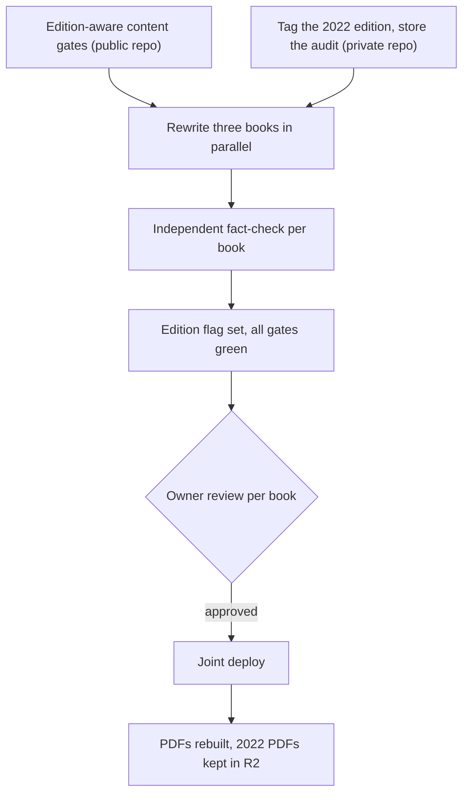

# Spec: Premium e-books, Revised Edition 2026

- **Status:** Draft
- **Date:** 2026-11-01
- **Path:** Architectural (three paid books rewritten, the verbatim rule of GEMINI.md section 30 changes, build gates change, and the store PDFs are replaced)
- **Related:** `docs/code-plan/specs/2026-11-01-dawnbook-premium-ebooks-design.md`; the chapter audit of 2026-11-01 (workflow `wf_1e1e9d9f-a9d`, 40 read-only agents). The report quotes book text, so it lives only in the private repository `dawnbook-premium` under `audits/`, never here.

## Problem Statement

The three premium e-books (Belajar Cara Belajar, 100 Study Hacks, Lancar Nugas) were written around 2022 and published on Dawnbook verbatim on 2026-11-01. A chapter-by-chapter audit found 12 critical and 69 high findings, plus 51 dead links out of 284:

- two reference links now redirect to gambling sites;
- the books recommend piracy sites, a browser extension that turned into malware, and essay-mill tools;
- they present learning myths as fact;
- they misdefine core techniques;
- about ten of the recommended tools are dead;
- they give risky sleep advice;
- they say nothing about generative AI;
- they predate the current regulations on spelling, final projects and personal data.

Every one of the 48 chapter files needs some change. Buyers pay for text that misleads them, and the free chapter 1 of one book is public and indexed.

## Solution

The three books are rewritten in place as the 2026 edition under the same slugs, product ids and URLs, so every buyer gets the update.

- **Evidence:** every hack and technique carries an evidence label (kuat, sedang, terbatas) with one research link.
- **Removed:** piracy, malware and essay-mill recommendations, dead tools, myths presented as fact, and risky health advice.
- **New chapters:** each book gains a chapter on studying or doing assignments with generative AI.
- **Images:** risky images (faces without consent, third-party watermarks, slides resembling another course, photos of unclear licence) are replaced with original illustrations.
- **Closing pages:** they link only to belajarcarabelajar.com product pages.
- **Content rules:** the revised text follows the same content rules as every free Dawnbook book.
- **Archive:** the 2022 text stays as a tag in the private repository.
- **PDFs:** the store PDFs are rebuilt from the 2026 text.

## User Stories

1. As a buyer, I want the book I paid for to recommend only legal, safe sources, so that following it never exposes me to piracy, malware or plagiarism.
2. As a buyer, I want to see how strong the evidence behind each technique is, so that I can tell proven methods from tips.
3. As a buyer, I want every tool the book recommends to exist and its free-plan limits to be current, so that I do not waste time on dead links.
4. As a student, I want guidance on using generative AI honestly for learning and assignments, so that I benefit from it without breaking campus rules.
5. As a student writing a final project or a survey, I want the book to reflect current Indonesian rules (EYD Edisi V, Permendiktisaintek 39/2025, UU PDP 27/2022), so that my work is not rejected for outdated practice.
6. As a buyer of 100 Study Hacks, I want the book to still hold 100 hacks, so that the title stays true.
7. As a visitor reading the free chapter 1, I want it to contain no piracy recommendation, so that the public preview is safe and represents the brand.
8. As a buyer who downloads the PDF from the store, I want the PDF to match the revised text, so that the two versions do not contradict each other.
9. As the owner, I want to review each book in a local build before anything goes live, so that I approve the text published under my name.
10. As the owner, I want the 2022 edition kept in the private repository and the 2022 PDFs kept in storage, so that I can restore or compare them.
11. As a maintainer, I want the build to apply the content gates to the 2026 edition and to fail when a revised chapter breaks them, so that the revised books cannot drift back below the house standard.
12. As a maintainer, I want a premium book without the edition flag to keep its verbatim exemption, so that a future verbatim book is not broken by the gate change.

## Implementation Decisions

- **Modules:**
  - **Premium registry:** each entry gains an optional edition field. A book whose edition is 2026 is a revised premium book, and a book without it stays verbatim.
  - **Content gates:** the voice, heading-colon, repeated-heading and structure checkers stop skipping revised premium books. They keep skipping verbatim premium books.
  - **Technical premium rules are unchanged:** gating, sitemap and llms limits, the deploy guard, and the empty `content_md` in D1.
  - **Verbatim proof:** retired for revised books. The tool stays for verbatim ones.
  - **Book text:** lives in the private repository as before and is rewritten there.
  - **PDF builder:** a local step that prints the built `print.html` of each revised book to PDF with headless Chromium. It is a one-off release step, not part of the deploy.
- **Interfaces:** a helper that lists premium slugs exempt from content gates, used by the four checkers in place of the plain premium list.
- **Schema:**
  - `data/premium-books.json` entries may carry `"edition": 2026`. No D1 change.
  - In R2 `bcb-admin-media`, the 2022 PDFs are copied to `member/<slug>-2022.pdf` before `member/<slug>.pdf` is overwritten. bcb code is unchanged, because it serves `member/<slug>.pdf`.
- **Contracts:**
  - **Chapter 1 stays the public preview of each book,** and its opening sentence follows the 155-character meta cap (section 8).
  - **Belajar Cara Belajar:** the STIFIn chapter and every mention of STIFIn are removed, and the following chapters are renumbered. The learning-styles chapter is rewritten to explain that matching instruction to a VAK type is not supported, and what works instead. It does not mention STIFIn.
  - **100 Study Hacks:** keeps exactly 100 hacks. Weak, dead or myth hacks are replaced by evidence-based ones.
  - **Lancar Nugas:** its tools list becomes a curated list without a number in the title, grouped by task, with free-plan limits and the month it was checked. Its AI chapter follows the Kemendikbudristek generative AI guide of October 2024.
  - **New chapter per book:** each book gains one chapter on generative AI.
  - **Closing and About pages:** they link only to belajarcarabelajar.com product pages. There is no WhatsApp number, Typeform link, QR call or Canva Pro offer.
  - **References:** follow section 15. Every entry is verified and deep-linked.
- **Architecture:**
  - **Approach A, approved:** in-place rewrite with one writer subagent per chapter, an independent fact-check per book, and the gates switched on per book by the edition flag.
  - **Rejected:** a parallel slug per edition, because the owner chose to replace the 2022 text and a swap would touch the registry, bcb and the sitemap. Also rejected: one long-context agent per book, because quality drops and it breaks the line-by-line rule of section 16.
  - **Order:** the code change merges first. The flag is set per book only when its rewritten text passes the gates, so the build never breaks in between.
  - **Release:** all three books ship together in one deploy, after the owner has reviewed each book in a local build (owner decision).

## Testing Decisions

- **What a good test is here:** a test that runs a checker over a fixture books folder plus a registry, and fails when a revised book with a violation passes or when a verbatim book with the same text fails.

| Seam | What it catches | What it misses |
|---|---|---|
| Each content checker's gate function over a temporary books folder and registry | Revised books are checked again; verbatim books are still skipped | Quality of the prose (covered by the fact-check reviewer and the owner review) |
| Registry helper unit test | The edition field parsed, missing field means verbatim, unknown values rejected | Nothing beyond parsing |
| Full `bun run build` with the private sources synced | All gates over the real revised books | Rendering on the live site (checked by a probe after deploy) |
| Fact-check reviewer per book (subagent, read-only) | Unverified claims, wrong citations, dead links, audit findings left unaddressed | Owner taste and voice (owner review) |

- **Prior art:** the premium gate tests added with sections 29 and 30 (`tests/` for `check-voice`, `check-heading-colons`, `check-book-structure`, and `tests/functions/lib/premium.test.ts`).

## Glossary

- **Revised premium book:** a premium book whose registry entry has `edition: 2026`. Its text is authored by us and passes the content gates.
- **Verbatim premium book:** a premium book without an edition. Its text matches the original PDF, and the content gates skip it.
- **Evidence label:** one line per hack or technique giving the strength of the research behind it (kuat, sedang, terbatas) and one research link.

## Out of Scope

- **Repricing or new store products:** the slugs and product ids stay.
- **Grandbook Pro PDF:** not one of these three books.
- **An interim hotfix of the live 2022 text:** the owner chose to ship all three books together. The gambling and piracy links stay live until this release.
- **A Canva-style designed PDF:** the PDFs use the mdBook print style (owner decision).

## Outcome Check (optional)

- **Metric:** critical plus high audit findings still present in the published text, and dead links among the links in the books.
- **Baseline:** 12 critical, 69 high, and 51 dead links out of 284 on 2026-11-01, from the chapter audit workflow `wf_1e1e9d9f-a9d`.
- **Check after merge:** run the same audit workflow over the 2026 edition within 7 days of release. Target: 0 critical, 0 high, 0 dead links.

## Further Notes

- **Risk: the rewrite adds unsupported claims.** Section 29.6 already measured this on a voice rewrite. Writers must cite a source for every new fact, and the fact-checker rejects any claim without one.
- **Risk: a section 29 voice rewrite that sounds generic.** The owner reviews each book before release.
- **Original illustrations:** SVG files in `src/images/` of a premium book stay gated, because only chapter 1, the theme assets and `images/public/` are public (`isPremiumPublicPage`). Illustrations for chapter 1 go to `images/public/`.
- **Two production writes need their own gates:** the deploy, and the R2 upload of the new PDFs.

## Visual Map

## Approval

| Gate | Answer | Date |
|---|---|---|
| `Probe` (chapter audit) | Approve, run it | 2026-11-01 |
| `Next step` | Full Revised Edition 2026 | 2026-11-01 |
| `Order` | All three books together | 2026-11-01 |
| `Rules` | Yes, follow all gates | 2026-11-01 |
| `Old edition` | Replace, tag 2022 | 2026-11-01 |
| `Hack count` | Keep 100, replace weak | 2026-11-01 |
| `STIFIn` | Delete, no mention | 2026-11-01 |
| `AI content` | New chapter per book | 2026-11-01 |
| `Contact` | Product links only | 2026-11-01 |
| `Tools list` | Curated, no number | 2026-11-01 |
| `Evidence` | Yes, label each | 2026-11-01 |
| `Images` | Replace with new art | 2026-11-01 |
| `PDFs` | Regenerate PDFs too | 2026-11-01 |
| `Review` | Per book, local preview | 2026-11-01 |
| `Section 1` to `Section 3` | Approve | 2026-11-01 |
| `Spec` | pending | |
