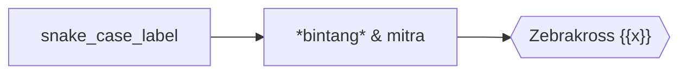

<!-- Question: what reaches the meta lead text and the search index when a short lead paragraph precedes a diagram? -->
# Bab Dua

Diagram berikut menunjukkan alur belajar.

Paragraf sesudah diagram menjelaskan setiap langkah dengan kata-kata sendiri.
