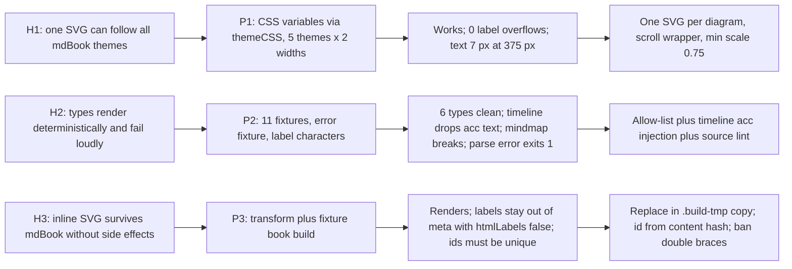

# Spike report: build-time Mermaid rendering for Dawnbook

- **Date:** 2026-10-16
- **Session:** dawnbook-mermaid-diagrams (plan `docs/code-plan/plans/2026-10-16-dawnbook-mermaid-diagrams.md`)
- **Question:** can chapter ```mermaid blocks be rendered once, locally, into inline SVG that follows all five mdBook themes, stays readable on a phone, stays out of the meta description and the paywall bypass, and fails loudly on bad input?
- **Answer:** yes, under a locked config, for six diagram types plus timeline with injected accessibility metadata. Mindmap is excluded.
- **Status:** prototype only. Nothing under `scripts/`, `books/`, `functions/` or `tests/` changed.

## Visual summary



## P1: theming and fit (prototype in `p1-theme/`)

- One inline SVG follows light, rust, coal, navy and ayu. The colours come from mdBook variables (`--fg`, `--bg`, `--quote-bg`, `--links`, `--table-alternate-bg`, `--quote-border`) set in a `-C` CSS file, which Mermaid inlines unchanged and scopes as `#<id> ...` after its own rules. The parent viewed `v2-light-1280.png`, `v2-coal-1280.png` and `v2-scroll-coal-375.png` on 2026-10-16: colours switch with the theme and every label sits inside its box.
- A measured fit check found 0 label overflows across 5 themes x 2 widths, with 12 to 15 percent width headroom (letter-spacing 1.5 px overflows, 1 px still fits).
- At 375 px a full-width SVG scales to 0.45 and labels drop to about 7 px. A wrapper with `overflow-x: auto` and a minimum SVG width gives 12 px text with horizontal scroll.
- `fontFamily: "Epilogue, sans-serif"` measures labels in a sans-serif face close to what readers see; `inherit` measures in serif and shifts the layout. Epilogue itself is not loaded anywhere, so readers see their system sans-serif.
- `/usr/bin/chromium` and the cached chrome-headless-shell 153 give byte-identical output apart from the id; `mmdc` without an explicit executable exits 1.
- Render time 0.85 to 1.2 s per CLI call; 25,022 bytes for a 7-node flowchart.
- Chromium CLI `--screenshot` on `file://` pages is blocked by the gating script in `shared-script.js`; screenshots need puppeteer with a seeded `sessionStorage`.

## P2: diagram types and failure modes (prototype in `p2-types/`)

| Type | Clean (no foreignObject, no p) | title/desc and aria | Deterministic |
|---|---|---|---|
| flowchart, sequenceDiagram, stateDiagram-v2, pie, quadrantChart, xychart (bar, line) | yes | yes | yes |
| timeline | yes | no: Mermaid drops `accTitle`/`accDescr` silently | yes |
| mindmap | render fails (exit 1) when `accTitle`/`accDescr` are present | n/a | n/a |

- `xychart` and `xychart-beta` give identical output.
- A syntax error makes `mmdc` exit 1 and write no SVG; `renderMermaid` rejects with the same message. Parent reproduced exit 1 and no output file on 2026-10-16.
- Silent failures (exit 0, wrong output): xychart data written with Indonesian number format (`2.170,2`) parses into wrong values; an unquoted xychart title loses its spaces; an unquoted xychart category with a comma splits into several categories.
- Label syntax: flowchart labels with brackets need quotes, edge labels with special characters need quotes, straight double quotes cannot be shown (use curly quotes), `#lt;` and `#amp;` work.
- Config: `layout: "dagre"` is required (the default is ELK); `look: "classic"` must be pinned (the default is `neo` for flowchart, sequence and state); `flowchart.wrappingWidth` defaults to 120 and is the only key that changes node wrapping.
- One shared browser through the JS API from Bun: 11 diagrams in 2.8 s sequentially, 2.6 s in parallel, against 0.56 to 1.06 s per CLI call.

## P3: mdBook integration (prototype in `p3-integration/`)

- `replaceMermaidFences` (pure, 11 tests, `bun test` exit 0, re-run by the parent on 2026-10-16) replaces ```, ~~~ and longer fences, fences inside list items, leaves blockquotes, non-mermaid fences and unclosed fences alone, and joins renderer output onto one line so no blank line ends the HTML block.
- mdBook 0.5.4 re-serializes the inline SVG (lowercases `viewBox` and other camelCase names, adds a space before `/>`). Browsers restore SVG name casing while parsing HTML; P1's screenshots were taken from mdBook output and rendered correctly, which confirms it.
- `{{#title ...}}` and `{{#include ...}}` inside the raw HTML are still processed by mdBook (the include logs an error but the build exits 0). Diagram source must not contain `{{`.
- With `htmlLabels: false`, `extractLeadText` returns only the prose; with `htmlLabels: true`, label text leaks into the meta description.
- The search index holds the label text but no Mermaid source and no CSS, whereas a raw fence would index the whole source.
- Two SVGs with the default id produce 16 duplicate ids and cross-wired arrowheads; a unique id per diagram removes them.

## Decisions carried into the design

1. One SVG per diagram, coloured by mdBook CSS variables; no light/dark pair.
2. Locked config: `theme: base`, `look: classic`, `layout: dagre`, `htmlLabels: false`, `flowchart.wrappingWidth: 200`, `fontFamily: "Epilogue, sans-serif"`, `securityLevel: strict`.
3. Allowed types: flowchart, sequenceDiagram, stateDiagram-v2, pie, quadrantChart, xychart, and timeline with title/desc/aria injected by the renderer. Mindmap excluded.
4. Id per diagram derived from a hash of its source; the same diagram twice in one chapter is refused by the gate.
5. A source lint refuses missing `accTitle`/`accDescr`, `{{`, straight quotes in labels, unquoted xychart strings, and comma-decimal xychart data.
6. Replacement runs on the `.build-tmp` copy; a cache miss fails the build, so CI never needs a browser.

Not read: none. Scratch evidence outside the repository: `/tmp/mermaid-spike/p1/shots/*.png`, `/tmp/mermaid-spike/p2/run2.log`, `/tmp/mermaid-spike/p3/harness.ts` (not persisted).
